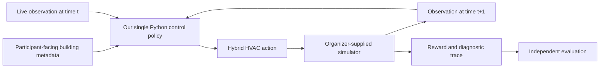
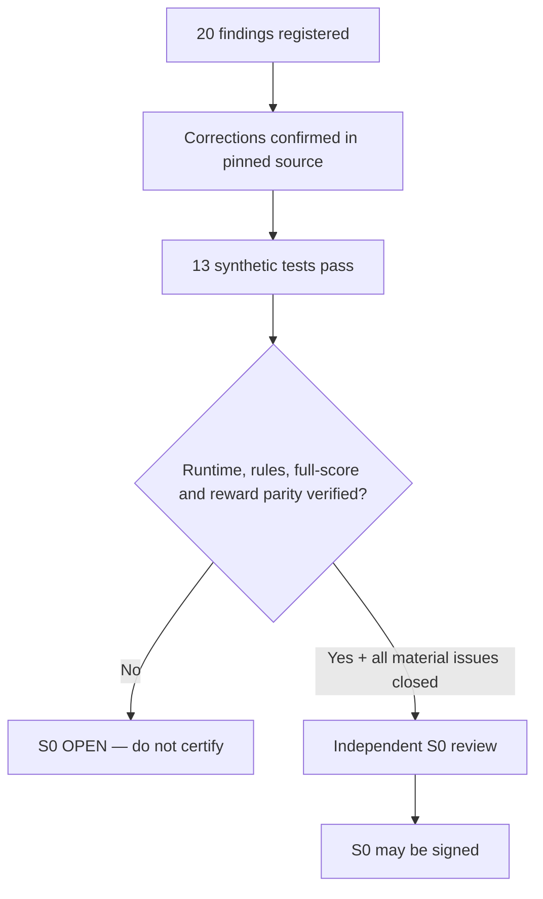
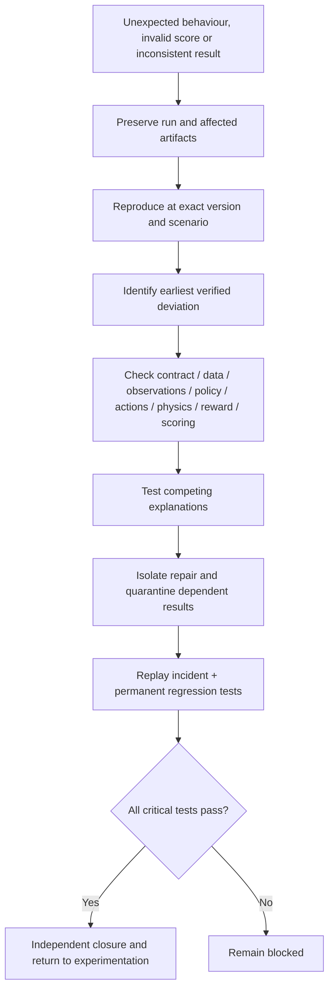

# Smart Buildings Challenge — Source Truth, Test Findings & What We Do Next

**Phase 03 | Integrated findings and execution plan**  
**Assessment date:** 27 October 2026  
**Competition:** NeurIPS 2026 Smart Buildings Challenge  
**Inspected starter-kit revision:** [`95cea5b1c57b5291f44baf0283e0a081d53f5b16`](https://github.com/smart-buildings-2026/starter-kit/commit/95cea5b1c57b5291f44baf0283e0a081d53f5b16)  
**Gate decision:** **S0 OPEN — NOT CERTIFIED**

> **The central finding:** We now understand the policy interface, principal HVAC actions, shipped scenarios and scoring rules much more accurately. We have also identified mistakes in the Data Understanding Guide and gaps in the evaluation safeguards. **But we have not yet demonstrated that our independent calculations match a running copy of the pinned simulator.** This document separates what is known from what has merely been proposed, then states what to do next.

---

## Reading guide

This document answers three questions, in order:

1. **What is actually true about the competition?** — The verified engineering contract and corrected assumptions.
2. **How strong is the evidence?** — What source inspection and the 20 available tests did and did not prove.
3. **What do we do with the findings?** — A prioritized execution plan, verification deliverables and the S0 sign-off gate.

**Status language used throughout:**

| Status | Meaning |
|---|---|
| **SOURCE-CONFIRMED** | Supported by inspected code or configuration at the pinned revision; not automatically demonstrated in a live run. |
| **SOURCE-CORRECTED** | An earlier research statement conflicts with the pinned source; its replacement is supported at source level. |
| **TESTED — SYNTHETIC** | A standalone test passed using constructed numerical examples; no real simulator result was compared. |
| **PENDING RUNTIME** | Requires the exact local simulator, scenario execution, and archived output. |
| **OPEN / MATERIAL BLOCKER** | Evidence is inadequate or contradictory for a decision that S0 must certify. |
| **HYPOTHESIS** | A plausible research or controller-design explanation, not an established competition requirement or result. |

**Priority convention:** `P0` blocks S0; `P1` corrects consequential research or improves controls before serious solution experiments; `P2` informs subsequent Solution Discovery. These priorities are project decisions, not organizer-defined severity labels.

---

# Part I — What the source investigation established

## 1. Executive interpretation

**Five conclusions should shape our next decisions:**

1. **We are building a reusable controller, not a conventional CSV predictor.** It receives building-specific metadata and current observations, then returns HVAC actions every five minutes.
2. **More building structure is available to the policy than our research guide claimed.** The interface may supply floor and zone maps, AHU–zone assignments, schedules, and named action/observation mappings.
3. **Several physical and mathematical claims in the guide were incorrect.** Particularly important were comfort normalization, material ranges, heating equipment terminology, and the example comfort schedule.
4. **A plausible score is not proof of a valid experiment.** The inspected official scoring utility can report a number for an incomplete scenario set, and the action-validation helper does not check every numerical condition we want to enforce.
5. **We must not select a controller architecture yet.** The evidence establishes control difficulties but does not establish that ML, GNNs, online inertia estimation, MPC, or a hybrid system is the correct answer.

### Evidence snapshot

| Item | Result | Interpretation |
|---|---:|---|
| Registered source-audit findings | **20** | A mixed register of corrected assertions, confirmed facts, implementation risks, and unresolved claims; not 20 independent bugs. |
| Standalone tests passed | **13** | Mathematical/scoring fixtures behaved as expected. |
| Pinned-source tests skipped | **7** | The exact local checkout was unavailable during the test run. **Skipped is not passed.** |
| Live simulator episodes executed for this audit | **0** | No numerical parity or closed-loop behaviour certified. |
| Live reward-response comparisons | **0** | The real reward pipeline is still unverified against the independent implementation. |
| Formal Kaggle rules fully reviewed | **No** | Rule-sensitive method/submission claims remain provisional. |
| **S0 exit gate** | **BLOCKED** | Source understanding improved; execution evidence and material resolutions are missing. |

The test suite was rerun on 27 October 2026 with the same outcome: `13 passed, 7 skipped`.

## 2. The actual system we are solving



The policy is a Python class with this source-documented contract:

```python
class TransferPolicy:
    def __init__(self, building_meta_data, action_spec):
        ...

    def get_action(self, obs):
        return {
            "continuous_action": ...,  # float32, (3*K + 2 + 2*V,)
            "discrete_action": ...,    # int32,   (K + 1,)
        }
```

`K` is the number of air-handling units; `V` is the number of VAV-controlled zones. The continuous actions are normalized to `[-1, 1]`, and discrete switches take `{0, 1}`. **Continuous zero is the midpoint of an actuator's normalized range—not an OFF command.** The action vector uses an interleaved layout, so implementations must consult supplied action-index mappings rather than guessing offsets. Observation dimensions and field order vary across buildings; the policy receives `observation_field_names` to interpret them.

**What the policy can control:**

| Equipment | Participant-controlled quantities | Practical meaning |
|---|---|---|
| Air-handling unit (each AHU) | Run switch; supply-air temperature; static pressure; recirculation | Shared airflow and cooling-related operation for multiple zones. |
| Central hot-water system | Run switch; supply-water temperature; differential pressure | Supplies the hot water used by terminal reheat. |
| Each zone's VAV | Damper; reheat valve | Zone-specific airflow and terminal heating. |

The documented AHU **cools mixed supply air**; zone heating occurs through hot-water reheat. There is no participant-side chilled-water setpoint in the inspected policy action contract. The simulator also enforces operating floors/limits for running AHUs: minimum static pressure, damper floor, and a recirculation ceiling. Requested actions can therefore differ from realized equipment states **without a software defect**.

**What metadata the policy gets:** the inspected `create_building_meta_data()` exposes action indices, field names, AHU–zone assignments, schedule information, normalization metadata, and `floor_plan`/`zone_map` **if those files are available**. This does not give the policy unrestricted simulator internals or future scenario trajectories.

**Design consequence:** The controller should adapt to the information actually supplied. We should not force it to infer topology or physical schedules that are already disclosed, nor assume knowledge of hidden material parameters it never receives.

### Scenarios and evaluation horizon

The shipped `training_set.yaml` contains **30 specific building–weather pairings**: six buildings, five represented stations, and a different weather strip for each shipped pairing. Stations represented in that manifest are Atlanta, Denver, Fairbanks, Phoenix and Singapore. A Minneapolis weather source is described as an additional generator input, not one of the shipped pairs.

Each scored scenario contains **8,640 sequential steps of 300 seconds = 30 days**. The documented setup scores every step, including the beginning; there is no excluded warm-up window. These 30 scenarios are not 30 independent buildings.

### The performance objective

For a scenario \(s\) with 8,640 steps and step reward \(r_{s,t}\), the official-equivalent scenario loss is

\[
L_s=\left|\frac{1}{8640}\sum_{t=1}^{8640}r_{s,t}\right|.
\]

Across an evaluated set \(S\),

\[
\boxed{L=\frac{1}{|S|}\sum_{s\in S}L_s}\qquad\text{(lower is better).}
\]

All eligible scenarios have equal weight. Baseline policies are **comparators**, not inputs to the official scoring formula. Do not compare shortened diagnostic rollouts with full-length baseline returns.

The inspected per-step reward weights are **comfort/productivity regret 0.6**, **energy cost 0.2**, and **carbon emissions 0.2**. The terms are normalized before combination; normalized cost is not raw dollars and normalized carbon is not raw kilograms. Their energy-rate denominators are scoring reference scales, **not physical consumption caps**.

For a zone whose temperature lies \(d\) kelvin outside the active comfort band, the guide's revised source-aligned shortfall function is

\[
f(d)=\begin{cases}
 d/w & d\le w,\\
 1+((d-w)/w)^2 & d>w,
\end{cases}\qquad w=5\,\mathrm{K}\text{ in the inspected configuration.}
\]

When total occupancy is positive, the reward uses **actual occupancy** in normalizing the comfort-related productivity loss; when zero, the implementation sets the normalized productivity regret to zero. **The guide's fixed `/125` divisor is incorrect.** The complete source calculation still needs numerical confirmation against real `RewardResponse` outputs.

---

## 3. What we had wrong — and what changes now

These are the highest-impact corrections because they can change which solutions we consider or whether we trust our experiments.

### Finding A — Floor plans are not categorically hidden (`ST-01`)

**Previous conclusion:** `floor_plan.npy` and `zone_map.npy` are hidden from the submitted controller.  
**Source truth:** `evaluate.py` places `floor_plan` and `zone_map` in participant metadata when files exist.  
**Interpretation:** We may use these legitimately supplied fields, subject to exact competition rules; no need to infer topology solely from temperature histories.  
**Required follow-up:** Observe the fields during a real policy initialization in several different buildings and correct the guide's access classification.

### Finding B — Comfort normalization is occupancy-based (`ST-02`)

**Previous conclusion:** Comfort loss is divided by a fixed population value of 125.  
**Source truth:** The reward computes normalized productivity regret using actual total occupancy when positive.  
**Interpretation:** The objective depends on occupants actually represented in the step. A wrong divisor could corrupt an independent score, control hypothesis, or per-zone diagnostic.  
**Required follow-up:** Reconstruct numerical reward on real simulator output, including unequal zone occupancies and zero occupancy.

**Illustrative check:** If 10 occupants experience a shortfall of 0.5, while another 90 occupants remain in band, the normalized comfort loss is **−0.05** under the audited default productivity bounds. This is a synthetic known-answer example—not an actual building measurement.

### Finding C — The sampled construction ranges were wrong (`ST-03`, `ST-04`)

The pinned `materials.py` defines these ranges:

| Material-property parameter | Correct pinned range |
|---|---|
| Exterior conductivity | **0.15–0.55**, log sampled |
| Exterior density | **350–2400**, log sampled |
| Interior mass density | **10–40**, log sampled |
| Interior wall conductivity | **0.45–0.60**, linear sampled |
| Interior wall density | **110–700**, log sampled |
| Exterior heat capacity | **840–1000**, linear sampled |

**Interpretation:** These define generator variability; earlier derived empirical diversity claims may need re-evaluation if they were calculated using incorrect inputs. Do not infer an exact heating response time from a material-ratio proxy without testing dynamic behaviour.

### Finding D — The example schedule differs from the guide (`ST-05`, `ST-06`)

**Previous conclusion:** Comfort hours were 07:00–18:00, and `comfort_mode_soon` was asserted to give a two-hour advance warning.  
**Source truth:** The inspected `building_train_1/fairbanks_1/config.gin` says **06:00–19:00**. The exact `comfort_mode_soon` lead time was **not** independently established.  
**Interpretation:** A controller that prepares for morning comfort using the wrong schedule could be systematically mistimed.  
**Required follow-up:** Audit all shipped configuration files and check actual flag transitions around schedules and timezone boundaries. Do not generalize one config to every scenario.

### Finding E — We described the wrong equipment interface (`ST-07`, `ST-11`)

**Previous conclusion:** Some diagrams implied a controllable chilled-water loop, and energy normalization rates were described as equipment capacities.  
**Source truth:** The documented actions include **AHU supply-air controls and hot-water terminal reheat**. Reward normalization energy rates are **reference denominators**, not physical caps.  
**Interpretation:** We must not design a controller for nonexistent actions or mark physically permissible energy use as invalid merely because it exceeds a reward reference scale.

### Finding F — Architectural certainty was unjustified (`ST-08`, `ST-09`, `ST-10`)

**Previous conclusion:** The guide treated a closed-form observation length, specific GNN/modular architectures, and precise thermal lag figures as definitively established.  
**Source truth:** Observation layout should be read from live field-name metadata; the official interface does **not** prescribe GNNs, neural networks, online inertia estimation or any particular controller architecture. The thermal-inertia surrogate has not been established as a measured response time.  
**Interpretation:** These belong in **Solution Discovery as hypotheses**. We should not choose an approach because the guide accidentally promoted a plausible idea into a requirement.

### Finding G — Our protection against silent failures needs to be stricter (`ST-19`, `ST-20`)

**Source finding 1:** `score_leaderboard.py --expect 30` may print an incomplete-set warning without failing outright.  
**Our response:** The independent scoring helper fails closed if its declared scenario manifest has missing or unexpected entries or a non-8,640-step episode.

**Source finding 2:** `evaluate.py:validate_action` converts arrays and verifies shapes but does not itself perform every finiteness, range and value check needed for research certification.  
**Our response:** Add independent numeric/action checks and compare commanded versus realized actuator states. This stricter guard was **identified but not yet validated end-to-end**.

### Finding H — Some claimed precision is not yet demonstrated (`ST-12`, `ST-15`, `ST-16`, `ST-17`)

The guide's weather-file counts are internally inconsistent; the hidden weather wording differs across inspected public descriptions; simulator determinism has not been reproduced locally; and the asserted **zero-error complete reward reconstruction** has not been independently confirmed using the missing original D5 diagnostic output and real simulator responses.

**Interpretation:** These are **not permission to invent convenient answers**. Keep the claims open, acquire primary evidence, and update the guide only when that evidence is available.

---

# Part II — What the tests proved, and what they did not

## 4. Test execution: precise meaning of `13 passed, 7 skipped`

**Actual command rerun:**

```bash
cd Phase_03_Source_Truth
python -m pytest SOURCE_TRUTH_TESTS -q
```

**Observed result:**

```text
sssssss.............                                                     [100%]
13 passed, 7 skipped in 0.38s
```

### The 13 tests that passed

| Test family | Checks | Why it matters | What it does **not** prove |
|---|---:|---|---|
| Independent scenario scoring | **6** | Equal scenario weighting, expected absolute-loss arithmetic, rejection of short episodes, mismatched scenario sets, nonfinite rewards and incorrect aggregation | That actual simulator-written reward values are correct |
| Independent reward arithmetic | **7** | Comfort in band, zero occupancy, true occupancy weighting, 5 K linear/quadratic boundary, alternative productivity bounds, weighted reward combination and rejection of invalid occupancy | That the full simulator's physical calculations and `RewardResponse` match our implementation |
| **Total** | **13** | The independently written arithmetic behaves correctly on these fixtures | **Not a certified live reward pipeline** |

**Important scope limit:** These are hand-built mathematical examples and deliberate invalid inputs. They are useful *known-answer checks*, not 13 real building experiments, and not a probabilistic confidence estimate.

The independent scorer currently reads `total_reward` and `total_steps` from evaluation summary files; it does **not** independently recompute the whole HVAC physical simulation or every raw per-step reward component. That second kind of numerical parity is a distinct requirement.

### The 7 checks that were skipped

All seven are **pinned-source static checks**, not executed source tests. They assert:

1. Required `TransferPolicy` methods and action-shape documentation.
2. `floor_plan` and `zone_map` membership in participant metadata.
3. Correct material-generator ranges.
4. Exactly 30 manifest pairs with expected building/station/strip uniqueness.
5. The inspected sample's configured 06:00–19:00 schedule.
6. Occupancy-sensitive reward source expressions.
7. Full-episode constant and expected score aggregation in `score_leaderboard.py`.

They skipped because `SB_REPO_ROOT` did not point to a local Git checkout of the pinned revision in the audit runtime. The corresponding files were **inspected remotely at the pinned commit**, which is evidence for their source content, but **not a substitute for running the local tests**.

### Critical checks that did not run at all

| Missing verification | Consequence of leaving it open |
|---|---|
| Verify exact local Git revision and installation | Cannot claim executable source parity |
| Initialize a real policy and step a real environment | Cannot certify action/observation/metadata behaviour |
| Run a full 8,640-step episode | Cannot demonstrate a valid complete closed-loop experiment |
| Score all 30 shipped episodes with both scorers | Cannot demonstrate manifest-complete official-score parity |
| Recompute actual per-step reward from simulator evidence | Cannot certify the reward reconstruction or D5 zero-error claim |
| Inspect full formal Kaggle rules and submission template | Cannot certify eligibility, external data use or release procedure |
| Audit every schedule, weather inventory and flag timing | Cannot support global schedule/weather assertions |
| Mutation-test action validator and fault isolation | Cannot claim those protections work on the actual controller interface |
| Independent review and signed S0 decision | Cannot advance a *certified* competition contract |

### Why S0 remains blocked despite source-level progress



A passing test proves only the property and execution conditions covered by that test. **Seven skipped tests are seven unperformed checks, not seven minor warnings.**

---

## 5. Complete 20-finding register — with what to do next

This register preserves the `ST-01` through `ST-20` identity of the original audit. The concise resolution descriptions are authoritative **for this reporting scope**, but findings requiring execution remain open.

| ID | Finding | Evidence state | Required next action | Priority |
|---|---|---|---|---|
| **ST-01** | Floor/zone maps are supplied when files exist | SOURCE-CORRECTED | Runtime metadata probe; rewrite access taxonomy | P1 |
| **ST-02** | Comfort normalization uses actual occupancy, not `/125` | SOURCE-CORRECTED; runtime pending | Real-step numerical reward parity | **P0** |
| **ST-03** | Exterior conductivity is 0.15–0.55 | SOURCE-CORRECTED | Fix guide range, record source | P1 |
| **ST-04** | Other generator-property ranges differ | SOURCE-CORRECTED; empirical metrics pending | Fix table and recheck derived diversity results | P1 |
| **ST-05** | Sample schedule is 06:00–19:00, not 07:00–18:00 | SOURCE-CORRECTED for sample | Audit schedules across shipped scenarios | P1 |
| **ST-06** | `comfort_mode_soon` timing is unresolved | OPEN | Inspect implementation and test flag transitions | P1; P0 if relied upon |
| **ST-07** | No documented participant chilled-water action | SOURCE-CORRECTED | Correct HVAC diagrams and action tests | P1 |
| **ST-08** | Guide's observation length formula/decomposition unverified | OPEN | Inspect live `observation_field_names`/spaces | **P0 for hardcoded parsers** |
| **ST-09** | A required GNN/modular architecture was unsupported | Reclassified as HYPOTHESIS | Remove mandatory architecture claim | P2 |
| **ST-10** | Thermal inertia proxy is not proven dynamic response lag | OPEN empirical claim | Recompute descriptors and measure rollouts before using | P2 |
| **ST-11** | Reward reference energy rates are not equipment caps | SOURCE-CORRECTED | Fix docs and scoring diagnostics | P1 |
| **ST-12** | Weather inventory row-count assertions conflict | OPEN | Recount primary files; test continuity/provenance | P1; P0 for split design |
| **ST-13** | Shipped 6 buildings / 30 pairs / 5 stations | SOURCE-CONFIRMED | Verify exact manifest locally | P1 |
| **ST-14** | Score uses equal scenario weights / 8,640-step episodes | SOURCE-CONFIRMED; runtime pending | Full-suite scorer parity and completeness | **P0** |
| **ST-15** | Hidden **station** versus **strip** descriptions differ | OPEN external wording | Check formal rules and seek clarification; document both validation risks | **P0** |
| **ST-16** | Determinism asserted but not reproduced | SOURCE CLAIM; runtime pending | Repeat matched full runs and compare state/reward | P1 |
| **ST-17** | Claimed exact 10-component/D5 reward reconstruction unverified here | OPEN | Reconcile original D5 artifact and real RewardResponse | **P0** |
| **ST-18** | Generic row-level CV/OOF workflow is wrong for this task | SOURCE-CORRECTED by control interface | Maintain environment-level control evaluation | P1 |
| **ST-19** | `--expect` is not a strict completeness failure | SOURCE-CONFIRMED risk | Test independent fail-closed scorer on actual results | **P0** |
| **ST-20** | `validate_action` is not a complete numeric guard | SOURCE-CONFIRMED risk; guard pending | Strict action validator and mutation tests | P1; P0 for certification |

**Prioritization note:** `P0` denotes work that must be resolved for its relevant S0 claim; it does not mean every row is a distinct mandatory additional test. For example, a live metadata probe can help close several findings together. Likewise, ST-09 and ST-10 should not block S0 merely because we have not discovered the best controller—only unsupported claims must be retired or correctly labeled.

---

# Part III — What we must do with these findings

## 6. Decision changes effective immediately

Until S0 closes, adopt the following binding project decisions:

**Allowed now:** Inspect the pinned code, implement and test the independent harness, produce reproducible baseline runs, audit actual participant metadata, correct research documentation, and prepare method-agnostic solution questions.

**Not justified now:** Claim the competition has been completely verified; assert exact live reward parity; choose a mandatory ML/GNN/hybrid architecture based on the old guide; use `6V+15K+58` or a two-hour comfort-soon lead as source-established invariants; treat the shipped 30 scenarios as independent building-level generalization evidence; certify a policy from incomplete scoring.

**Evidence isolation rule:** Simulator-internal details may be examined by research diagnostics, but they may not silently become undeclared features supplied to a deployed controller. The exact boundary must be checked against formal rules.

**Failure classification rule:** A bad controller score is not automatically a software failure; an invalid score from wrong data, missing scenarios or wrong arithmetic is not evidence that a control hypothesis failed. Keep scientific outcomes and infrastructure defects separate.

## 7. The execution plan — close the gaps in dependency order

The work below is deliberately ordered. Each work package identifies an action, the artifact it must produce, and an acceptance condition. **Don't advance because a script simply finished; advance because the declared evidence exists and passes review.**

### WP-01 — Pin and run the actual source (**P0**)

**Purpose:** Replace remote source inspection with a verified, executable checkout.

**Actions**

1. Clone the organizer repository; check out **exactly** `95cea5b1c57b5291f44baf0283e0a081d53f5b16`.
2. Record `git rev-parse HEAD`, repository cleanliness/diff, relevant file hashes, Python version and dependency lock/freeze.
3. Install the starter-kit in an isolated environment; run `SOURCE_TRUTH_TESTS/test_pinned_contract.py` with `SB_REPO_ROOT` pointing to this checkout.
4. Investigate any failed assertion as a source mismatch, test defect, or genuinely changed implementation. Do not silently modify the expected SHA or official source.

**Required evidence:** `git_sha.txt`, dependency manifest, `s0_source_tests.xml`, test stdout/stderr, source-change log if any.

**Pass when:** The exact pinned SHA is documented, all applicable source tests execute rather than skip, and every failure is resolved with evidence. **A source test passing does not yet satisfy runtime parity.**

### WP-02 — Resolve the formal rules and hidden-weather wording (**P0**)

**Purpose:** Ensure our control methods, data sources, and internal validation assumptions match competition rules.

**Actions**

1. Read the complete formal Kaggle rules and submission template through an authorized account or official source.
2. Record restrictions on algorithms, external data/models, network access, notebooks, runtime, package availability, and prohibited state access.
3. Reconcile the **unseen weather stations** versus **unseen weather strips** descriptions. Obtain organizer clarification if authoritative documentation remains ambiguous.
4. Distinguish verified rules from conservative validation recommendations.

**Required evidence:** Exact URLs or archived excerpts allowed under the rules, review date, rules decision log, resolution of `ST-15`, updated provisional competition-spec entries.

**Pass when:** No material rule ambiguity affects policy implementation, validation, or submission planning. Where an official answer is unavailable, document the restriction conservatively and obtain explicit review before certifying.

### WP-03 — Prove the live policy contract (**P0**)

**Purpose:** Observe the actual inputs, outputs and one-step semantics—not just read source code.

**Actions**

1. Run `SOURCE_TRUTH_TESTS/runtime_probe.py` from the verified checkout.
2. Capture metadata keys, observation field names and lengths, action `dtype`/shape, schedule fields, and raster availability.
3. Execute at least one action and record both the command and subsequent observation/reward.
4. Repeat the schema check across **different building dimensions**, including a case where floor/zone rasters are available; do not infer universal field offsets.
5. Run deliberately invalid action probes in **isolated diagnostics**, identifying exactly which layer rejects/coerces/floors them; do not alter the canonical simulation source.

**Required evidence:** `runtime_probe_evidence.json`, per-building schema report, action validation/flooring tests, source SHA and trace.

**Pass when:** The real policy receives the documented fields, actions have the correct mappings and shapes, and ambiguity in important interface fields is resolved. `ST-01`, `ST-08`, and much of `ST-20` become testable here.

### WP-04 — Prove full-episode evaluation and score parity (**P0**)

**Purpose:** Demonstrate that a complete experiment produces a score we can trust.

**Actions**

1. Execute **one complete 8,640-step reference-policy scenario** and archive the full outputs. A short smoke test is insufficient.
2. Execute the declared **30-pair shipped manifest** using a reference controller; preserve all scenario outputs and failures.
3. Independently score `summary.json` results using the declared manifest; reject missing, unexpected, duplicate, wrong-length or nonfinite results.
4. Compare that output against the inspected official `score_leaderboard.py` on the **same completed scenario set**; define tolerance and reporting precision before comparing.
5. Verify scenario identities and matches rather than trusting filename prefixes alone.

**Required evidence:** Complete run manifest, 30 scenario summaries and traces, independent scoring JSON, official scorer stdout, parity table, completeness report.

**Pass when:** All declared scenarios are accounted for; every episode is complete; both implementations agree within a prespecified numerical tolerance; missing-scenario tests fail closed. These checks address `ST-14` and `ST-19`.

### WP-05 — Verify actual reward components (**P0**)

**Purpose:** Prove we understand the objective the controller is optimizing.

**Actions**

1. Capture actual simulator `RewardResponse` / reward component records for real control steps.
2. Independently recompute comfort shortfall, productivity regret, energy cost normalization, carbon normalization, and the final combined reward, using the **same timestamps, rates, occupancies and inputs**.
3. Include normal and extreme deviation cases, heterogeneous zone occupancy, zero occupancy, and contrasting electricity/gas conditions.
4. Compare per-step values to observed output with an explicit absolute/relative tolerance, report maximum discrepancy and investigate any systematic disagreement.
5. Retrieve the original D5 diagnostic output if available; compare its reported exactness with new evidence. Treat absence of that source as a limitation, not an excuse to assert success.

**Required evidence:** Per-step parity table, formula provenance, edge-case suite, discrepancy log, versioned reward calculator, evidence linking to real run IDs.

**Pass when:** The independent calculation reproduces relevant simulator reward fields to the declared tolerance across sufficiently varied real situations, and previously disputed claims are corrected. This resolves the critical portions of `ST-02` and `ST-17`.

### WP-06 — Complete the scenario, schedule and weather audit (**P1; P0 if validation depends on it**)

**Purpose:** Ensure the environmental assumptions used in development and validation are real.

**Actions**

1. Parse schedules for **every shipped scenario**; report differences rather than extrapolating from one sample.
2. Trace `comfort_mode_soon` from source to actual transitions across weekdays, weekends and relevant timezone boundaries.
3. Inventory primary weather records: file count, per-file row count, timestamp continuity, missingness, source station and reuse/overlap between proposed partitions.
4. Recompute material-property tables and any derived diversity metrics from the actual files; distinguish a thermal proxy from measured response lag.
5. Execute a two-run reproducibility comparison under identical policy, scenario, code and seeds; distinguish true determinism from apparently similar aggregate scores.

**Required evidence:** Scenario schedule matrix, flag-transition traces, weather inventory and continuity report, corrected material table, reproducibility report, list of invalidated empirical claims.

**Pass when:** `ST-04`–`ST-06`, `ST-10`, `ST-12`, `ST-13`, and `ST-16` have supported resolutions or are explicitly retired as nonessential claims with no downstream dependency.

### WP-07 — Correct the research and protect downstream decisions (**P1**)

**Purpose:** Prevent discovered research mistakes from being copied into the controller design.

**Actions**

1. Prepare an explicit errata mapping from every affected Data Understanding Guide section to the new verified claim and evidence.
2. Replace incorrect data-access, reward, schedule, material, control-interface and reference-cap descriptions.
3. Demote architecture prescriptions and unmeasured thermal-lag figures to **testable hypotheses**, not facts.
4. Link each corrected claim to the original `ST-ID`; mark all affected engineering decisions and experiments as requiring review or rerun.
5. Update `competition-spec.yaml` only after its material fields have a proven source and verification status.

**Required evidence:** Versioned research errata, revised guide or change patch, downstream impact matrix, signed decision record.

**Pass when:** No known consequential contradiction remains in the documents our development agents will use, and every unresolved nonessential claim is visibly labeled as uncertain.

### WP-08 — Independent S0 review and handoff (**P0**)

**Purpose:** Decide whether we may rely on the contract for serious controller research.

**Actions**

1. Independently review WP-01 through WP-07 evidence and all 20 findings.
2. Verify that tests are not skipped, numerical parity actually used real simulator data, and formal rules are documented.
3. Check that there are **no unresolved material source, runtime, reward, access or validation conflicts**.
4. Record a signed `S0_DECISION`: `PASS`, `BLOCKED`, or `INCONCLUSIVE`, with the exact source revision and evidence links.
5. If blocked, preserve the current evidence and enumerate the minimal discriminating actions needed; do not call the phase complete.

**Required evidence:** Reviewer identity/role, full check matrix, unresolved issue list, pass/fail rationale and next-stage authorization.

**Pass when:** An independent reviewer can reproduce the central claims and confirms that no material blocker remains.

---

## 8. How the findings should change our experimentation platform

Phase 03 is not just a documentation repair exercise. These findings create concrete requirements for the infrastructure that follows.

| Phase 03 finding | Platform requirement | When to implement |
|---|---|---|
| Wrong participant-access assumption (`ST-01`) | Participant-only interface tests and explicit observation provenance | Trusted experiment foundation |
| Wrong reward normalization (`ST-02`, `ST-17`) | Independent reward reconstruction plus live parity checks | S0 before scoring trust |
| Mismatched construction/schedule assumptions (`ST-03`–`ST-06`, `ST-12`) | Scenario fingerprints, per-config metadata audits and weather-provenance tracking | S0 / validation suite design |
| Wrong equipment diagram (`ST-07`, `ST-11`) | Actuator mapping tests and requested-versus-realized action traces | Trusted foundation / Failure Engineering |
| Premature architectural claims (`ST-09`, `ST-10`) | Hypothesis register; mandatory comparator and ablation design | Solution Discovery |
| Incomplete scoring risk (`ST-19`) | Fail-closed manifest-aware score certification | S0 |
| Incomplete action numeric checks (`ST-20`) | Strict independent validator with deliberate fault injection | Trusted foundation / Failure Engineering |
| Environment-level dependence (`ST-13`, `ST-18`) | Protected whole-scenario partitions and paired evaluation | Evaluation governance |

### How we isolate failures after this phase



A physical limitation or a weak generalization result is **not automatically a platform defect**. The platform must locate the earliest demonstrable departure from a contract before blaming a controller hypothesis.

### Independent evaluation must measure more than a headline score

The official loss remains the primary optimization objective. Accompany it with separate diagnostics: comfort shortfall and extreme violations, electricity and gas expenditure, carbon, requested/realized actuator values, episode stability, per-scenario losses, performance tails, and generalization gaps. A good mean score must not mask missing scenarios, unauthorized information, severe local failures or an invalid execution trace.

No validation scheme can guarantee hidden-score performance. Protected validation should use genuinely separated building/weather sources and an explicit record of every evaluation peek; a final sealed audit must not become an iterative tuning loop.

---

## 9. A practical start-to-finish checklist for the project agent

The checklist below is the shortest dependable route from **today's status** to an S0 sign-off. It describes work still to be executed; it does **not** claim those outputs already exist.

### Recommended sequence

- [ ] **Source pinned:** Local checkout matches the audited 40-character commit; environment and hashes are recorded.
- [ ] **Static checks executed:** Seven previously skipped checks run and pass or produce reviewed resolutions.
- [ ] **Rules read:** Full formal competition requirements and submission constraints inspected and recorded.
- [ ] **Live interface proven:** A real policy initializes, receives metadata, emits valid actions and advances the simulator.
- [ ] **Action guard proven:** Incorrect shapes, nonfinite values, invalid discrete values and index faults are demonstrably detected in independent tests.
- [ ] **Complete episode proven:** At least one full 8,640-step scenario executed with trace and version evidence.
- [ ] **Complete official set proven:** All 30 shipped scenarios accounted for and independently scored.
- [ ] **Scoring parity proven:** Independent and official scorers agree on the same complete scenario set.
- [ ] **Reward parity proven:** Real `RewardResponse` components independently reconstructed, including important edge cases.
- [ ] **Environment audit completed:** Schedules, weather counts, flag timing and scenario identities checked.
- [ ] **Research corrected:** Contradicted guide claims repaired; unsupported conclusions demoted to hypotheses.
- [ ] **Independent review completed:** Findings register and downstream dependencies reviewed; no material blocker remains.
- [ ] **S0 signed:** Reviewer records `PASS` at the exact audited revision.

### Useful commands in the project repository

The initial Phase 03 package already includes `SOURCE_TRUTH_TESTS/`. Use that existing harness rather than re-implementing every check from scratch. From the **verified pinned starter-kit checkout**, and with `PHASE03` replaced by the absolute path to the existing Phase 03 directory:

```bash
# Confirm the source identity
 git rev-parse HEAD

# Execute the seven previously skipped checks as real tests
# Set SB_REPO_ROOT to the absolute pinned checkout before running.
 python -m pytest "$PHASE03/SOURCE_TRUTH_TESTS/test_pinned_contract.py" -v

# Live participant interface smoke check (not a complete episode)
 python "$PHASE03/SOURCE_TRUTH_TESTS/runtime_probe.py" \
   --repo . --out evidence/runtime_probe_evidence.json

# Complete single-scenario policy episode (example baseline)
 python -m smart_buildings.evaluate --policies transfer \
   --buildings building_train_1 --weathers fairbanks_1 \
   --steps 8640 --results-dir results/s0_single

# Full shipped scenario suite
 python -m smart_buildings.evaluate --policies transfer \
   --steps 8640 --results-dir results/s0_all30

# Strict independent scorer: requires all declared shipped pairs
 python "$PHASE03/SOURCE_TRUTH_TESTS/independent_score.py" \
   results/s0_all30 --policy transfer \
   --manifest smart_buildings/training_set.yaml \
   --output evidence/s0_independent_score.json

# Cross-check official scoring (not the only completeness gate)
 python score_leaderboard.py results/s0_all30 --policy transfer --expect 30
```

**Windows PowerShell note:** Use `$env:SB_REPO_ROOT=(Get-Location).Path` and set `$PHASE03` to the Phase 03 folder; PowerShell variable/line-continuation syntax differs from Bash. The commands above describe the checks, not a claim that they have been executed here.

**Existing harness limitation:** The supplied suite includes source assertions, a live *one-step* probe, mathematical reward tests and an independent scorer. It does **not yet implement** full per-step `RewardResponse` parity, an exhaustive scenario schedule/weather audit, or every desired action fault-injection test. Those are explicit WP-03/WP-05/WP-06 engineering tasks.

---

## 10. The actual S0 exit decision

**Decision as of 27 October 2026: `BLOCKED`**

**What we can claim:**

- We have a source-grounded description of the participant policy contract and major simulator mechanics.
- We have identified and source-corrected several consequential research claims.
- Our standalone arithmetic checks pass on their specified synthetic inputs.
- We know the next executable and documentary checks required to establish higher-confidence correctness.

**What we cannot claim:**

- That this project has executed and certified a full simulator policy episode in the Phase 03 audit environment.
- That the independent reward calculation has reproduced actual simulator reward responses.
- That full Kaggle rule compliance or the hidden weather distribution has been conclusively established.
- That the original Data Understanding Guide's empirical claims or proposed controller architecture are all validated.
- That a winning controller method has already been identified.

**Next immediate action:** **WP-01 — establish the exact pinned local source and run the seven source-contract checks.** Begin formal rules inspection in parallel (WP-02). Then execute the live interface and full-episode verification before revising any score-based scientific conclusions.

### What happens after S0 passes?

Proceed to the **Trusted Experiment Foundation**: a reproducible policy-to-simulator runner, strict action and scenario contracts, immutable traces, independent scoring and a preserved reference controller. Next establish protected evaluation, Red Team and Failure Engineering minimum gates. Only then begin serious method-agnostic controller hypotheses and solution experiments.

**Operating principle:** Preserve a failed idea as research knowledge; quarantine an invalid experiment as system failure. Never allow a confident-looking number or document to substitute for evidence.

---

## Source and evidence references

**Primary inspected implementation — all links pin the exact audited SHA:**

- [Starter-kit README — task, scenarios, baselines and scoring](https://github.com/smart-buildings-2026/starter-kit/blob/95cea5b1c57b5291f44baf0283e0a081d53f5b16/README.md)
- [Policy interface and action semantics](https://github.com/smart-buildings-2026/starter-kit/blob/95cea5b1c57b5291f44baf0283e0a081d53f5b16/smart_buildings/baselines/transfer_policy.py)
- [Evaluator, participant metadata and action validation](https://github.com/smart-buildings-2026/starter-kit/blob/95cea5b1c57b5291f44baf0283e0a081d53f5b16/smart_buildings/evaluate.py)
- [Shipped 30-scenario manifest](https://github.com/smart-buildings-2026/starter-kit/blob/95cea5b1c57b5291f44baf0283e0a081d53f5b16/smart_buildings/training_set.yaml)
- [Sample scenario schedule and physical configuration](https://github.com/smart-buildings-2026/starter-kit/blob/95cea5b1c57b5291f44baf0283e0a081d53f5b16/smart_buildings/training_scenarios/building_train_1/fairbanks_1/config.gin)
- [Material generator and parameter ranges](https://github.com/smart-buildings-2026/starter-kit/blob/95cea5b1c57b5291f44baf0283e0a081d53f5b16/smart_buildings/smart_control/utils/materials.py)
- [Zone comfort penalty curve](https://github.com/smart-buildings-2026/starter-kit/blob/95cea5b1c57b5291f44baf0283e0a081d53f5b16/smart_buildings/smart_control/reward/base_setpoint_energy_carbon_reward.py)
- [Normalized reward combination](https://github.com/smart-buildings-2026/starter-kit/blob/95cea5b1c57b5291f44baf0283e0a081d53f5b16/smart_buildings/smart_control/reward/setpoint_energy_carbon_regret.py)
- [Leaderboard score implementation](https://github.com/smart-buildings-2026/starter-kit/blob/95cea5b1c57b5291f44baf0283e0a081d53f5b16/score_leaderboard.py)

**Competition pages whose complete rule meaning still requires verification:**

- [Kaggle competition overview](https://www.kaggle.com/competitions/neurips-2026-smart-buildings/overview)
- [Formal competition rules](https://www.kaggle.com/competitions/neurips-2026-smart-buildings/rules)

**Evidence underlying this consolidated report:** The Phase 03 `SOURCE_TRUTH_AUDIT.md` (20 findings), `VERIFIED_PROBLEM_AND_SYSTEM_CONTRACT.md`, `TEST_RESULTS.md`, `competition-spec.yaml`, and the actual `SOURCE_TRUTH_TESTS/` Python tests. Earlier research context: `Smart_Buildings_Problem_Research_R1-R5.md` and `DATA_UNDERSTANDING_GUIDE.md`. These are source provenance references; this document is designed to be readable on its own.
