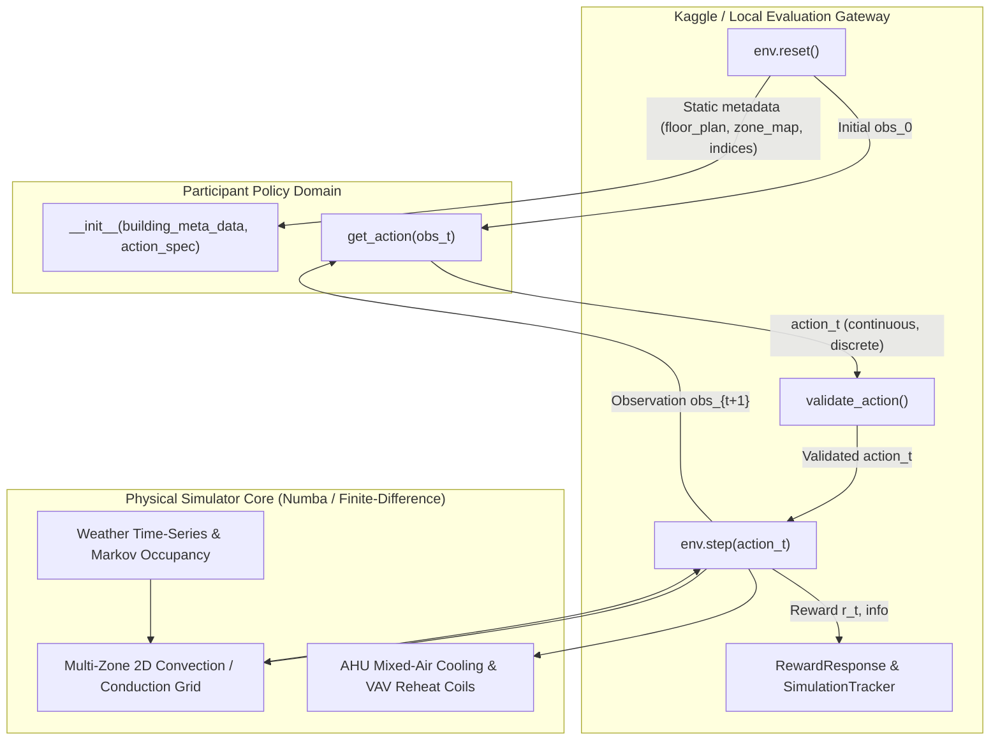

# VERIFIED PROBLEM AND SYSTEM CONTRACT

**NeurIPS 2026 Smart Buildings Foundation Model Challenge**  
**Specification Level:** Level 0 (Authoritative Code & Runtime Verified)  
**Starter-Kit Pinned Commit:** `95cea5b1c57b5291f44baf0283e0a081d53f5b16`  

---

## 1. What the Competition Asks Us to Solve

Commercial buildings account for massive global electricity and natural gas consumption. Traditional heating, ventilation, and air conditioning (HVAC) control relies on rule-based heuristics (such as ASHRAE guideline setback schedules and PID loops) that must be manually tuned for every individual building.

The **Smart Buildings Challenge** asks for a single, generalizable control policy capable of operating across diverse, previously unseen commercial buildings and climatic regimes with zero per-building retraining.

At every 5-minute decision step over a 30-day evaluation horizon (8,640 consecutive steps), the policy must jointly optimize three competing objectives:
1. **Occupant Thermal Comfort & Productivity:** Maintaining zone temperatures within a tight comfort band ($21.0^\circ\text{C}\text{--}24.0^\circ\text{C}$ during working hours).
2. **Energy Cost:** Minimizing monetary expenditure under time-of-use (TOU) electricity tariffs and monthly natural gas pricing.
3. **Carbon Emissions:** Minimizing operational greenhouse gas emissions based on grid-level hourly carbon intensity.

---

## 2. System Architecture & The Closed-Loop Contract



### 2.1 The Two-Method Policy Contract

The submitted policy is a Python class implementing:
```python
class TransferPolicy:
    def __init__(self, building_meta_data: Mapping[str, Any], action_spec: Any) -> None:
        """Called once at scenario start. Adapts policy to building topology."""
        self.metadata = building_meta_data
        self.action_spec = action_spec

    def get_action(self, obs: np.ndarray) -> dict[str, np.ndarray]:
        """Called every 5 minutes (8,640 times per 30-day episode)."""
        return {
            "continuous_action": np.ndarray,  # shape: (3*K + 2 + 2*V,), float32 in [-1.0, 1.0]
            "discrete_action": np.ndarray,    # shape: (K + 1,), int32 in {0, 1}
        }
```

---

## 3. What the Policy Observes and Controls

### 3.1 Observation Space Invariant: $\mathrm{Obs} = 6V + 15K + 58$

For a building with $V$ zones and $K$ Air Handling Units (AHUs), the observation vector is a 1D flat array with exact closed-form dimension:
- **Per-Zone Features ($6 \times V$):** Air temperature, heating setpoint, cooling setpoint, damper position, reheat valve position, sensed airflow.
- **Per-AHU Features ($15 \times K$):** Supply-air temperature (sensed + setpoint), static pressure (sensed + setpoint), airflow rates, recirculation fraction, cooling-request counts, fan status.
- **Central Plant Features:** Hot-water supply temperature (sensed + setpoint).
- **Building & Environmental Features:** Total building dynamic occupancy, comfort-mode-now flag, comfort-mode-soon flag, outdoor dry-bulb temperature (`TempF`), cyclically encoded time of day and day of week.

### 3.2 Action Space Invariants

- **Discrete Actions ($K + 1$):** Binary run commands ($0 = \text{OFF}, 1 = \text{ON}$) for each AHU ($0 \dots K-1$) and the central hot-water boiler/pump ($K$).
- **Continuous Actions ($3K + 2 + 2V$):** Normalized to $[-1.0, 1.0]$:
  - **AHU Channels ($3K$):** Supply air temperature, static pressure, recirculation fraction.
  - **Plant Channels ($2$):** Hot-water supply temperature setpoint, differential pressure.
  - **Zone Channels ($2V$):** VAV damper percentage command, VAV reheat valve percentage command.
- **Physical Interpretation:**
  - Continuous `0.0` is the **midpoint** of an actuator's range (not OFF).
  - AHUs provide shared cooling of mixed air; zones provide localized heating via hot-water reheat.
  - Simulator floors enforce minimum damper opening ($10\%$), minimum static pressure, and maximum recirculation ($70\%$).

---

## 4. How Reward and Scoring Work

### 4.1 Per-Step Reward ($r_t \in [-1.0, 0.0]$)

$$r_t = \frac{0.6 R_{\text{prod}, t} - 0.2 \tilde{C}_{\text{energy}, t} - 0.2 \tilde{E}_{\text{carbon}, t}}{0.6 + 0.2 + 0.2}$$

1. **Productivity Regret ($R_{\text{prod}, t}$):**
   - For deviation $d$ outside active comfort band ($w = 5.0\text{ K}$):
     $$f(d) = \begin{cases} d / 5.0 & d \le 5.0 \\ 1.0 + ((d - 5.0) / 5.0)^2 & d > 5.0 \end{cases}$$
   - Normalized across all zones by **actual dynamic total occupancy**:
     $$R_{\text{prod}, t} = -\frac{\sum_{z} N_{\text{occ}, z} f(d_z)}{\sum_z N_{\text{occ}, z}} \quad (\text{if } \sum N_{\text{occ}} > 0, \text{ else } 0.0)$$
2. **Normalized Energy Cost ($\tilde{C}_{\text{energy}, t}$):**
   - Combined electricity and natural gas expenditure divided by reference power denominators ($80\text{ kW} \times K$ electricity, $205\text{ kW} \times K$ gas).
3. **Normalized Carbon Emissions ($\tilde{E}_{\text{carbon}, t}$):**
   - Combined operational emissions from grid electricity and gas combustion divided by reference carbon scales.

### 4.2 Official Leaderboard Metric

$$L = \frac{1}{|S|} \sum_{s \in S} \left| \frac{1}{8640} \sum_{t=1}^{8640} r_{s, t} \right| \quad (\text{Lower is better})$$
- Flat equal weighting across all scenarios.
- Zero is theoretical perfection (perfect comfort at zero energy and zero carbon).

---

## 5. Permitted vs Prohibited Information

| Permitted at Inference | Prohibited / Hidden |
|---|---|
| CAD Floor plans (`floor_plan.npy`) and zone layouts (`zone_map.npy`) | Unseen building CAD files outside current scenario |
| Building metadata (AHU assignments, schedules, normalizers) | True envelope material parameters ($k, \rho, c_p$) |
| Live sensor observations ($t \le \text{now}$) | Future weather trajectories or future occupancy steps |
| Historical observations within the episode | Cross-scenario persistent state |
| Pre-trained model weights bundled in submission | Internet access or external API calls |

---

## 6. Generalization Challenge Summary

The challenge evaluates generalization across:
1. **Geometric Heterogeneity:** Different aspect ratios, zone counts ($V$), room layouts, and AHU assignments.
2. **Thermal Mass Diversity:** Facade conductivities ($0.15\text{--}0.55\text{ W}/(\text{m}\cdot\text{K})$) and densities ($350\text{--}2400\text{ kg}/\text{m}^3$) sampled via Latin hypercubes.
3. **Climatic Extremes:** Sub-zero arctic heating in Fairbanks vs extreme desert cooling in Phoenix vs tropical humidity in Singapore.
4. **Severe Asymmetry:** Temperature violation beyond 5 K triggers quadratic penalties that quickly destroy leaderboard scores.
