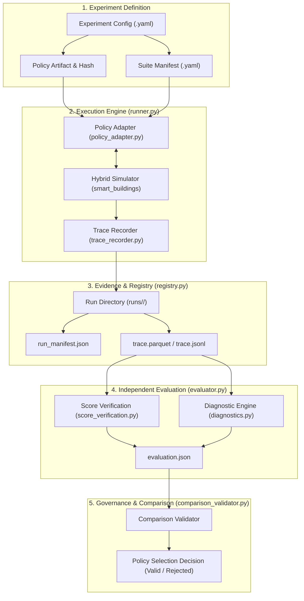
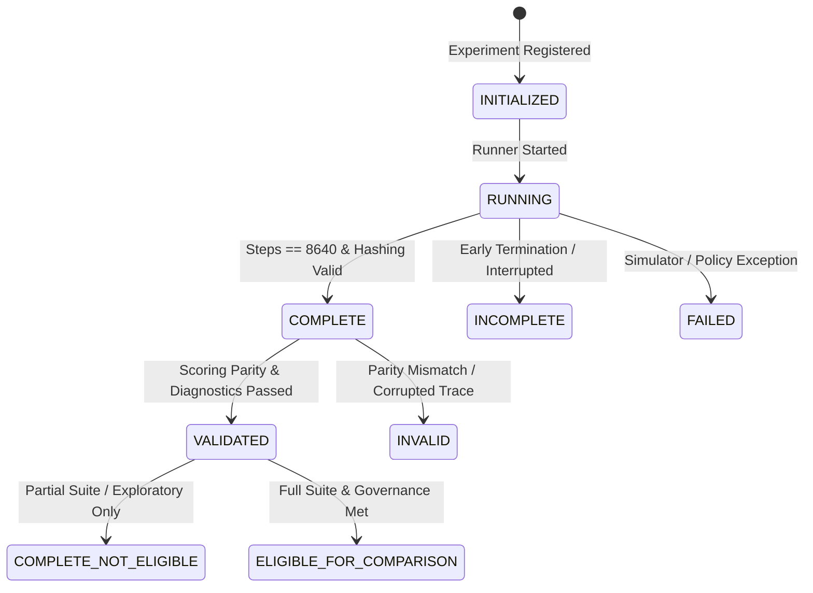

# Phase 04 — Experiment System Design: Architecture, Lifecycle & Data Contracts

**Project:** Smart Buildings Challenge — NeurIPS 2026  
**Document:** EXPERIMENT_SYSTEM_DESIGN.md  
**Status:** APPROVED ARCHITECTURE SPECIFICATION  

---

## 1. System Overview & Architectural Principles

The Experiment System Foundation establishes the software infrastructure and governance required to design, execute, evaluate, and compare smart building HVAC controllers without suffering from silent execution failures, corrupted scoring, evaluation leakage, or invalid comparisons.



### Core Architectural Principles
1. **Unidirectional Dependency**: Policy logic does not know about the simulator; the simulator does not know about the evaluation engine; the registry does not execute code.
2. **Replay-Grade Traceability**: Any historical run can be reconstructed bitwise from its manifest, policy hash, config hash, and scenario seeds.
3. **Dual Scoring Gate**: Official simulator returns and independent first-principles score reconstruction must reconcile within numerical tolerance ($\epsilon \le 1.0\times 10^{-6}$) before a run is considered valid.
4. **Strict Lifecycle State Machine**: No run may be marked `COMPLETE` unless all steps, artifacts, and reconciliation criteria pass without warnings or truncation.

---

## 2. Six Core Responsibilities

### A. Experiment Definition
An experiment specifies what is being tested before execution begins:
- `experiment_id`: Unique hierarchical slug (e.g. `EXP-001_baseline_transfer`).
- `hypothesis`: Concise statement of expected physical and score outcome.
- `experiment_type`: One of `EXPLORATORY`, `BENCHMARK`, `CANDIDATE_EVALUATION`, `FAULT_INJECTION`.
- `policy`: Specification of policy class, module path, parameters, and Git commit / file SHA256.
- `suite_id`: Targeted evaluation suite (e.g. `official_30`, `dev_smoke_1`, `stress_fairbanks`).
- `deterministic`: Boolean enforcing reproducibility seeds ($s_{\mathrm{sim}}, s_{\mathrm{env}}$).
- `baseline_run_id`: Optional parent run ID for delta comparison.

### B. Execution System (`core/runner.py`, `core/policy_adapter.py`)
- **Policy Adapter**: Isolates policy implementation from environment specifics. Enforces:
  - Input inspection: Receives only permitted observation vector and public metadata (`floor_plan`, `zone_map`).
  - Output constraint enforcement: Validates discrete action shape ($K+1$) and continuous action shape ($3K+2+2V$). Clips continuous setpoints to $[-1.0, 1.0]$.
  - Exception containment: Traps NaN/Inf values and uncaught policy exceptions, cleanly signaling failure to the runner without simulator crash.
- **Simulator Runner**:
  - Instantiates environment via `gin` config.
  - Steps through the fixed 5-minute interval ($dt = 300\text{ s}$).
  - Enforces exact episode step count ($8,640$ steps for 30 days).
  - Streams each transition $(t, o_t, a_t, r_t, s_t)$ directly to the trace recorder.

### C. Evidence & Experiment Registry (`core/registry.py`)
Manages immutable execution artifacts in `04_EXPERIMENT_FOUNDATION/experiments/runs/<run_id>/`:
- `run_manifest.json`: Full cryptographic provenance and runtime metadata.
- `trace.jsonl` / `trace.csv`: Complete step-level observations, actions, and states.
- `summary.json`: Official simulator summary metrics.
- `evaluation.json`: Independent reconstruction, diagnostics, and eligibility flags.

#### Lifecycle State Machine


### D. Independent Evaluation (`core/evaluator.py`, `evaluation/score_verification.py`)
- Independent reconstruction of productivity regret ($p_t$), energy cost ($e_t$), and carbon emissions ($c_t$).
- Recomputes step reward $r_t = 0.6 p_t - 0.2 c_t - 0.2 e_t$.
- Sums episode return $R = \sum_{t=1}^T r_t$.
- Reconciles independent return $R_{\mathrm{indep}}$ against official simulator return $R_{\mathrm{off}}$:
  $$\Delta_R = |R_{\mathrm{indep}} - R_{\mathrm{off}}| \le 1.0\times 10^{-6}$$
- Rejects incomplete episodes ($T < 8,640$) or missing scenario sets from suite aggregation.

### E. Evaluation Governance & Failure Engineering
- Scenarios are partitioned into formal, provenance-tracked roles:
  - `DEV`: Fast feedback, single building/weather (e.g. `building_train_1 / atlanta_2`).
  - `SELECT`: Official 30-scenario benchmark for candidate selection.
  - `GENERALIZATION`: Withheld or perturbed scenarios to evaluate out-of-distribution transfer.
  - `STRESS`: Extreme climate edge cases (e.g. Fairbanks winter cold snap, Phoenix summer heatwave).
  - `SEALED RELEASE`: Hidden competition test set (inaccessible locally).
- Comparison safeguards reject candidate comparisons if suites differ, metrics differ, or any episode is incomplete.

### F. Experiment Analysis & Diagnostics (`evaluation/diagnostics.py`)
Calculates engineering metrics that explain *why* a policy succeeded or failed:
- **Thermal Comfort**: Degree-hours of violation beyond comfort boundaries ($[T_{\mathrm{min}}, T_{\mathrm{max}}]$); peak temperature deviation ($^\circ\text{C}$).
- **Energy Subsystems**: AHU supply fan energy (kWh), cooling coil energy (kWh), zone reheat hot water coil energy (kWh), boiler gas consumption (kWh).
- **Carbon Accounting**: Total kilograms of $\mathrm{CO}_2$ emitted during occupied vs unoccupied hours.

---

## 3. Directory Layout

```text
04_EXPERIMENT_FOUNDATION/
│
├── EXPERIMENT_SYSTEM_DESIGN.md                # This architecture specification
├── EVALUATION_GOVERNANCE.md                   # Scenario roles, suite manifests, comparison rules
├── PHASE_04_BASELINE_AUDIT.md                 # Inventory and reuse plan from Phase 03
├── PHASE_04_TEST_RESULTS.md                   # Full test pass/fail ledger
├── PHASE_04_EXIT_REPORT.md                    # Formal Phase 04 sign-off and Gate S1 decision
│
├── core/
│   ├── __init__.py
│   ├── runner.py                              # Orchestrates scenario execution
│   ├── policy_adapter.py                      # Wraps policies, validates shapes, hashes code
│   ├── trace_recorder.py                      # Streams episode transitions to disk
│   ├── registry.py                            # Manages runs, states, and directory layouts
│   └── evaluator.py                           # High-level evaluation coordinator
│
├── evaluation/
│   ├── __init__.py
│   ├── score_verification.py                  # Independent formula reconstruction & parity
│   ├── diagnostics.py                         # Deep physical diagnostics (degree-hours, energy)
│   └── comparison_validator.py                # Enforces valid candidate comparisons
│
├── suites/
│   ├── official_suite.yaml                    # Full 30-scenario official benchmark
│   └── additional_suites/
│       ├── dev_smoke.yaml                     # Single scenario for rapid unit tests
│       └── stress_extremes.yaml               # Fairbanks-1 and Phoenix-5 stress suite
│
├── experiments/
│   ├── experiment_definitions/                # YAML experiment specifications
│   │   ├── exp_000_vertical_slice.yaml
│   │   └── exp_001_transfer_baseline.yaml
│   └── runs/                                  # Immutable run evidence directories
│
└── tests/
    ├── __init__.py
    ├── test_runner.py                         # Verifies execution and step lifecycle
    ├── test_scoring.py                        # Verifies parity, synthetic tests, and tolerances
    ├── test_reproducibility.py                # Verifies bitwise determinism and reloads
    ├── test_failure_detection.py              # Injected defect harness (12 failure modes)
    └── test_evaluation_governance.py          # Verifies suite integrity and comparison rules
```

---

## 4. Staged Implementation Sequence

1. **Stage 2**: Define formal schemas for Experiment, Manifest, Trace, Evaluation, and Suite in Python dataclasses.
2. **Stage 3**: Implement `core/` modules (`policy_adapter.py`, `trace_recorder.py`, `registry.py`, `runner.py`, `evaluator.py`). Execute the minimum trusted vertical slice on `building_train_1 / atlanta_2`.
3. **Stage 4**: Implement `evaluation/diagnostics.py` and reproducibility tests.
4. **Stage 5**: Implement `evaluation/score_verification.py` and certify score reconstruction parity.
5. **Stage 6**: Formulate `EVALUATION_GOVERNANCE.md`, generate `suites/official_suite.yaml`, and build `evaluation/comparison_validator.py`.
6. **Stage 7**: Implement `tests/test_failure_detection.py` covering all 12 fault injection criteria.
7. **Stage 8**: Run complete test suite, compile `PHASE_04_TEST_RESULTS.md`, and author `PHASE_04_EXIT_REPORT.md`.
