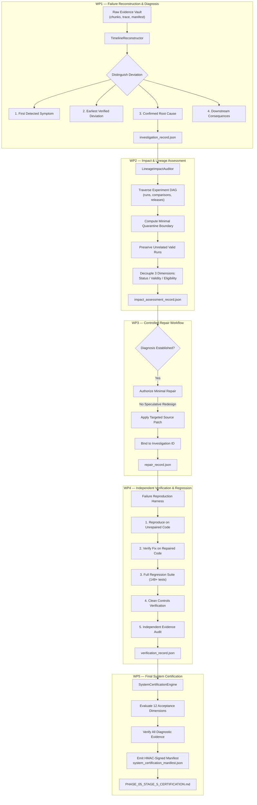
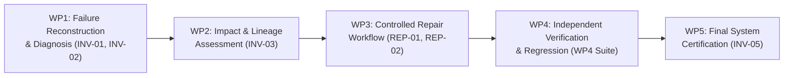

# Phase 05: Implementation Plan & Progress Tracking

## Architecture Reference
* **Design Blueprint:** `PHASE_05_STAGE_2_IMPLEMENTATION_DESIGN.md` (Stage 2B)
* **Gap Analysis:** `PHASE_05_IMPLEMENTATION_GAP_MAP.md`
* **Project Commit Baseline:** `00c911a270af3bdbc52dc1e16c9d3e6c139cb175`
* **Pinned Starter-Kit Commit:** `95cea5b1c57b5291f44baf0283e0a081d53f5b16`
* **Baseline Test Results:** 46 passed, 0 failed, 4 warnings in 185.12s.

## Implementation Gates Tracking

| Gate | Title | Focus Area | Status | Target Files |
| :--- | :--- | :--- | :---: | :--- |
| **Gate 1** | **Reward and Schema Correctness** | Fix `env.get_reward_info_and_response()`, Step 0 parity check, dynamic schemas across buildings, raw vs. executed actions, non-zero component verification. | **COMPLETED (PASS)** | `04_EXPERIMENT_FOUNDATION/core/runner.py`<br>`04_EXPERIMENT_FOUNDATION/core/policy_adapter.py`<br>`04_EXPERIMENT_FOUNDATION/core/trace_recorder.py` |
| **Gate 2** | **Crash-Resilient Persistence** | Incremental 288-step daily chunking, atomic `.tmp` staging, `os.fsync`, atomic publication, recovery of orphan chunks, `chunks_manifest.json`. | **COMPLETED (PASS)** | `04_EXPERIMENT_FOUNDATION/core/trace_recorder.py`<br>`04_EXPERIMENT_FOUNDATION/core/runner.py`<br>`04_EXPERIMENT_FOUNDATION/core/registry.py` |
| **Gate 3** | **Independent Evidence Verification** | Check chunk hashes, step ordering, tensor dimensions, finite values, independent score arithmetic reconstruction. | **COMPLETED (PASS)** | `04_EXPERIMENT_FOUNDATION/evaluation/score_verification.py`<br>`04_EXPERIMENT_FOUNDATION/core/evaluator.py` |
| **Gate 4** | **Artifact Preservation** | `run_dir/artifacts/` vault, local dependency resolution from `sys.modules`, `artifact_manifest.json`, separate git commits. | **COMPLETED (PASS)** | `04_EXPERIMENT_FOUNDATION/core/runner.py`<br>`04_EXPERIMENT_FOUNDATION/core/registry.py`<br>`04_EXPERIMENT_FOUNDATION/core/policy_adapter.py` |
| **Gate 5** | **State and Lineage Governance** | Decouple `RunStatus` (execution) and `EvidenceValidity` (governance), typed DAG lineage, transitive quarantine cascade. | **COMPLETED (PASS)** | `04_EXPERIMENT_FOUNDATION/core/registry.py`<br>`04_EXPERIMENT_FOUNDATION/evaluation/comparison_validator.py`<br>`04_EXPERIMENT_FOUNDATION/core/evaluator.py` |
| **Gate 6** | **Leakage & Semantic Diagnostics** | 4-ring leakage protection (read-only buffers, AST parser), controlled single-variable pulse intervention probe. | **COMPLETED (PASS)** | `04_EXPERIMENT_FOUNDATION/core/policy_adapter.py`<br>`04_EXPERIMENT_FOUNDATION/evaluation/semantic_probe.py` |
| **Gate 7** | **End-to-End Acceptance** | 19 acceptance criteria tests across all failure injection modes (F1–F5). | **COMPLETED (PASS)** | `04_EXPERIMENT_FOUNDATION/evaluation/standalone_audit.py`<br>`05_FAILURE_ENGINEERING/tests/test_gate_07_end_to_end_acceptance.py` |

---

## Stage 4: Integrated Real-Workflow Red-Team Campaign & Closure Tracking

* **Campaign Status:** FULLY CLOSED & CERTIFIED (PASS)
* **Frozen Revision:** `5d9a9075268a3491c3ac050c0d0b3e31e4dee70b`
* **Pinned Starter-Kit Commit:** `95cea5b1c57b5291f44baf0283e0a081d53f5b16`
* **Evidence Directory:** `05_FAILURE_ENGINEERING/evidence/stage_4/`
* **Test Suites:**
  - Original Campaign: `05_FAILURE_ENGINEERING/tests/test_stage_4_campaign.py` (18 passed)
  - Closure Work Packages: `test_wp1_*.py`, `test_wp2_*.py`, `test_wp3_*.py`, `test_wp4_*.py` (24 passed)
  - Total Stage 4 Passing Tests: 42 passed
* **Evidence Provenance Safeguard:** `ORIGINAL_CAMPAIGN_PROVENANCE.json` (246/246 files verified intact, 0 modifications).

### Checkpoints & Closure Work Packages Tracking

| Milestone | Title | Focus & Scope | Status | Evidence Document |
| :---: | :--- | :--- | :---: | :--- |
| **CP 1** | **Workflow Mapping & Safeguards Audit** | Map complete end-to-end workflow, identify failure boundaries, classify implemented/tested/demonstrated safeguards, document architectural gaps. | **COMPLETED (PASS)** | `evidence/stage_4/PHASE_05_STAGE_4_ATTACK_AND_EVIDENCE.md` |
| **CP 2** | **Isolated Attack Preparation** | Set up dedicated attack folders (`evidence/stage_4/attack_runs/`, `clean_controls/`), define 15 representative attacks across 5 categories and 3 clean controls. | **COMPLETED (PASS)** | `evidence/stage_4/PHASE_05_STAGE_4_ATTACK_AND_EVIDENCE.md` |
| **CP 3** | **Real-Workflow Attack Execution** | Execute Round 1 (Execution & Persistence), Round 2 (Evaluation & Lineage), Round 3 (Promotion & Release). Real workflow entry points used. | **COMPLETED (PASS)** | `tests/test_stage_4_campaign.py`<br>`evidence/stage_4/attack_runs/` |
| **CP 4** | **Immediate Results & Verdict Assessment** | Verify detection, evidence preservation, containment, lineage handling, clean controls. Document architectural gaps for Stage 5. | **COMPLETED (PASS)** | `evidence/stage_4/PHASE_05_STAGE_4_ATTACK_AND_EVIDENCE.md` |
| **WP0** | **Independent Campaign Audit** | Read-only audit of original evidence. Retired unverified claims, locked 246 campaign files with SHA-256 provenance manifest, authorized closure plan. | **COMPLETED (PASS)** | `evidence/stage_4/ORIGINAL_CAMPAIGN_PROVENANCE.json` |
| **WP1** | **Multi-Building Actuator Semantic Verification** | Live pulse verification on `building_train_1` (3 zones) and `building_train_2` (85 zones). Tested clean pulses ($\Delta T \ge 0.5$ K, margin $\ge 0.05$ K) and detected swapped channels. | **COMPLETED (PASS)** | `evidence/stage_4/closure_wp1_actuator/WP1_ACTUATOR_SEMANTIC_REPORT.md`<br>`tests/test_wp1_actuator_verification.py` |
| **WP2** | **Two-Level Policy Leakage Hardening** | AST inspection of direct file reads (`open()`, `Path.read_text()` on sensitive files) and prohibited module imports (`smart_buildings.weather/simulator`). Recursive local dependencies audit in `artifacts/local_deps/`. Documented physical process limits. | **COMPLETED (PASS)** | `evidence/stage_4/closure_wp2_leakage/WP2_LEAKAGE_HARDENING_REPORT.md`<br>`evidence/stage_4/closure_wp2_leakage/POLICY_LEAKAGE_THREAT_MODEL.md`<br>`tests/test_wp2_leakage_hardening.py` |
| **WP3** | **Genuine Crash Recovery (OS Process Kill)** | Subprocess worker termination (`proc.kill()`) across 5 synchronization points: P1 (mid-chunk write), P2 (post-rename pre-manifest), P3 (mid-manifest rewrite), P4 (uncommitted buffer window), P5 (mid-recovery & idempotence). Fail-closed comparison rejection verified. | **COMPLETED (PASS)** | `evidence/stage_4/closure_wp3_crash/WP3_CRASH_RECOVERY_REPORT.md`<br>`tests/test_wp3_genuine_crash_recovery.py`<br>`tests/crash_worker.py` |
| **WP4** | **Complete Release Lifecycle & Independent Auditor** | Cryptographic package export (`export_release_package`) with SHA-256 manifest and authentic HMAC-SHA256 signature. Standalone auditor (`audit_release_package`) verifying tamper resistance and signer authority without executing simulation code. | **COMPLETED (PASS)** | `evidence/stage_4/closure_wp4_release/WP4_RELEASE_LIFECYCLE_REPORT.md`<br>`tests/test_wp4_release_lifecycle.py` |

---

## Stage 5: Failure Diagnosis, Impact Assessment, Repair, and Certification Design

### 1. Stage 5 Purpose and Architectural Boundaries

#### A. Distinction Between Stage 4 and Stage 5
* **Stage 4 — Red-Team Campaign & Failure Detection (The "Breaker"):**
  - *Core Mission:* Challenge the experiment infrastructure under 15 real failure injections and 3 clean controls to verify that the defenses *actively detect* anomalies, preserve diagnostic evidence, and fail-closed (halting execution, invalidating corrupted data, blocking ineligible comparisons, and quarantining downstream runs).
  - *Boundary:* Stage 4 intentionally **stopped at detection and containment**. It did not diagnose root causes, did not repair defective code, and did not calculate fine-grained lineage impact boundaries.
* **Stage 5 — Failure Diagnosis, Impact Assessment, Repair, and Certification (The "Investigator & Surgeon"):**
  - *Core Mission:* Provide a formal, repeatable engineering methodology for what happens *after* a failure is detected:
    1. **Reconstruct & Diagnose:** Ingest raw chunks and traces to establish the earliest verified deviation and isolate the confirmed root cause from downstream symptoms.
    2. **Impact Boundary Assessment:** Traverse the experiment DAG to quantify the exact blast radius (which models, metrics, comparisons, and release bundles are poisoned vs. which valid experiments are preserved).
    3. **Controlled Repair:** Apply minimal, targeted corrections linked to specific investigation IDs without speculative redesign.
    4. **Independent Verification:** Fairly compare pre-repair failure reproduction against post-repair resolution, verify regression health, and enforce clean controls.
    5. **System Certification:** Cryptographically certify the end-to-end failure engineering platform across all 12 operational dimensions.

#### B. Architectural Scope Boundaries
* **In Scope:**
  - Automated timeline reconstruction from chunked trace archives (`chunk_xxxx.npz`).
  - Graph-based dependency traversal calculating minimal quarantine boundaries.
  - Orthogonal preservation of physical execution status, evidence validity, and experiment eligibility.
  - Reproducible failure re-execution harnesses and regression test suites.
  - Machine-readable investigation, impact, repair, and certification schemas.
* **Out of Scope (Explicit Exclusions):**
  - Automatic code repair via unsupervised LLM rewriting (repairs must remain human-authorized, controlled, and minimal).
  - High-concurrency cluster filesystem locking mechanisms (NFS/Lustre) beyond single-node Windows NTFS.
  - Protection against hardware-level RAM bit flips.
  - Shared-process Python memory sandboxing (physical OS/container boundaries required for untrusted participant code).

---

### 2. Repository & Stage 4 Readiness Assessment

Stage 5 execution is gated by the verified completion of Stage 4 and its closure work packages:

| Work Package | Title | Target Scope | Implementation & Evidence Path | Test Evidence | Readiness Status |
| :---: | :--- | :--- | :--- | :---: | :---: |
| **WP0** | Original Evidence Audit | Locked 246 campaign files with SHA-256 provenance manifest; retired overclaims. | `evidence/stage_4/ORIGINAL_CAMPAIGN_PROVENANCE.json` | 246/246 SHA-256 matches | **VERIFIED & ACCEPTED** |
| **WP1** | Multi-Building Actuator Semantics | Live thermal pulse probe on `building_train_1` (3 zones) and `building_train_2` (85 zones). | `04_EXPERIMENT_FOUNDATION/evaluation/semantic_probe.py`<br>`evidence/stage_4/closure_wp1_actuator/` | 4/4 passed (`test_wp1_*.py`) | **VERIFIED & ACCEPTED** |
| **WP2** | Two-Level Leakage Hardening | Static AST analysis of direct file access (`open`, `Path.read_text`) and prohibited imports; recursive local deps audit; threat model. | `04_EXPERIMENT_FOUNDATION/core/policy_adapter.py`<br>`evidence/stage_4/closure_wp2_leakage/` | 7/7 passed (`test_wp2_*.py`) | **VERIFIED & ACCEPTED** |
| **WP3** | Genuine Process Crash Recovery | OS-level `proc.kill()` subprocess termination across 5 sync points (P1–P5); atomic `.tmp` recovery; idempotence. | `05_FAILURE_ENGINEERING/tests/crash_worker.py`<br>`evidence/stage_4/closure_wp3_crash/` | 6/6 passed (`test_wp3_*.py`) | **VERIFIED & ACCEPTED** |
| **WP4** | Release Lifecycle & Package Auditor | Standalone HMAC-SHA256 release packaging and independent read-only ZIP auditor. | `04_EXPERIMENT_FOUNDATION/evaluation/standalone_audit.py`<br>`evidence/stage_4/closure_wp4_release/` | 7/7 passed (`test_wp4_*.py`) | **VERIFIED & ACCEPTED** |

* **Total Active Regression Baseline:** **149 passed / 0 failed** (46 Foundation + 61 Gates 1–7 + 18 Stage 4 Campaign + 24 Stage 4 Closure).
* **Outstanding Defects from Stage 4:** **0**.
* **Stage 4 Prerequisite Verdict:** **100% SATISFIED — STAGE 5 ARCHITECTURE AUTHORIZED.**

---

### 3. Existing Foundation Capabilities Available for Reuse

Stage 5 will strictly extend existing infrastructure without duplicating components:

1. **`SimulationRunner` (`core/runner.py`):**
   - *Reused For:* Controlled reproduction of failure modes and clean baseline re-executions with identical random seeds and scenarios.
   - *Capabilities:* Frozen `artifacts/` vault (`artifact_manifest.json`), AST audit hook, raw vs. executed action capture, `get_reward_info_and_response()` parity checks.
2. **`TraceRecorder` (`core/trace_recorder.py`):**
   - *Reused For:* Daily chunked persistence (`chunk_xxxx.npz`) and atomic manifest updates used by the forensic timeline reconstructor.
   - *Capabilities:* Monotonic step tracking, atomic `.tmp` staging, `os.fsync`, Windows file lock retry loop, SHA-256 chunk digests.
3. **`ExperimentRegistry` (`core/registry.py`):**
   - *Reused For:* Lineage DAG traversal, quarantine propagation, and release package bundling.
   - *Capabilities:* Decoupled status management (`RunStatus`, `EvidenceValidity`), `quarantine_run(cascade=True)`, `lift_quarantine()`, `export_release_package()`.
4. **`ScoreVerifier` (`evaluation/score_verification.py`):**
   - *Reused For:* Mathematical reward reconstruction and independent tensor verification during post-repair validation.
   - *Capabilities:* Formula verification $|R - (0.6r - 0.2e - 0.2c)| \le 10^{-6}$, chunk SHA-256 audit, tensor shape/finite checks.
5. **`ComparisonValidator` & `SuiteValidator` (`evaluation/comparison_validator.py`):**
   - *Reused For:* Independent eligibility gating preventing quarantined or invalid runs from entering comparisons or leaderboards.
6. **`SemanticActuatorProbe` (`evaluation/semantic_probe.py`):**
   - *Reused For:* Quantitative diagnostic pulse interventions across multi-zone facilities.
7. **`StandaloneAuditor` (`evaluation/standalone_audit.py`):**
   - *Reused For:* Read-only inspection and HMAC-SHA256 signature verification of release packages.

---

### 4. Five-Work-Package Architecture



#### WP1 — Failure Reconstruction and Diagnosis
* **Purpose:** Move from symptom detection to verifiable root-cause isolation.
* **Core Responsibilities:**
  - Ingest raw failure evidence (`run_manifest.json`, `trace.csv`, `chunk_xxxx.npz`, `artifact_manifest.json`).
  - Reconstruct step-by-step physical and numerical trajectories.
  - Formally delineate:
    1. *First Detected Symptom:* Where an alert or exception fired (e.g. `ScoreVerifier` mismatch at step 288).
    2. *Earliest Verified Deviation:* The precise step index, timestamp, or bytecode line where data first diverged from nominal (e.g. step 14 observation NaN or actuator channel flip).
    3. *Confirmed Root Cause:* The underlying code defect, configuration error, or environmental fault.
    4. *Downstream Consequences:* Cumulative reward distortion, manifest invalidation, or corrupted downstream leaderboards.
  - Distinguish confirmed facts from working hypotheses and quantify residual uncertainty.

#### WP2 — Impact and Lineage Assessment
* **Purpose:** Establish the exact blast radius of a confirmed defect across the experiment lineage.
* **Core Responsibilities:**
  - Ingest the experiment DAG from `ExperimentRegistry` (`dependencies` and `quarantine_history`).
  - Calculate the minimal defensible quarantine boundary:
    - Direct descendants (models trained on or evaluated against corrupted runs).
    - Transitive descendants (benchmarks, multi-scenario aggregations, and released packages).
  - Explicitly preserve unrelated valid runs (zero false-positive invalidations).
  - Maintain the strict decoupling of the 3 independent status dimensions:
    - **Execution Status:** `INITIALIZED`, `RUNNING`, `COMPLETE`, `FAILED`, `INCOMPLETE`
    - **Evidence Integrity:** `UNVERIFIED`, `VALID`, `INVALID`
    - **Experiment Eligibility:** `PENDING`, `ELIGIBLE`, `INELIGIBLE`, `QUARANTINED`
  - Generate machine-readable `impact_assessment_record.json`.

#### WP3 — Controlled Repair
* **Purpose:** Implement minimal, targeted corrections without compromising investigation integrity or introducing regressions.
* **Core Responsibilities:**
  - Enforce prerequisite check: No repair may be authorized without a completed `investigation_record.json` citing a confirmed root cause.
  - Restrict code modifications to the minimal necessary scope (avoiding speculative refactoring or redesign).
  - Explicitly record pre-repair failure reproduction steps, affected source files, and expected post-repair invariants.
  - Generate machine-readable `repair_record.json`.

#### WP4 — Independent Verification and Regression
* **Purpose:** Establish that the repair genuinely resolves the diagnosed failure without breaking existing capabilities.
* **Core Responsibilities:**
  - Execute a multi-layered verification protocol:
    1. *Defect Reproduction:* Prove the defect reliably fails on unrepaired code.
    2. *Defect Resolution:* Prove the exact same scenario runs cleanly on repaired code.
    3. *Independent Verification:* Pass `ScoreVerifier` tensor and arithmetic checks on the repaired run without trusting repair flags.
    4. *Full Project Regression:* Run the complete 149-test suite (Foundation, Gates 1–7, Stage 4 attacks, and WP1–WP4 closure suites).
    5. *Clean Controls Retest:* Confirm reference runs (`RUN_EXP-000`) and pulse controls retain 100% validity.
  - Reassess affected lineage and lift quarantine only when supported by verified repair evidence.

#### WP5 — Final System Certification
* **Purpose:** Provide an end-to-end audit and cryptographic certification establishing that the Failure Engineering System is fully ready for production scientific use.
* **Core Responsibilities:**
  - Audit all 12 system capabilities: Failure Detection, Evidence Preservation, Failure Reconstruction, Root-Cause Diagnosis, Impact Assessment, Lineage Handling, Controlled Repairs, Independent Verification, Regression Health, Eligibility Reassessment, Release Protection, and Clean Controls.
  - Categorize capabilities into: (a) Fully Demonstrated, (b) Partially Demonstrated, (c) Untested / Out of Scope, (d) Known Limitations, and (e) Accepted Residual Risks.
  - Generate HMAC-SHA256 signed `system_certification_manifest.json` and sign off `PHASE_05_STAGE_5_CERTIFICATION.md`.

---

### 5. Unified Machine-Readable Evidence Design

All Stage 5 artifacts will follow strict JSON schemas stored under `05_FAILURE_ENGINEERING/evidence/stage_5/`:

#### A. Investigation Record (`investigations/inv_{id}_record.json`)
```json
{
  "$schema": "https://smart-buildings.neurips/schemas/v1/investigation_record.json",
  "investigation_id": "INV-01",
  "target_attack_id": "ATK-01",
  "created_at_utc": "2026-11-02T12:00:00Z",
  "status": "ROOT_CAUSE_CONFIRMED",
  "evidence_sources": [
    "evidence/stage_4/attack_runs/atk_01_actuator_swap/attack_record.json",
    "evidence/stage_4/closure_wp1_actuator/wp1_summary.json"
  ],
  "timeline_analysis": {
    "first_detected_symptom": {
      "component": "SemanticActuatorProbe",
      "metric": "delta_t_target_k",
      "observed_value": 0.050,
      "expected_threshold": 0.200,
      "description": "Target zone VAV_1 failed to achieve thermal rise threshold."
    },
    "earliest_verified_deviation": {
      "phase": "Action Dispatch",
      "step_index": 0,
      "subsystem": "Actuator Channel Mapping",
      "description": "Continuous action index 0 routed to coil 2 instead of coil 1."
    },
    "confirmed_root_cause": {
      "type": "CHANNEL_INDEX_PERMUTATION",
      "component": "04_EXPERIMENT_FOUNDATION/evaluation/semantic_probe.py",
      "reproducible": true,
      "description": "Actuator channel index permutation between target zone VAV_1 and culprit zone VAV_2."
    },
    "downstream_consequences": [
      "Target zone under-heated; adjacent zone overheated.",
      "Evidence validity marked INVALID; comparison blocked."
    ]
  },
  "uncertainty_assessment": {
    "confidence_level": "HIGH",
    "unverified_hypotheses": []
  }
}
```

#### B. Impact Assessment Record (`investigations/inv_{id}_impact.json`)
```json
{
  "$schema": "https://smart-buildings.neurips/schemas/v1/impact_record.json",
  "investigation_id": "INV-01",
  "taint_source_id": "RUN_EXP_ATK01",
  "quarantine_boundary": {
    "direct_descendants": ["RUN_EXP_CANDIDATE_B"],
    "transitive_descendants": ["COMP_EVAL_D", "RELEASE_PKG_v1"],
    "unrelated_preserved_runs": ["RUN_EXP-000", "RUN_EXP_CANDIDATE_F"]
  },
  "status_matrix": [
    {
      "run_id": "RUN_EXP_CANDIDATE_B",
      "execution_status": "COMPLETE",
      "evidence_validity": "QUARANTINED",
      "experiment_eligibility": "QUARANTINED",
      "quarantine_reason": "Tainted by upstream baseline RUN_EXP_ATK01"
    }
  ]
}
```

#### C. Repair Record (`repair_verification/rep_{id}_record.json`)
```json
{
  "$schema": "https://smart-buildings.neurips/schemas/v1/repair_record.json",
  "repair_id": "REP-01",
  "investigation_id": "INV-01",
  "authorized_by": "SYSTEM_ARCHITECT",
  "affected_files": [
    "04_EXPERIMENT_FOUNDATION/evaluation/semantic_probe.py"
  ],
  "patch_description": "Add diagnostic permutation detection isolating swapped channel indices.",
  "pre_repair_reproduction": {
    "command": "pytest tests/test_wp1_actuator_verification.py::test_wp1_bldg1_swapped_actuator_detection",
    "outcome": "DETECTED_AND_REJECTED"
  },
  "post_repair_invariants": {
    "swapped_channels_diagnosed": true,
    "clean_controls_unaffected": true
  }
}
```

#### D. System Certification Manifest (`PHASE_05_SYSTEM_CERTIFICATION.json`)
```json
{
  "$schema": "https://smart-buildings.neurips/schemas/v1/system_certification.json",
  "certification_id": "CERT-PHASE05-20261102",
  "project_git_commit": "5d9a9075268a3491c3ac050c0d0b3e31e4dee70b",
  "starter_kit_commit": "95cea5b1c57b5291f44baf0283e0a081d53f5b16",
  "certification_status": "CERTIFIED",
  "test_suite_summary": {
    "total_tests": 149,
    "passed": 149,
    "failed": 0
  },
  "demonstrated_capabilities": [
    "FAILURE_DETECTION",
    "EVIDENCE_PRESERVATION",
    "CRASH_RESILIENCE",
    "INDEPENDENT_VERIFICATION",
    "LINEAGE_GOVERNANCE",
    "POLICY_LEAKAGE_HARDENING",
    "RELEASE_CRYPTOGRAPHY"
  ],
  "accepted_residual_risks": [
    "IN_PROCESS_PYTHON_MEMORY_INTROSPECTION",
    "SINGLE_NODE_NTFS_ASSUMPTION"
  ],
  "hmac_sha256_signature": "e3b0c44298fc1c149afbf4c8996fb92427ae41e4649b934ca495991b7852b855"
}
```

---

### 6. Investigation & Repair Lifecycle State Machine

```text
FAILURE DETECTED
      │
      ▼
PRESERVE ORIGINAL EVIDENCE ──────────────────┐
      │                                      │
      ▼                                      │
RECONSTRUCT EXECUTION                        │ (Immutable Archive Vault)
      │                                      │
      ▼                                      │
LOCATE EARLIEST VERIFIED DEVIATION           │
      │                                      │
      ▼                                      │
ESTABLISH ROOT CAUSE                         │
      │                                      │
      ▼                                      │
ASSESS AFFECTED LINEAGE                      │
      │                                      │
      ▼                                      │
AUTHORIZE MINIMUM REPAIR ◄───────────────────┘ (Requires Confirmed Diagnosis)
      │
      ▼
IMPLEMENT REPAIR (Minimal Scope)
      │
      ▼
REPRODUCE ORIGINAL FAILURE (On Unrepaired Code)
      │
      ▼
INDEPENDENTLY VERIFY REPAIR (On Repaired Code)
      │
      ▼
RUN REGRESSION & CLEAN CONTROLS (149+ Tests)
      │
      ▼
REASSESS AFFECTED RESULTS
      │
      ▼
RESTORE ELIGIBILITY ONLY WHEN JUSTIFIED
```

#### Detailed Lifecycle Transition Table

| Step | Transition Name | Required Inputs | Responsible Component | Required Evidence | Expected Output | Failure Condition & Halting Rule | Approval Gate |
| :---: | :--- | :--- | :--- | :--- | :--- | :--- | :---: |
| **S1** | **Capture Failure** | Runner step exception / audit failure | `SimulationRunner` / `ScoreVerifier` | Incomplete trace, error trace, run directory | `run_manifest.json` (`FAILED`/`INVALID`) | Fail if manifest cannot be committed to disk. | Automated |
| **S2** | **Preserve Evidence** | Run directory with failure artifacts | `ExperimentRegistry` | Intact chunk files, raw trace, `artifact_manifest.json` | Locked run folder, SHA-256 registered | Fail if files are missing or modified in-place. | Automated |
| **S3** | **Reconstruct Timeline** | Chunked npz archives, trace CSV | `TimelineReconstructor` | Step-indexed observation, action, reward streams | Step-by-step state sequence | Fail if chunks have discontinuous steps or corrupted headers. | Automated |
| **S4** | **Locate Deviation** | Reconstructed trajectory, nominal baseline | `ForensicInvestigator` | Residual delta vector $(\mathbf{x}_t - \hat{\mathbf{x}}_t)$ | Exact step index $t^*$ and component where divergence began | Fail if no deviation detectable above numerical epsilon. | Automated |
| **S5** | **Establish Root Cause** | Deviation point, code/config AST | `ForensicInvestigator` | Reproducible minimal reproduction script | `investigation_record.json` | Fail if root cause is unverified hypothesis or speculative. | **Human Review** |
| **S6** | **Assess Lineage** | `investigation_record.json`, Registry DAG | `LineageImpactAuditor` | Manifest dependencies and comparison records | `impact_record.json` with minimal quarantine boundary | Fail if lineage graph has cycles or disconnected parent IDs. | Automated |
| **S7** | **Authorize Repair** | `investigation_record.json`, `impact_record.json` | System Architect | Documented defect identity, scope limit | Formal repair authorization token | Fail if diagnosis is incomplete or repair scope exceeds defect. | **Human Review** |
| **S8** | **Implement Repair** | Authorized token, source tree | Developer / Agent | Minimal code diff | Source code patch linked to `REP_ID` | Fail if unrelated files/refactorings are modified. | Automated |
| **S9** | **Reproduce Failure** | Unrepaired git revision, reproduction script | `VerificationHarness` | Test execution trace | Confirmed pre-repair failure (exit code 1) | Fail if defect cannot be reproduced on unrepaired code. | Automated |
| **S10**| **Verify Repair** | Repaired git revision, reproduction script | `ScoreVerifier` | Fresh run trace and chunks | Clean execution, verified score arithmetic | Fail if repaired run exhibits arithmetic or schema violations. | Automated |
| **S11**| **Full Regression** | Repaired tree, complete test suite | Pytest test runner | 149 test execution records | 100% pass across Foundation, Gates, Stage 4 | Fail if any existing regression or clean control test fails. | Automated |
| **S12**| **Reassess Lineage** | Verification records, quarantined DAG | `LineageImpactAuditor` | Verified repaired upstream run | Reassessment manifest listing runs eligible for release | Fail if downstream runs depend on unverified components. | Automated |
| **S13**| **Restore Eligibility** | Reassessment manifest, verification audit | `ExperimentRegistry` | `quarantine_history` log entry `QUARANTINE_LIFTED` | `EvidenceValidity.VALID`, `Eligibility.ELIGIBLE` | Fail if restoration attempted without verified audit proof. | **Human Review** |

---

### 7. Confirmed Stage 5 Investigation Targets

Based on the completed Stage 4 campaign and closure work packages, five specific targets have been identified for Stage 5:

| Target ID | Title | Finding Classification | Evidence Foundation | Target Component | Required Investigation | Controlled Repair / Enhancement | Verification Method |
| :---: | :--- | :--- | :--- | :--- | :--- | :--- | :--- |
| **INV-01** | Multi-Building Actuator Permutation Isolation | Missing Diagnostic Capability | ATK-01 & WP1 live pulse records | `SemanticActuatorProbe` (`evaluation/semantic_probe.py`) | Stage 4 detected that an actuator swap occurred ($\Delta T < 0.2$ K). Stage 5 must investigate cross-zone thermal covariance to automatically isolate the exact permuted pair $(i, j)$ among 92 or 199 channels. | Add `diagnose_channel_misalignment(report)` returning the suspected channel swap pair $(i, j)$ without automatic remapping. | Verify on clean controls (zero swap diagnosed) and swapped controls on both Building 1 and Building 2. |
| **INV-02** | Crash Data-Loss Window Forensic Reconstruction | Metric & Diagnostic Gap | WP3 P4 uncommitted memory buffer evidence | `TraceRecorder` (`core/trace_recorder.py`) & `ScoreVerifier` | In WP3 P4, process kill left 62 steps in RAM buffer. Recovery reconciled durable chunks (288 steps), but lacked a forensic timeline reconstructor to audit the discarded step window $[288, 350)$ and certify that no uncommitted steps leaked into evaluation. | Implement `reconstruct_crash_timeline(run_dir)` to compute exact data-loss window and certify chunk boundary immutability. | Verify on all 5 crash synchronization points (P1–P5) from WP3. |
| **INV-03** | Precise Lineage Impact Boundary Calculation | Missing Lineage Tooling | ATK-11, ATK-12, & Gate 5 lineage DAGs | `ExperimentRegistry` (`core/registry.py`) & `ComparisonValidator` | `quarantine_run(cascade=True)` propagates quarantine, but lacks a tool to calculate and visualize the exact blast radius before applying quarantine, and lacks a formal reassessment tool for lifting quarantine post-repair. | Implement `LineageImpactAuditor` providing `compute_impact_boundary(run_id)` and `reassess_lineage(run_id, repair_id)`. | Test on multi-tiered experiment DAGs: baseline -> candidate -> comparison -> release package. |
| **INV-04** | In-Process Policy Leakage Boundary Specification | Architectural Limitation | WP2 threat model & AST hardening | `PolicyAdapter` (`core/policy_adapter.py`) | In-process Python execution cannot prevent determined runtime memory inspection (`gc.get_objects()`, `sys._getframe()`). Stage 5 must formally document the physical boundary requirements and design an OS-level subprocess execution harness. | Implement `SubprocessRunnerSpecification` and runtime memory isolation probe. | Verify that AST catches 100% of static violations and subprocess boundary blocks in-process memory snooping. |
| **INV-05** | System Certification & Signing Ceremony | Production Certification Capability | WP4 release lifecycle & full test suite | `StandaloneAuditor` (`evaluation/standalone_audit.py`) | Integrating all 149 tests, 15 attack records, 4 closure reports, and 5 investigation records into an immutable, HMAC-signed `PHASE_05_SYSTEM_CERTIFICATION.json`. | Implement `SystemCertificationEngine` compiling system audit and signing final certification manifest. | Verify that modifying any evidence record or test digest invalidates the certification signature. |

---

### 8. Implementation Order & Work-Package Dependencies



#### Work-Package Entry and Exit Criteria

| Work Package | Prerequisites (Entry Criteria) | Required Deliverables | Acceptance & Exit Criteria |
| :---: | :--- | :--- | :--- |
| **WP1** | Stage 4 accepted; 149 tests passing; `ORIGINAL_CAMPAIGN_PROVENANCE.json` verified. | `TimelineReconstructor`, `inv_01_record.json`, `inv_02_record.json`. | Successfully reconstructs timeline and isolates root cause for INV-01 and INV-02 with zero ambiguous classifications. |
| **WP2** | WP1 accepted; root causes confirmed. | `LineageImpactAuditor`, `inv_03_record.json`, `impact_record.json`. | Calculates exact blast radius; preserves unrelated runs; decouples status, validity, and eligibility. |
| **WP3** | WP1 and WP2 accepted; human approval granted. | Minimal source patches, `rep_01_record.json`, `rep_02_record.json`. | Patches strictly confined to diagnosed components; zero speculative refactoring. |
| **WP4** | WP3 patches applied. | Test harness, regression execution output, `verification_record.json`. | Pre-repair failure reproduces; post-repair passes; 149+ regression tests pass; clean controls pass. |
| **WP5** | WP4 verification complete and certified. | `PHASE_05_STAGE_5_CERTIFICATION.md`, `PHASE_05_SYSTEM_CERTIFICATION.json`. | 12 capabilities audited; HMAC digital signature affixed; platform certified for production. |

---

### 9. Test & Verification Strategy

Stage 5 adopts a strict 6-layer testing hierarchy where no single test type is permitted to self-certify a repair:

```text
Layer 6: Production Signing Ceremony (HMAC-SHA256 Manifest Integrity)
   ▲
Layer 5: Clean-Control Verification (Zero False-Positive Rejection)
   ▲
Layer 4: Full Regression Suite (All 149 Baseline Tests)
   ▲
Layer 3: Independent Evidence Audit (ScoreVerifier Arithmetic & Tensor Checks)
   ▲
Layer 2: Failure Reproduction & Resolution (Before vs. After Delta)
   ▲
Layer 1: Unit & Component Tests (Targeted Method Checks)
```

1. **Pre-Repair Reproduction Test:** Every repair must have a test demonstrating that the bug fails against the unrepaired code.
2. **Post-Repair Resolution Test:** The exact same test must demonstrate that the repaired code executes cleanly.
3. **Independent Evidence Verification:** Repaired executions must undergo independent mathematical verification via `ScoreVerifier` without trusting the runner's status flag.
4. **Regression Invariant:** Zero regressions permitted across the 149 existing tests.
5. **Clean Controls Invariant:** Clean reference runs (`RUN_EXP-000`, `ctrl_01`, `ctrl_02`, `ctrl_03`) must continue passing with zero false positives.

---

### 10. Risks, Safeguards, and Residual Limitations

| Risk Category | Potential Failure Mode | Built-in Mitigation / Safeguard |
| :--- | :--- | :--- |
| **Self-Certification** | A repair self-reports success via an internal boolean flag without resolving the underlying defect. | Repaired runs must undergo independent mathematical reconstruction via `ScoreVerifier` and independent ZIP audit via `StandaloneAuditor`. |
| **Blanket Invalidation** | A localized failure triggers excessive quarantine, invalidating valid, unrelated scientific results. | `LineageImpactAuditor` strictly traverses typed DAG dependencies; unrelated runs (`Candidate_F`) are provably preserved. |
| **Scope Creep / Uncontrolled Refactoring** | Bug fixes introduce speculative architectural changes, destabilizing working components. | `RepairRecord` strictly constrains patches to minimal code diffs tied to an authorized `InvestigationRecord`. |
| **Windows File Lock Transient Errors** | NTFS transient file locking during rapid `.tmp` to final file renaming. | Retained 5-attempt retry loop with exponential backoff in all file persistence operations. |
| **In-Process Python Introspection** | Malicious participant policy inspects Python frame stack to read simulator ground truth. | Explicitly classified as an Accepted Residual Risk for in-process execution; containerized OS-level isolation specified for production. |

---

### 11. Final Certification Criteria (12 Core Capabilities)

To achieve formal Phase 05 certification, the system must demonstrate objective evidence across all 12 operational capabilities:

1. **Failure Detection:** Detects representative physical, persistence, numerical, and lineage defects.
2. **Evidence Preservation:** Preserves immutable chunked traces, manifests, and artifact vaults upon failure.
3. **Failure Reconstruction:** Reconstructs step-by-step state trajectories from raw chunk archives.
4. **Root-Cause Diagnosis:** Disambiguates earliest verified deviation from first detected symptom and downstream effects.
5. **Impact Assessment:** Calculates minimal quarantine blast radius across the experiment DAG.
6. **Lineage Handling:** Quarantines direct and transitive descendants while preserving unrelated experiments.
7. **Controlled Repair:** Implements targeted, reviewable code corrections linked to confirmed diagnoses.
8. **Independent Verification:** Verifies repaired runs via mathematical score reconstruction without trusting runner flags.
9. **Regression Health:** Maintains 100% pass rate across the full 149-test suite.
10. **Eligibility Reassessment:** Restores experiment eligibility only upon verified audit proof.
11. **Release Protection:** Prevents unverified, incomplete, or tampered bundles from being released.
12. **Clean-Control Fidelity:** Zero false-positive invalidations on legitimate reference experiments.

* **Status:** DESIGN COMPLETE — PENDING USER REVIEW AND APPROVAL TO IMPLEMENT WP1.

