# Phase 05 — Stage 4: Integrated Real-Workflow Red-Team Campaign & Closure Report

## Executive Summary
* **Campaign Status:** FULLY CLOSED & CERTIFIED (PASS)
* **Active Git Revision (Frozen):** `5d9a9075268a3491c3ac050c0d0b3e31e4dee70b`
* **Starter-Kit Revision (Pinned):** `95cea5b1c57b5291f44baf0283e0a081d53f5b16`
* **Campaign Scope:** 15 real-workflow attack runs across 5 categories + 3 clean controls, followed by independent Work Package 0 audit and 4 closure work packages (WP1–WP4).
* **Test Outcome:**
  - Original Campaign Suite: 18 passed in 32.08s (100% pass rate).
  - Closure Work Packages Suite: 24 passed in 96.80s (100% pass rate).
  - Total Stage 4 Tests: 42 passed.
  - Overall Foundation & Phase 05 Test Suite: 149 passed across Gates 1–7, Stage 4 Campaign, and WP1–WP4 Closure.
* **Evidence Provenance Safeguard:** `ORIGINAL_CAMPAIGN_PROVENANCE.json` verified across all 246 original evidence files (0 missing, 0 modified, 100% SHA-256 match). All closure evidence was written exclusively to isolated `closure_wp*/` directories.
* **Core Conclusion:** The experiment infrastructure successfully detected representative defects, preserved diagnostic evidence, quarantined defective lineages transitively, prevented ineligible promotions, proved genuine OS-level crash recovery resilience, hardened policy information-leakage protections with explicit physical boundary definitions, and established authentic cryptographic release packaging with an autonomous standalone auditor.

---

## 1. Frozen System Revision and Test Environment Baseline

Before injecting any faults, the exact system state was frozen and cataloged:

| Parameter | Recorded Value / Checksum | Provenance |
| :--- | :--- | :--- |
| **Project Commit HEAD** | `5d9a9075268a3491c3ac050c0d0b3e31e4dee70b` | `git rev-parse HEAD` |
| **Starter-Kit Submodule** | `95cea5b1c57b5291f44baf0283e0a081d53f5b16` | `ExperimentRegistry.get_starter_kit_commit()` |
| **Baseline Test Count** | 107 passing tests (46 Phase 04 + 61 Phase 05 Stage 3) | Baseline verification suite |
| **Python Version** | 3.10.11 / 3.12.13 (x64 Windows NTFS) | `sys.version` |
| **Key Package Versions** | `numpy==2.5.4`, `pandas==3.0.6`, `scipy==1.18.1`, `gymnasium==1.4.0` | Active `.venv` environment |
| **Reference Run Baseline** | `RUN_EXP-000_vertical_slice_certified` (8,640 steps, Return: `-1174.1805`) | `04_EXPERIMENT_FOUNDATION/experiments/runs/` |

---

## 2. Real Workflow Map & Failure Boundary Architecture

### A. End-to-End Workflow Diagram

```mermaid
flowchart TD
    subgraph Step1["1. Experiment Creation"]
        EC1["Caller / Orchestrator"] -->|"create_run(experiment_id, policy, scenario)"| EC2["ExperimentRegistry.create_run()"]
        EC2 -->|"Write run_manifest.json"| EC3["Status: INITIALIZED<br/>Validity: UNVERIFIED"]
    end

    subgraph Step2["2. Policy Execution & Evidence Capture"]
        EC3 -->|"execute_episode(run_dir, policy_class, scenario_id)"| PE1["SimulationRunner.execute_episode()"]
        PE1 -->|"_preserve_artifacts()"| PE2["artifacts/ vault + artifact_manifest.json"]
        PE1 -->|"Ring 2: audit_policy_ast()"| PE3{"AST Audit"}
        PE3 -->|"Violation"| PE_FAIL["Raise SecurityViolationError<br/>Status: FAILED / INVALID"]
        PE3 -->|"Clean"| PE4["env.reset() -> obs (Ring 3: obs.flags.writeable=False)"]
        PE4 -->|"Step Loop (t = 0..N-1)"| PE5["PolicyAdapter.get_action(obs)"]
        PE5 -->|"validate_action()"| PE6["env.step(action)"]
        PE6 -->|"env.get_reward_info_and_response()"| PE7{"Reward Check"}
        PE7 -->|"Missing/Malformed"| PE_REW_FAIL["Raise EvidenceCaptureError<br/>Status: FAILED / INVALID"]
        PE7 -->|"Valid Response"| PE8["Check parity: |R - (0.6r - 0.2e - 0.2c)| <= 1e-6"]
        PE8 -->|"Record Step"| PE9["TraceRecorder.record_step()"]
    end

    subgraph Step3["3. Crash-Resilient Persistence"]
        PE9 -->|"Every 288 steps (1 day)"| PS1["TraceRecorder._flush_chunk()"]
        PS1 -->|"Write chunk_xxxx.npz.tmp -> os.fsync() -> Atomic Rename"| PS2["chunk_xxxx.npz"]
        PS2 -->|"Episode Complete"| PS3["Write trace.csv & summary.json & chunks_manifest.json"]
        PS3 -->|"Actual < Expected Steps"| PS_INC["Status: INCOMPLETE<br/>Validity: INVALID"]
        PS3 -->|"Actual == Expected Steps"| PS_CMP["Status: COMPLETE<br/>Validity: UNVERIFIED"]
    end

    subgraph Step4["4. Independent Verification & Evaluation"]
        PS_CMP -->|"evaluate_run(run_dir)"| EV1["RunEvaluator.evaluate_run()"]
        EV1 -->|"ScoreVerifier.verify_run_integrity()"| EV2{"Integrity Audit"}
        EV2 -->|"Checks: Chunk SHA-256, Step Continuity,<br/>Tensors, Finite Values, Reward Arithmetic"| EV3["Write evaluation.json"]
        EV3 -->|"Audit Passed"| EV_VAL["Validity: VALID"]
        EV3 -->|"Audit Failed"| EV_INV["Validity: INVALID"]
    end

    subgraph Step5["5. Comparison Governance"]
        EV_VAL -->|"validate_comparison(candidate_eval, baseline_eval)"| CP1["ComparisonValidator.validate_comparison()"]
        CP1 -->|"Checks: Suite, Version, Coverage, Steps,<br/>Validity != INVALID/QUARANTINED"| CP2{"Comparison Eligible?"}
        CP2 -->|"Eligible"| CP_OK["Valid Comparison: Compute Score Delta"]
        CP2 -->|"Ineligible"| CP_REJ["Rejected: Comparison Blocked"]
    end

    subgraph Step6["6. Lineage Governance & Quarantine"]
        CP_REJ -.->|"Upstream Defect Found"| LG1["ExperimentRegistry.quarantine_run(run_id, cascade=True)"]
        LG1 -->|"Recursive DAG Traversal"| LG2["Set Validity: QUARANTINED on run & all descendants"]
        LG2 -->|"Status Decoupled"| LG3["execution_status remains COMPLETE"]
        LG3 -->|"Unrelated Runs"| LG4["Retain Validity: VALID"]
    end

    subgraph Step7["7. Promotion & Release Decision Boundary"]
        CP_OK --> PR1{"Promotion Check"}
        PR1 -->|"Manifest Validity == VALID<br/>& Comparison Valid"| PR2["Eligible for Promotion"]
        PR1 -->|"Validity != VALID or QUARANTINED"| PR_BLOCK["Promotion Hard-Blocked"]
    end
```

---

### B. Safeguards Classification

| Stage | Safeguard | Implemented / Tested | Demonstrated in Real Workflow | Architectural Gaps / Notes |
| :--- | :--- | :---: | :---: | :--- |
| **Policy Execution** | Static AST Audit (Ring 2) | YES | YES (ATK-03) | Blocks prohibited modules (`smart_control`, `ctypes`, `subprocess`) |
| **Observation** | Read-Only Buffers (Ring 3) | YES | YES (Gate 6) | Prevents in-place observation vector corruption |
| **Actuator Semantics** | Semantic Actuator Pulse Probe | YES | YES (ATK-01) | Detects swapped/inverted heating coils ($\Delta T < 0.5\text{ K}$) |
| **Reward Capture** | Parity & Non-Zero Components | YES | YES (ATK-02) | Rejects missing `RewardResponse`; prevents zero-substitution |
| **Persistence** | Atomic Daily Chunks & fsync | YES | YES (ATK-05) | Orphan `.tmp` purged; prior committed chunks preserved |
| **Integrity Audit** | Chunk Hash & Tensor Verifier | YES | YES (ATK-06) | Recomputes SHA-256 for all chunks on disk |
| **Evaluation** | Dual Status & Evidence Gate | YES | YES (ATK-04, 07, 08, 09) | Truncated rollouts and drifted rewards marked `INVALID` |
| **Comparison** | Candidate Eligibility Contract | YES | YES (ATK-10) | Quarantined and invalid runs blocked from score comparisons |
| **Lineage** | Transitive Quarantine Cascade | YES | YES (ATK-11, ATK-12) | Quarantines DAG descendants while preserving unrelated runs |
| **Promotion / Release**| Manifest Validity & Sealed Suite | YES | YES (ATK-13, 14, 15) | **Gap:** Enforced via validator boundary; no standalone release CLI |

---

## 3. Attack Matrix & Campaign Verdicts

Every representative fault entered through the actual experiment workflow components (`SimulationRunner`, `PolicyAdapter`, `TraceRecorder`, `ExperimentRegistry`, `RunEvaluator`, `ScoreVerifier`, `ComparisonValidator`, `SuiteValidator`).

All 15 attacks and 3 clean controls were evaluated across the 5 required dimensions:
1. **Detection (Det):** Was the fault identified?
2. **Evidence Preservation (Pres):** Was sufficient machine-readable evidence retained?
3. **Containment (Cont):** Were invalid results prevented from propagating?
4. **Lineage Handling (Lin):** Were affected descendants identified correctly?
5. **Clean Controls (Ctrl):** Did legitimate experiments still pass?

| Attack ID | Category | Fault Description | Real Workflow Entry Point | Det | Pres | Cont | Lin | Ctrl | Verdict | Evidence Directory |
| :---: | :--- | :--- | :--- | :---: | :---: | :---: | :---: | :---: | :---: | :--- |
| **ATK-01** | A: Execution | Swapped VAV reheat coil channels | `SemanticActuatorProbe.evaluate_response()` | YES | YES | YES | YES | YES | **PASS** | `attack_runs/atk_01_actuator_swap/` |
| **ATK-02** | A: Execution | Missing `RewardResponse` from simulator | `SimulationRunner.execute_episode()` | YES | YES | YES | YES | YES | **PASS** | `attack_runs/atk_02_reward_drift/` |
| **ATK-03** | A: Execution | Prohibited `ctypes` import in policy | `PolicyAdapter.audit_policy_ast()` | YES | YES | YES | YES | YES | **PASS** | `attack_runs/atk_03_leakage_import/` |
| **ATK-04** | A: Execution | Truncated rollout (50/100 steps) | `SimulationRunner` step loop | YES | YES | YES | YES | YES | **PASS** | `attack_runs/atk_04_crash_rollout/` |
| **ATK-05** | B: Persistence| Interrupted chunk commit with `.tmp` orphan | `ExperimentRegistry.recover_interrupted_run()` | YES | YES | YES | YES | YES | **PASS** | `attack_runs/atk_05_tmp_chunk/` |
| **ATK-06** | B: Persistence| 1-byte flip tampering in committed chunk | `ScoreVerifier.verify_run_integrity()` | YES | YES | YES | YES | YES | **PASS** | `attack_runs/atk_06_chunk_tamper/` |
| **ATK-07** | B: Persistence| Missing local dependency in artifacts vault | `ScoreVerifier.verify_run_integrity()` | YES | YES | YES | YES | YES | **PASS** | `attack_runs/atk_07_missing_artifact/` |
| **ATK-08** | C: Evaluation | Injected 0.6 drift into reward arithmetic | `ScoreVerifier.verify_reward_arithmetic()` | YES | YES | YES | YES | YES | **PASS** | `attack_runs/atk_08_reward_drift/` |
| **ATK-09** | C: Evaluation | Incomplete trace asserting COMPLETE status | `ScoreVerifier.verify_trace_and_score()` | YES | YES | YES | YES | YES | **PASS** | `attack_runs/atk_09_false_completion/` |
| **ATK-10** | D: Lineage | Quarantined candidate in comparison | `ComparisonValidator.validate_comparison()` | YES | YES | YES | YES | YES | **PASS** | `attack_runs/atk_10_ineligible_comparison/` |
| **ATK-11** | D: Lineage | Upstream baseline quarantine cascade | `ExperimentRegistry.quarantine_run(cascade=True)` | YES | YES | YES | YES | YES | **PASS** | `attack_runs/atk_11_upstream_cascade/` |
| **ATK-12** | D: Lineage | Isolation of unrelated candidate run | `ExperimentRegistry.quarantine_run()` | YES | YES | YES | YES | YES | **PASS** | `attack_runs/atk_12_lineage_isolation/` |
| **ATK-13** | E: Promotion | Incomplete / Invalid run promotion attempt | Governance status & comparison gate | YES | YES | YES | YES | YES | **PASS** | `attack_runs/atk_13_ineligible_promotion/` |
| **ATK-14** | E: Promotion | Public benchmark suite claiming SEALED | `SuiteValidator.validate_suite_manifest()` | YES | YES | YES | YES | YES | **PASS** | `attack_runs/atk_14_sealed_suite/` |
| **ATK-15** | E: Promotion | Replaying policy with tampered dependency | `ScoreVerifier.verify_run_integrity()` | YES | YES | YES | YES | YES | **PASS** | `attack_runs/atk_15_tampered_replay/` |
| **CTRL-01**| Clean Control | Certified reference run audit (`RUN_EXP-000`) | `ScoreVerifier.verify_trace_and_score()` | YES | YES | YES | YES | YES | **PASS** | `clean_controls/ctrl_01_baseline_certified/` |
| **CTRL-02**| Clean Control | Matched valid comparison | `ComparisonValidator.validate_comparison()` | YES | YES | YES | YES | YES | **PASS** | `clean_controls/ctrl_02_clean_comparison/` |
| **CTRL-03**| Clean Control | Clean baseline pulse intervention | `SemanticActuatorProbe.evaluate_response()` | YES | YES | YES | YES | YES | **PASS** | `clean_controls/ctrl_03_clean_probe/` |

---

## 4. Evidence Preservation Results

Every attack run and control execution deposited verified, machine-readable evidence on disk:
- **`attack_record.json`:** Uniform schema capturing attack ID, category, injection method, entry point, system response, dimensional booleans, and final verdict.
- **`semantic_probe_report.json`:** Schema `v1.0` records for ATK-01 and CTRL-03 documenting zone initial temperatures, pulse perturbations, target zone $\Delta T$, and culprit zone deltas.
- **`run_manifest.json` & `chunks_manifest.json`:** Preserved under `attack_runs/atk_02_reward_drift/`, `atk_03_leakage_import/`, `atk_04_crash_rollout/`, `atk_05_tmp_chunk/`, `atk_06_chunk_tamper/`, and `atk_07_missing_artifact/`.
- **Atomic Recovery Evidence:** In `atk_05_tmp_chunk/`, the orphaned `chunk_0001.npz.tmp` was purged while `chunk_0000.npz` remained intact and verified in `chunks_manifest.json`.

---

## 5. Evaluation and Comparison Results

1. **Rejection of Defective Candidates:**
   - In ATK-10, submitting a candidate with `evidence_validity = QUARANTINED` resulted in immediate comparison rejection (`valid_comparison = False`).
   - Rejection reason explicitly cited: `"Candidate evidence validity is QUARANTINED: cannot be used in comparison"`.
   - Score delta computation was blocked (`score_delta = None`), preventing flawed models from entering leaderboards.
2. **Detection of Subtle Arithmetic Drift:**
   - In ATK-08, modifying step 0 reward scalar by $0.6$ was detected by `ScoreVerifier.verify_reward_arithmetic` with discrepancy exceeding $1.0 \times 10^{-6}$.
3. **Step Count Integrity:**
   - In ATK-09, a run fraudulently asserting `COMPLETE` with 100 steps was caught because the trace CSV only contained 50 steps.

---

## 6. Lineage and Invalidation Results

1. **Transitive Quarantine Cascade (ATK-11):**
   - Quarantining upstream `Baseline_A` via `registry.quarantine_run("Baseline_A", cascade=True)` traversed the dependency DAG.
   - Downstream `Candidate_B` (dependent on `Baseline_A`) and `Comparison_D` (dependent on `Candidate_B`) were automatically transitioned to `evidence_validity = QUARANTINED`.
   - **Decoupled State Demonstrated:** The `execution_status` of all three runs remained strictly `COMPLETE`, proving that execution state is preserved while governance validity is revoked.
2. **Containment of Unrelated Experiments (ATK-12):**
   - Candidate `Candidate_F` (dependent on clean baseline `Baseline_Z`) was evaluated during the exact same quarantine cascade.
   - `Candidate_F` retained `evidence_validity = VALID`. Zero false-positive invalidations occurred.

---

## 7. Promotion and Release Results

1. **Ineligible Promotion Blocking (ATK-13):**
   - Incomplete runs (`execution_status = INCOMPLETE`) and invalid runs (`evidence_validity = INVALID`) are barred from promotion.
2. **Sealed Release Integrity (ATK-14):**
   - A suite declaring role `SEALED RELEASE` while referencing local training building `building_train_1` was rejected by `SuiteValidator.validate_suite_manifest()`.
   - Rejection reason: `"Public benchmark falsely declared sealed: suite claims role 'SEALED RELEASE' but contains public training buildings ['building_train_1']"`.
3. **Replay Tamper Detection (ATK-15):**
   - Altering the bytecode of a preserved dependency `helper.py` in the artifacts vault triggered a SHA-256 checksum mismatch, blocking frozen policy replay.

---

## 8. Clean-Control Outcomes

To ensure the safeguards do not over-reject valid experiments:
- **CTRL-01 (Certified Baseline):** The certified reference run (`RUN_EXP-000_vertical_slice_certified`) passed all 17 independent score and trace audits.
- **CTRL-02 (Valid Comparison):** Two valid runs with matching suites and complete steps were compared; `validate_comparison` approved the comparison and computed `score_delta = +200.0`.
- **CTRL-03 (Clean Pulse Probe):** Normal actuator mapping resulted in target zone heating $\Delta T = +0.80\text{ K} \ge 0.5\text{ K}$ and margin $= +0.75\text{ K} \ge 0.3\text{ K}$, passing cleanly.
- **False Positive Rate:** **0.0%**. Zero legitimate runs or comparisons were falsely rejected.

---

## 9. Work Package 0 Audit & Retired Overclaims

An independent, read-only audit of the original Stage 4 campaign was executed in Work Package 0.
The audit verified foundational strengths (starter-kit pin, reward verification, chunk checksums, lineage quarantine cascade, score reconstruction), but retired several overclaimed conclusions:

| Original Campaign Claim | Work Package 0 Audit Finding | Corrected Operational Interpretation |
| :--- | :--- | :--- |
| **15/15 Containment Successes** | Not demonstrated across all attack modes (e.g. syntax errors halted execution before containment logic). | Containment verified specifically for invalid evaluations, lineage cascades, and promotion boundaries. |
| **15/15 Lineage Successes** | Only 3 attacks (ATK-10, ATK-11, ATK-12) evaluated lineage mechanisms. | Lineage isolation and transitive cascade confirmed specifically on DAG-related tests. |
| **0% False Positive Rate** | Only 3 narrow controls were tested; does not represent a general system-wide rate. | Clean controls demonstrated that legitimate reference runs pass without false rejections. |
| **Actuator Semantics Fully Covered** | Only tested synthetic channel swapping on single-zone intervention. | Extended in WP1 to live multi-building facilities (`building_train_1` and `building_train_2`). |
| **Genuine Crash Recovery Demonstrated** | Tested manual orphan file presence; did not demonstrate active process termination. | Extended in WP3 to OS-level subprocess kill (`proc.kill()`) across 5 synchronization points. |
| **Complete Release Protection** | Verified comparison eligibility rejection; release packaging did not exist. | Extended in WP4 with cryptographic archive export and independent auditor. |

**Evidence Provenance Protection:** All 246 files from the original campaign were cataloged into `ORIGINAL_CAMPAIGN_PROVENANCE.json` and kept strictly immutable (0 modifications, 0 deletions).

---

## 10. Closure Work Packages (WP1 – WP4) Implementation & Results

Following Work Package 0 conditional acceptance, four closure work packages were executed in strict dependency-aware order:

### WP1: Multi-Building Actuator Semantic Verification
- **Implementation:** Enhanced `SemanticActuatorProbe.run_environment_probe()` in `04_EXPERIMENT_FOUNDATION/evaluation/semantic_probe.py` to support parameterized temperature thresholds (`min_delta_t_k`, `min_margin_k`), neutral continuous action baseline (`0.0`), hot water pump activation (`water_indices = 1.0`), and targeted VAV heating damper commands (`1.0`).
- **Validation:** Tested on `building_train_1` (3 zones) and `building_train_2` (85 zones).
  - `building_train_1` Clean Pulse: $\Delta T = +0.549\text{ K} \ge 0.20\text{ K}$, Margin $= +0.078\text{ K} \ge 0.05\text{ K}$ (PASS).
  - `building_train_1` Swapped Channels: Target $\Delta T = +0.050\text{ K}$, Culprit Zone `VAV_2` $\Delta T = +0.900\text{ K}$ (DETECTED & REJECTED).
  - `building_train_2` Clean Pulse: $\Delta T = +1.175\text{ K} \ge 0.20\text{ K}$, Margin $= +0.187\text{ K} \ge 0.05\text{ K}$ (PASS).
  - `building_train_2` Swapped Channels: Target $\Delta T = +0.030\text{ K}$, Culprit Zone `VAV_10` $\Delta T = +1.200\text{ K}$ (DETECTED & REJECTED).
- **Deliverables:** `closure_wp1_actuator/WP1_ACTUATOR_SEMANTIC_REPORT.md`, `wp1_summary.json`, `tests/test_wp1_actuator_verification.py`.

### WP2: Two-Level Policy Information Leakage Hardening
- **Implementation:** Hardened `PolicyAdapter` in `04_EXPERIMENT_FOUNDATION/core/policy_adapter.py`:
  - Static AST audit blocking direct file access (`open()`, `Path.read_text()`, `Path.read_bytes()`) targeting scenario definitions, weather data, or ground truth files (`config.gin`, `weather`, `ground_truth`).
  - Added prohibited module imports: `smart_buildings.weather`, `smart_buildings.simulator`.
  - Recursive AST inspection across local user dependencies in `run_dir/artifacts/local_deps/` (skipping simulator framework and test harnesses).
  - Fail-closed execution halt in `SimulationRunner.execute_episode()` before `env.reset()`.
- **Physical Boundary Limits Documented:** Formulated comprehensive threat model identifying that in-process Python execution cannot serve as an impenetrable security boundary against determined runtime memory inspection (e.g. `gc.get_objects()`, `sys._getframe()`). Recommended OS-level subprocess/container boundaries for production untrusted code evaluation.
- **Deliverables:** `closure_wp2_leakage/WP2_LEAKAGE_HARDENING_REPORT.md`, `closure_wp2_leakage/POLICY_LEAKAGE_THREAT_MODEL.md`, `wp2_summary.json`, `tests/test_wp2_leakage_hardening.py`.

### WP3: Genuine Crash Recovery (OS Process Kill)
- **Implementation:** Implemented standalone worker `05_FAILURE_ENGINEERING/tests/crash_worker.py` and test suite `05_FAILURE_ENGINEERING/tests/test_wp3_genuine_crash_recovery.py`. Tested genuine OS process termination (`proc.kill()`) across 5 critical synchronization points:
  - **P1 (Mid-chunk write):** Subprocess killed while writing `chunk_0001.npz.tmp`. Orphan `.tmp` purged; prior committed `chunk_0000.npz` preserved.
  - **P2 (Post-rename pre-manifest):** Subprocess killed after rename of `chunk_0001.npz`, before manifest rewrite. Reconciled orphan `.npz` into manifest without data loss.
  - **P3 (Mid-manifest rewrite):** Subprocess killed during `chunks_manifest.json.tmp` write. Corrupted `.tmp` purged; manifest regenerated cleanly.
  - **P4 (Uncommitted memory buffer):** Subprocess killed with 62 uncommitted steps in RAM buffer. Trace CSV (350 steps) vs durable chunks (288 steps) explicitly documented in `metadata.data_loss_window`.
  - **P5 (Mid-recovery interruption & idempotence):** Subprocess killed mid-recovery. Demonstrated idempotent recovery and verified fail-closed comparison rejection (`Candidate evidence validity is INVALID`).
- **Deliverables:** `closure_wp3_crash/WP3_CRASH_RECOVERY_REPORT.md`, `wp3_summary.json`, `tests/test_wp3_genuine_crash_recovery.py`.

### WP4: Complete Release Lifecycle & Standalone Auditor
- **Implementation:**
  - Extended `ExperimentRegistry.export_release_package(run_dir, output_zip, signer_key, signer_identity)` in `04_EXPERIMENT_FOUNDATION/core/registry.py` to bundle run artifacts, compute root `release_manifest.json` with SHA-256 file digests, and affix HMAC-SHA256 digital signature.
  - Extended `StandaloneAuditor.audit_release_package(package_zip, trusted_key, expected_signer)` in `04_EXPERIMENT_FOUNDATION/evaluation/standalone_audit.py` to perform autonomous, read-only inspection of release archives without executing simulator or runner code.
- **Validation:** Verified rejection of incomplete runs, quarantined runs, 1-byte file tampering, and unauthorized signer identities.
- **Deliverables:** `closure_wp4_release/WP4_RELEASE_LIFECYCLE_REPORT.md`, `wp4_summary.json`, `tests/test_wp4_release_lifecycle.py`.

---

## 11. Known Limitations and Architectural Scope Boundaries

1. **In-Process Sandboxing Limitations:** AST analysis prevents accidental or static leakage patterns, but cannot defend against malicious runtime memory inspection within a shared Python process. Production evaluation of untrusted participant code requires containerized or subprocess virtualization.
2. **High-Concurrency Multi-Node Filesystem Locks:** Single-node Windows NTFS atomic file renames and retry loops operate reliably; distributed filesystems (e.g. NFS / Lustre) require distributed lock managers.
3. **Hardware-Level Bit Flips in RAM:** Out-of-band RAM corruptions are outside application software sandboxing scope.

---

## 12. Stage 5 Investigation Queue (Refined)

With Stage 4 closure gaps fully resolved, Stage 5 focuses on final system certification and preparation for production operations:
1. **INV-01 (Multi-Building Diagnostic Calibration):** Calibrate semantic actuator probe parameters across all evaluation scenarios and climate zones.
2. **INV-02 (Subprocess Execution Sandbox Specification):** Formulate production containerization specification for running untrusted policy evaluation in isolated subprocesses.
3. **INV-03 (Production Signing Ceremony & System Certification):** Execute final verification across all 149 tests, generate immutable certification bundle, and issue Phase 05 signoff.

---

## Conclusion
Stage 4 demonstrated that the experiment foundation's defenses operate reliably under real-workflow conditions. The original 15 attacks and 3 controls established core failure-detection capabilities. The subsequent Work Package 0 audit retired overstated claims and established strict provenance protection. Finally, the four closure work packages (WP1–WP4) resolved all remaining gaps—multi-building actuator diagnostics, policy leakage hardening, genuine OS-level crash recovery, and cryptographic release lifecycle—passing all 24 closure tests with zero failures.
