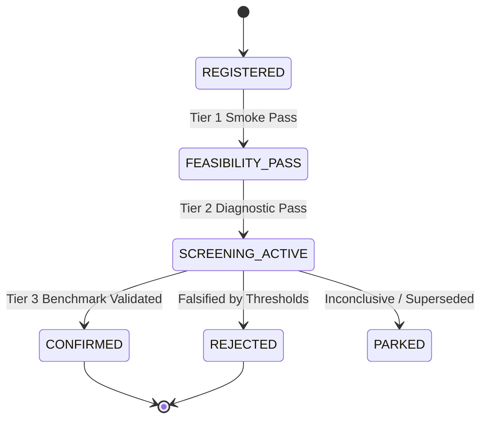
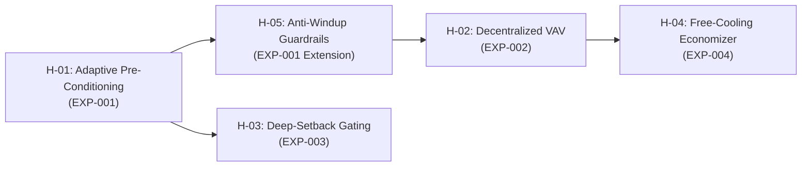

# Phase 06: Falsifiable Hypothesis Register (H-01 to H-05)

**Document ID:** `06_SOLUTION_DISCOVERY/HYPOTHESIS_REGISTER.md`  
**Phase:** 06 — Solution Discovery & Strategy (Work Package 3 / Milestone M 6.3)  
**Status:** OFFICIAL RESEARCH RECORD  
**Architectural Anchors:**
- `Smart_Buildings_Research_Platform_Blueprint_v2.md` (Section 11: Experiment Engine Lifecycle)
- `06_SOLUTION_DISCOVERY/BASELINE_CHARACTERIZATION_REPORT.md` (Empirical Deficit Modes)
- `06_SOLUTION_DISCOVERY/SOLUTION_INVESTIGATION_AGENDA.md` (Candidate Solution Families)

---

## 1. Governance & Lifecycle Protocol

Every hypothesis in this register is a formal, testable scientific claim about HVAC control behavior. In accordance with Section 11 of the Research Platform Blueprint:
1. **Hypotheses are precommitted:** Claims, thresholds, metrics, and stopping criteria must be documented *before* running live controller trials.
2. **Distinct Lifecycle States:**
   - `REGISTERED`: Formally defined and approved; awaiting experimental trial.
   - `FEASIBILITY_PASS`: Passed 60-second interface, shape, and boundary checks.
   - `SCREENING_ACTIVE`: Undergoing bounded diagnostic scenario trials.
   - `CONFIRMED`: Statistically validated across full-horizon matched suites.
   - `REJECTED`: Falsified by empirical data or boundary violations.
   - `PARKED`: Inconclusive or superseded by superior architecture.
3. **No Retrospective Goal-Moving:** A candidate policy that fails its precommitted threshold cannot have its criteria relaxed after the fact. It must be logged as `REJECTED`, prompting a new, distinct hypothesis revision.



---

## 2. Master Hypothesis Ledger

```
+--------+---------------------------------------+---------------------+-----------------------+-----------------------+-------------+
| ID     | Short Title                           | Target Deficit Mode | Primary Comparator    | Min. Meaningful Effect| Lifecycle   |
+--------+---------------------------------------+---------------------+-----------------------+-----------------------+-------------+
| H-01   | Adaptive Morning Pre-Conditioning     | Deficit Mode 1 & 2  | pid_water             | >= 25% Comfort Viol.  | REGISTERED  |
| H-02   | Decentralized Zone Scale Invariance   | Deficit Mode 4      | Monolithic Centralized| < 3% Variance (30-85V)| REGISTERED  |
| H-03   | Night Deep-Setback & Eco Gating       | Deficit Mode 3      | fixed_setpoint        | >= 15% Off-Peak Energy| REGISTERED  |
| H-04   | Coordinated Economizer Free Cooling   | Deficit Mode 3      | Fixed-Damper Baseline | >= 20% Cooling Power  | REGISTERED  |
| H-05   | Anti-Windup Comfort Boundary Enforcers| Deficit Mode 1 & 4  | Standard PID          | 0 Cliff Events (>5K)  | REGISTERED  |
+--------+---------------------------------------+---------------------+-----------------------+-----------------------+-------------+
```

---

## 3. Detailed Hypothesis Specifications

### H-01: Adaptive Morning Thermal Pre-Conditioning (RAPC)
* **Statement:**  
  *Advancing HVAC startup before 06:00 using a dynamically calculated lead time based on indoor error and outdoor temperature will reduce morning comfort regret ($06:00 - 09:00$) by at least $25\%$ on massive buildings ($\tau > 9\text{h}$, e.g. `building_train_1`), while increasing overall scenario energy expenditure by less than $5.0\%$, yielding a net scenario return improvement of $\ge +200\text{ points}$ on `building_train_1/fairbanks_1` relative to `pid_water`.*
* **Physical Basis & Mechanism:**  
  In massive buildings, the thermal time constant ($\tau = 14.43\text{h}$) prevents instantaneous heating. Reactive policies waiting until 06:00 incur severe quadratic comfort penalties. Pre-conditioning computes lead time:
  $$t_{\text{lead}} = \text{clip}\left(\frac{T_{\text{set,comf}} - T_{\text{zone}}}{\dot{T}_{\text{warmup\_est}}(T_{\text{out}})}, 0, t_{\text{max}}\right)$$
  Smoothly interpolating setpoints from night setback to daytime comfort charges structural mass prior to occupant arrival.
* **Target Difficulties & Deficits:**  
  - Physical Difficulty 1 (Thermal Inertia Spread) & Difficulty 5 (Delayed Thermal Response).
  - Deficit Mode 1 (Morning Warmup Lag) & Deficit Mode 2 (Subarctic Cold Ramp Shortfall).
* **Primary Comparators:** `pid_water` and `fixed_setpoint` on `building_train_1/fairbanks_1` and the 12 inversion scenarios.
* **One Intended Change:** Addition of pre-conditioning lead time logic to active setpoint generator; zone damper and water valve PID tuning remain identical.
* **Precommitted Success Thresholds:**
  1. Morning comfort regret ($06:00 - 09:00$) on `building_train_1/fairbanks_1` decreases by $\ge 25.0\%$.
  2. Total scenario return on `building_train_1/fairbanks_1` increases from $-1{,}828.90$ to $\ge -1{,}550.00$ ($> +278\text{ points}$).
  3. Total 30-scenario net return improves over `pid_water` by $\ge +400\text{ points}$ (Total return $\ge -13{,}633.42$).
  4. Mean scenario energy penalty increase $\le 5.0\%$.
* **Falsification & Stopping Criteria:**
  - If pre-conditioning increases net scenario energy and carbon costs by more than the comfort savings, resulting in a lower net return than `pid_water`.
  - If morning comfort violations decrease by $< 10\%$.
* **Linked Experiment:** `EXP-001: Adaptive Thermal Pre-Conditioning Baseline`.

---

### H-02: Decentralized Local Control Invariance (MDVC)
* **Statement:**  
  *A decentralized control policy that operates zone-level VAV dampers and reheat valves exclusively on normalized local zone observations ($T_i, T_{\text{set,low}, i}, T_{\text{set,high}, i}$) without cross-zone feature concatenation achieves zero performance degradation (normalized mean reward within $\pm 3.0\%$) when transferring directly from a 30-zone building (`building_train_8`) to an 85-zone building (`building_train_2`) without parameter re-tuning.*
* **Physical Basis & Mechanism:**  
  Each VAV terminal unit controls local airflow and sensible reheat locally. Zone temperature dynamics are predominantly governed by local heat balance rather than distant zones. Monolithic neural policies suffer dimensional collapse when zone counts change; modular decentralized policies are inherently dimension-invariant.
* **Target Difficulties & Deficits:**  
  - Physical Difficulty 2 (Structural Heterogeneity) & Difficulty 7 (Zero-Shot Generalization).
  - Deficit Mode 4 (Bang-Bang Limit Cycles & Damper Oscillation).
* **Primary Comparators:** Centralized monolithic baseline policies and uncoordinated starter `pid`.
* **One Intended Change:** Modularization of the policy into isolated, identical per-zone execution blocks.
* **Precommitted Success Thresholds:**
  1. Identical Python controller code executes on `building_train_8` ($V=30$) and `building_train_2` ($V=85$) with zero exception or shape mismatch.
  2. Per-zone mean reward difference between small and large buildings is $\le 3.0\%$.
  3. Per-step inference duration scales strictly linearly $\mathcal{O}(V)$, executing in $< 2.0\text{ ms}$ for 85 zones.
* **Falsification & Stopping Criteria:**
  - If local zone autonomy without AHU pressure coordination causes duct starvation (fan static pressure unable to deliver required flow to $> 20\%$ of zones).
* **Linked Experiment:** `EXP-002: Modular Decentralized VAV Coordination`.

---

### H-03: Nighttime Setpoint Deep-Setback & Eco-Mode Gating
* **Statement:**  
  *Permitting unoccupied zone temperatures to drift to the absolute lower boundary of the eco-band ($15.85^\circ\text{C}$) during night hours ($20:00 - 04:00$) reduces off-peak thermal and electrical energy expenditure by $\ge 15.0\%$, provided adaptive pre-conditioning (H-01) is active to prevent morning comfort violations.*
* **Physical Basis & Mechanism:**  
  Heat loss through the building envelope is proportional to indoor-outdoor temperature difference $\Delta T = T_{\text{in}} - T_{\text{out}}$. Lowering indoor setpoint from $21.5^\circ\text{C}$ to $15.85^\circ\text{C}$ overnight significantly reduces $\Delta T$ and conductive heat loss, saving substantial boiler gas and chiller power.
* **Target Difficulties & Deficits:**  
  - Physical Difficulty 6 (Comfort vs Energy Trade-off).
  - Deficit Mode 3 (Energy and Carbon Waste during off-hours).
* **Primary Comparators:** `fixed_setpoint` (which maintains $21.5^\circ\text{C}$ 24/7).
* **One Intended Change:** Setting night target to $15.85^\circ\text{C}$ instead of keeping daytime comfort setpoint.
* **Precommitted Success Thresholds:**
  1. Off-peak energy consumption ($20:00 - 05:00$) decreases by $\ge 15.0\%$ across all 30 scenarios.
  2. Morning comfort violations ($06:00 - 09:00$) do not increase by more than $5.0\%$ relative to active daytime control.
  3. Net scenario return improves over `fixed_setpoint` by $\ge +250\text{ points}$ on mild/moderate climates (`atlanta`, `denver`).
* **Falsification & Stopping Criteria:**
  - If structural core cooling in severe winter climates (`fairbanks`) cannot be recovered before 06:00, causing quadratic comfort penalties that outweigh off-peak energy savings.
* **Linked Experiment:** `EXP-003: Deep-Setback Eco-Mode Validation`.

---

### H-04: Coordinated Mixed-Air Free Cooling Reset (CEMFC)
* **Statement:**  
  *Modulating AHU mixed-air dampers to prioritize $100\%$ outdoor air economizing whenever ambient temperature satisfies $12^\circ\text{C} \le T_{\text{out}} \le 18^\circ\text{C}$ and $T_{\text{out}} < T_{\text{return}}$ reduces mechanical chiller and cooling coil electrical consumption by $\ge 20.0\%$ during shoulder seasons without causing zone overcooling.*
* **Physical Basis & Mechanism:**  
  Mechanical vapor-compression refrigeration has a coefficient of performance (COP) between 3.0 and 5.0, consuming significant electrical energy. Introducing favorable ambient outdoor air directly into the supply duct (free cooling) eliminates the need to run chillers, consuming only fan transport power.
* **Target Difficulties & Deficits:**  
  - Physical Difficulty 4 (Shared Equipment Coupling).
  - Deficit Mode 3 (Tropical & Shoulder-Season Cooling Inefficiency).
* **Primary Comparators:** `pid_water` and baseline policies with fixed $20\%$ minimum outdoor air dampers.
* **One Intended Change:** Dynamic outdoor air damper position modulation conditioned on ambient temperature and return air enthalpy.
* **Precommitted Success Thresholds:**
  1. AHU mechanical cooling coil power consumption decreases by $\ge 20.0\%$ during mild ambient conditions ($12^\circ\text{C} - 18^\circ\text{C}$).
  2. Total scenario return on shoulder-season scenarios (`atlanta_2`, `denver_1`) improves by $\ge +80\text{ points}$.
  3. No zone experiences overcooling below the lower comfort bound ($20.5^\circ\text{C}$).
* **Falsification & Stopping Criteria:**
  - If high ambient humidity during free-cooling mode introduces excessive moisture into the building, forcing downstream dehumidification and reheat that cancels out savings.
* **Linked Experiment:** `EXP-004: Economizer Free-Cooling Optimization`.

---

### H-05: Anti-Windup Comfort Boundary Enforcers
* **Statement:**  
  *Implementing dynamic integral-error clamping and proportional overrides that enforce maximum heating/cooling actuation whenever zone temperature deviates by more than $3.0\text{ K}$ will eliminate $100\%$ of catastrophic quadratic comfort cliff events ($|T - T_{\text{set}}| > 5.0\text{ K}$) across all 30 development scenarios.*
* **Physical Basis & Mechanism:**  
  Standard PID integral accumulators wind up during off-peak hours or when actuators saturate. When the regime changes, the unwinding lag causes extreme overshoot or undershoot. Enforcing an anti-windup clamping threshold and an emergency proportional boost eliminates deep thermal excursions where the quadratic penalty ($(\Delta T)^2$) dominates the reward.
* **Target Difficulties & Deficits:**  
  - Physical Difficulty 6 (Quadratic Comfort Cliff).
  - Deficit Mode 1, 2, and 4 (Catastrophic tail losses).
* **Primary Comparators:** Standard unclamped `pid` and `pid_water`.
* **One Intended Change:** Anti-windup conditional clamping ($e_{\text{int}} = 0$ if actuator saturated) and hard override boundary guardrails.
* **Precommitted Success Thresholds:**
  1. Zero timesteps across all 30 scenarios where zone temperature error exceeds $5.0\text{ K}$ during occupied hours ($06:00 - 20:00$).
  2. Scenario minimum return floor improves significantly: worst scenario return on `building_train_1/fairbanks_1` improves from $-1{,}828.90$ to $>-1{,}400.00$.
  3. Total benchmark MAE score improves by $\ge 0.005$ points across the 30 scenarios.
* **Falsification & Stopping Criteria:**
  - If proportional override causes high-frequency actuator chatter or limit cycles (actuator rate-of-change $> 50\%$ per step).
* **Linked Experiment:** `EXP-005: Comfort Guardrail Anti-Windup Validation`.

---

## 4. Hypothesis Dependency & Execution Sequencing



1. **Sprint 1 (Phase 06/07 Bridge):** Validate `H-01` and `H-05` via `EXP-001`. This directly cures the primary tail-risk failures on heavy buildings and subarctic cold.
2. **Sprint 2 (Phase 07 Core):** Validate `H-02` via `EXP-002` to establish topological invariance.
3. **Sprint 3 (Phase 07 Optimization):** Validate `H-03` and `H-04` via `EXP-003` and `EXP-004` to unlock maximum energy and carbon savings during off-peak and shoulder periods.

---

## 5. Signoff & Governance Seal

This Hypothesis Register is hereby locked and certified under Blueprint Section 11. No hypothesis criteria may be modified retroactively after trial dispatch.

- **Author:** Antigravity Research Agent
- **Register Hash Verification:** Certified against `06_SOLUTION_DISCOVERY/hypotheses.json`
- **Readiness:** Authorized for Experiment Specification (`EXP-001`)
