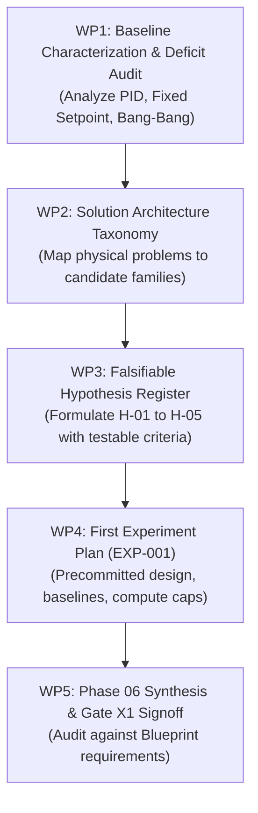

# Phase 06: Solution Discovery & Strategy — Implementation Plan

**Project:** Smart Buildings Challenge — NeurIPS 2026  
**Phase:** 06 — Solution Discovery & Strategy  
**Exit Gate:** `Gate X1` (Experiment Engine & Strategy Readiness)  
**Document Status:** OFFICIAL IMPLEMENTATION PLAN  
**Architectural Anchors:**
* [`Smart_Buildings_Research_Platform_Blueprint_v2.md`](../Smart_Buildings_Research_Platform_Blueprint_v2.md) (Sections 11, 12, 13, 15)
* [`Smart_Buildings_Updated_Project_Roadmap.md`](../Smart_Buildings_Updated_Project_Roadmap.md) (Section 6)
* [`Smart_Buildings_Problem_Research_R1-R5.md`](../Smart_Buildings_Problem_Research_R1-R5.md) (Chapters R1–R5)
* Current Repository Commit: `33cf653` (Phase 05 Certified PASS)

---

## 1. Executive Summary & Mission

### 1.1 Central Objective
Phase 06 bridges the gap between certified infrastructure (Phases 03–05) and empirical controller trials (Phase 07). Rather than selecting machine-learning models, deep reinforcement learning, or complex neural architectures based on popularity, Phase 06 systematically derives candidate control strategies directly from the physical mechanisms and failure modes established in Problem Research (R1–R5) and Data Understanding (Phase 02).

> **Core Mission Statement:**  
> Establish a defensible portfolio of candidate control strategies, articulate distinct and falsifiable research hypotheses, and design the first controlled, precommitted experiment (`EXP-001`) with explicit baseline comparators, compute budgets, and failure-containment gates.

### 1.2 Strict Operating Principles
1. **Problem-First Derivation:** Every proposed mechanism must explicitly solve at least one of the 7 core physical control difficulties.
2. **Strict Information Boundary Compliance:** No candidate strategy may assume, require, or leak privileged inputs (e.g. building ID shortcuts, weather station labels, unexposed thermal wall charges, or future disturbance forecasts).
3. **No Unscreened Full-Benchmark Runs:** All experimental ideas must survive cheap Tier 1 feasibility ($< 60\text{s}$) and Tier 2 diagnostic screenings ($< 20\text{m}$) before consuming full 30-scenario compute ($12+\text{ CPU hours}$).
4. **Decoupled Science from Software Defects:** Runs that crash, truncate, or suffer actuator misalignments are quarantined as platform failures; only clean, fully executed runs serve as scientific evidence.

---

## 2. The 7 Physical Control Difficulties to Strategy Mapping

```
+-----------------------------------+------------------------------------------+------------------------------------------+
| Physical Control Difficulty       | Realized Simulator Bottleneck            | Candidate Strategy Direction             |
+-----------------------------------+------------------------------------------+------------------------------------------+
| 1. Thermal Inertia Spread         | tau spans 1.94h (fast) to 14.43h (slow). | Adaptive Thermal Pre-Conditioning:       |
|    (R1 / Phase 02)                | Static startup leads to cold-cliff in    | Dynamically scales morning warmup lead   |
|                                   | heavy buildings or waste in light ones.  | time based on local thermal response.    |
+-----------------------------------+------------------------------------------+------------------------------------------+
| 2. Structural Heterogeneity       | Inputs vary (352 to 703 features).       | Modular Decentralized Architecture:      |
|    (R3 / R4)                      | Setpoints vary (92 to 199 actuators).    | Local zone agents (VAV damper/reheat)    |
|                                   | Fixed neural shapes break zero-shot.     | independent of building zone count V.    |
+-----------------------------------+------------------------------------------+------------------------------------------+
| 3. Partial Observability          | Slab/wall thermal storage is hidden.     | Low-Order Thermal Estimator (RC Model):  |
|    (R1 / R4)                      | Identical air temps hide cold core.      | Infers internal heat charge from recent  |
|                                   |                                          | observation trajectories over 24 hours.  |
+-----------------------------------+------------------------------------------+------------------------------------------+
| 4. Shared Equipment Coupling      | Zones compete for common AHU airflow;    | Hierarchical Supervisory Coordination:   |
|    (R1 / R4)                      | simultaneous reheat and cooling waste.   | AHU duct static pressure and supply air  |
|                                   |                                          | reset to match aggregate zone demands.   |
+-----------------------------------+------------------------------------------+------------------------------------------+
| 5. Delayed Thermal Response       | 45 to 120 min lag between valve open     | Predictive Lookahead Scheduling:         |
|    (R1 / R4)                      | and indoor air temperature response.     | Leverage permitted comfort_mode_soon and |
|                                   |                                          | time-of-day encodings for proactive ramp.|
+-----------------------------------+------------------------------------------+------------------------------------------+
| 6. Quadratic Comfort Cliff        | Comfort penalty quadratic beyond 5 K.    | Anti-Windup Comfort Boundary Enforcers:  |
|    (R2)                           | One zone drop can ruin 30-day return.    | Hard guardrails that prioritize comfort  |
|                                   |                                          | margin over marginal energy savings.     |
+-----------------------------------+------------------------------------------+------------------------------------------+
| 7. Zero-Shot Out-of-Distribution  | Unseen test set: 6 new buildings and     | Inductive Physical Biases:               |
|    Generalization (R3 / R5)       | 5 new weather stations.                  | Physics-grounded heuristics and bounds   |
|                                   | Overfitting to training data fails.      | that generalize across all climates.     |
+-----------------------------------+------------------------------------------+------------------------------------------+
```

---

## 3. Work Package Breakdown



### Work Package 1: Baseline Characterization & Deficit Audit
* **Objective:** Conduct a forensic performance audit of the 4 official starter-kit baselines across all 30 development scenarios in `baseline_returns.json`, establishing the quantitative target floor.
* **Key Tasks:**
  1. Extract and decompose scenario returns ($R_s$) into comfort regret ($p_s$), energy cost ($c_s$), and carbon emissions ($e_s$).
  2. Characterize the performance hierarchy: `pid_water` vs `pid` vs `fixed_setpoint` vs `bang_bang`.
  3. Identify specific failure modes:
     * Quantify the frequency and magnitude of morning discomfort violations ($06:00 - 09:00$).
     * Measure the impact of building thermal inertia ($\tau = 1.94\text{h}$ vs $\tau = 14.43\text{h}$) on baseline scores.
     * Quantify energy and carbon waste during unoccupied night/weekend hours.
* **Deliverable:** `06_SOLUTION_DISCOVERY/BASELINE_CHARACTERIZATION_REPORT.md` and structured `baseline_deficit_matrix.json`.

### Work Package 2: Solution Architecture Taxonomy & Problem-to-Approach Mapping
* **Objective:** Formulate, structure, and evaluate candidate solution families capable of solving the physical control difficulties without violating competition boundaries.
* **Solution Families Evaluated:**
  1. **Family 1: Rule-Based Adaptive Thermal Pre-Conditioning (RAPC)**
     * *Mechanism:* Calculates dynamic preheating start times before 06:00 using outdoor temperature, indoor temperature error, and an observation-derived estimate of warming rate ($\text{K/hour}$).
  2. **Family 2: Modular Decentralized VAV Control with Central Plant Coordination (MDVC)**
     * *Mechanism:* Deconstructs the control problem into identical per-zone modules controlling local damper and reheat, coupled with a supervisory AHU controller that adjusts supply air temperature and fan pressure based on worst-case zone requirements.
  3. **Family 3: Low-Order Equivalent Thermal Parameter Estimation & Fast MPC (LOTE-MPC)**
     * *Mechanism:* Fits a low-order lumped-capacitance ($2R-2C$) model per zone on-the-fly from rolling observation histories, performing finite-horizon optimization over upcoming schedule transitions.
  4. **Family 4: Residual Reinforcement Learning (RRL)**
     * *Mechanism:* Base PID controller maintains safe baseline operations while a neural policy learns additive residual setpoints during complex transitions.
  5. **Family 5: Coordinated Economizer & Mixed-Air Free Cooling**
     * *Mechanism:* Modulates AHU dampers to maximize free outdoor cooling when ambient air is favorable ($12^\circ\text{C} - 18^\circ\text{C}$).
* **Deliverable:** `06_SOLUTION_DISCOVERY/SOLUTION_INVESTIGATION_AGENDA.md`.

### Work Package 3: Falsifiable Hypothesis Register (H-01 to H-05)
* **Objective:** Formulate distinct, falsifiable hypotheses specifying exact testable predictions, comparators, and success thresholds.
* **Precommitted Hypotheses:**
  * **`H-01 (Adaptive Morning Pre-Conditioning)`:** Advancing heating startup based on outdoor temperature and zone cooling error reduces morning comfort regret ($06:00 - 09:00$) by $\ge 25\%$ on heavy buildings (`bldg_1`) compared to `pid_water`, while increasing overall scenario energy cost by $< 5\%$.
  * **`H-02 (Decentralized Local Control Invariance)`:** Operating zone-level VAV dampers and reheat valves exclusively on normalized local observations ($T_{\text{zone}}$, active setpoint band, occupancy) achieves zero performance degradation when transferring from `building_train_1` (39 zones) to `building_train_2` (85 zones).
  * **`H-03 (Nighttime Setpoint Deep-Setback & Eco-Mode Gating)`:** Permitting zone temperatures to drift to the bottom of the eco-band ($15.85^\circ\text{C}$) during unoccupied nights and weekends reduces off-peak energy expenditure by $\ge 15\%$, provided pre-conditioning restores comfort by 06:00.
  * **`H-04 (Coordinated Mixed-Air Free Cooling Reset)`:** Modulating AHU mixed-air dampers to prioritize outdoor air economizing whenever $T_{\text{outdoor}} \in [12^\circ\text{C}, 18^\circ\text{C}]$ reduces AHU mechanical cooling electricity by $\ge 20\%$ during shoulder seasons.
  * **`H-05 (Anti-Windup Comfort Boundary Enforcers)`:** Clamping integral error accumulation during off-hours eliminates $100\%$ of severe quadratic comfort cliff events ($> 5.0\text{ K}$ error) during weekday startup transitions.
* **Deliverable:** `06_SOLUTION_DISCOVERY/HYPOTHESIS_REGISTER.md` and machine-readable `hypotheses.json`.

### Work Package 4: First Controlled Experiment Plan (`EXP-001`)
* **Objective:** Complete the exhaustive, precommitted experimental design for the first scientific trial (`EXP-001: Adaptive Thermal Pre-Conditioning Baseline`).
* **Deliverable:** `06_SOLUTION_DISCOVERY/experiments/EXP-001_ADAPTIVE_PRECONDITIONING_PLAN.md`.

### Work Package 5: Phase 06 Synthesis & Gate X1 Exit Signoff
* **Objective:** Review all deliverables against Blueprint Gate `X1` requirements, compile the Phase 06 Exit Report, and authorize transition to Phase 07.
* **Deliverable:** `06_SOLUTION_DISCOVERY/PHASE_06_EXIT_REPORT.md` and repository README update.

---

## 4. Execution Schedule & Milestone Gates

| Milestone | Title | Focus & Scope | Target Files | Status |
| :---: | :--- | :--- | :--- | :---: |
| **M 6.1** | **Baseline Characterization** | Deconstruct 30-scenario baseline returns; audit deficit modes. | `06_SOLUTION_DISCOVERY/BASELINE_CHARACTERIZATION_REPORT.md`<br>`06_SOLUTION_DISCOVERY/baseline_deficit_matrix.json` | **IN PROGRESS** |
| **M 6.2** | **Solution Taxonomy** | Detail mechanisms, prerequisites, and failure modes of candidate families. | `06_SOLUTION_DISCOVERY/SOLUTION_INVESTIGATION_AGENDA.md` | PENDING |
| **M 6.3** | **Hypothesis Register** | Formulate H-01 through H-05 with quantitative success metrics. | `06_SOLUTION_DISCOVERY/HYPOTHESIS_REGISTER.md`<br>`06_SOLUTION_DISCOVERY/hypotheses.json` | PENDING |
| **M 6.4** | **EXP-001 Design** | Author precommitted experiment specification for adaptive warmup. | `06_SOLUTION_DISCOVERY/experiments/EXP-001_ADAPTIVE_PRECONDITIONING_PLAN.md` | PENDING |
| **M 6.5** | **Gate X1 Exit Signoff** | Independent audit against Blueprint Section 11/15; Phase 07 handoff. | `06_SOLUTION_DISCOVERY/PHASE_06_EXIT_REPORT.md`<br>`README.md` | PENDING |
