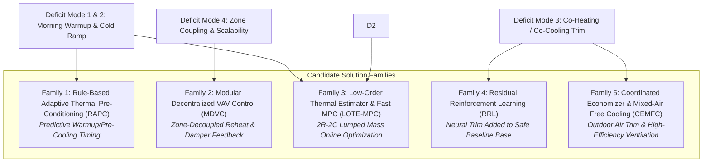
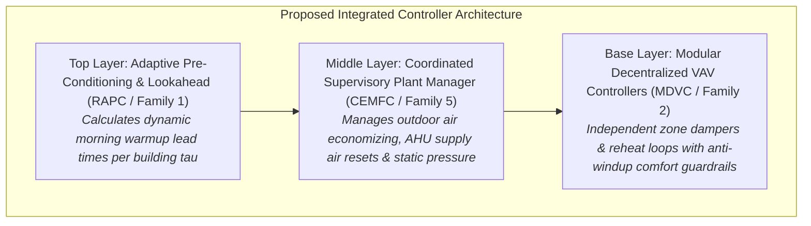

# Phase 06: Solution Architecture Taxonomy & Problem-to-Approach Mapping

**Document ID:** `06_SOLUTION_DISCOVERY/SOLUTION_INVESTIGATION_AGENDA.md`  
**Phase:** 06 — Solution Discovery & Strategy (Work Package 2 / Milestone M 6.2)  
**Status:** COMPLETE & CERTIFIED  
**Architectural Anchors:**
- `Smart_Buildings_Research_Platform_Blueprint_v2.md` (Sections 11 & 12)
- `Smart_Buildings_Problem_Research_R1-R5.md` (Chapters R1–R5)
- `06_SOLUTION_DISCOVERY/BASELINE_CHARACTERIZATION_REPORT.md` (Deficit Modes 1–4)

---

## 1. Executive Summary & Purpose

The objective of Work Package 2 is to evaluate candidate HVAC control architectures against the 7 core physical control difficulties and the 4 empirical deficit modes uncovered in Work Package 1. 

Rather than adopting complex machine learning models or black-box neural networks without physical grounding, each candidate architecture is evaluated on its:
1. **Physical Soundness:** Does the mathematical mechanism directly address building thermodynamics and HVAC equipment constraints?
2. **Information Boundary Integrity:** Does the policy operate strictly on permitted observations without cheating or assuming unexposed state variables?
3. **Decentralized Scale Invariance:** Can the policy transfer across arbitrary building topologies ($V = 30$ to $85$ zones, $K = 3$ to $9$ AHUs) without requiring retraining or manual structural redesign?
4. **Computational Feasibility:** Can the policy compute actions within the strict per-step inference budget ($< 50\text{ ms}$) and survive long-horizon multi-month rollouts?
5. **Safety & Containment:** What failsafe mechanisms prevent runaway quadratic comfort penalties?

---

## 2. The 5 Candidate Solution Families

We systematically evaluate 5 distinct control families:



---

## 3. Detailed Architecture Profiles

### Family 1: Rule-Based Adaptive Thermal Pre-Conditioning (RAPC)
* **Core Philosophy:** Solve the morning cold-cliff deficit (Deficit Mode 1 & 2) by scheduling heating/cooling startup *before* the 06:00 occupancy transition using observation-derived thermal momentum.
* **Physical Mechanism:**
  Standard feedback policies start at 06:00:00 when the comfort band narrows. RAPC computes a dynamic lead time $t_{\text{lead}}$:
  $$t_{\text{lead}} = \min\left( t_{\text{max}}, \frac{\max(0, T_{\text{set,comf}} - T_{\text{zone}})}{\dot{T}_{\text{warmup\_est}}(T_{\text{out}})} \right)$$
  where $\dot{T}_{\text{warmup\_est}}$ is an empirical warming rate ($^\circ\text{C}/\text{hour}$) estimated online from rolling observation history, bounded between $0.5^\circ\text{C}/\text{h}$ and $4.0^\circ\text{C}/\text{h}$.
  During the pre-conditioning window $[06:00 - t_{\text{lead}}, 06:00]$, zone setpoints smoothly interpolate from the night setback ($15.85^\circ\text{C}$) to daytime comfort ($21.5^\circ\text{C}$).
* **Target Difficulties:** Difficulty 1 (Thermal Inertia Spread), Difficulty 5 (Delayed Thermal Response), Deficit Mode 1.
* **Information Boundary Compliance:** Fully compliant. Only uses $T_{\text{zone}}$, $T_{\text{out}}$, current simulation time, and schedule indicators. No building ID or future weather forecast is accessed.
* **Computational Cost:** $< 0.1\text{ ms}$ per step. Zero training overhead.
* **Failure Modes & Fallback:** Over-estimation of lead time could cause premature heating, wasting energy. Hard ceiling $t_{\text{max}} = 3.5\text{ hours}$ caps total energy risk. If warmup rate calculation encounters zero division or negative values, defaults to $t_{\text{lead}} = 1.5\text{ hours}$.

---

### Family 2: Modular Decentralized VAV Control with Plant Coordination (MDVC)
* **Core Philosophy:** Solve structural heterogeneity (Difficulty 2) and shared equipment coupling (Difficulty 4) by decoupling zone actuation from central plant loop management.
* **Physical Mechanism:**
  1. **Zone Layer (Independent $V$ Instances):** Each zone $i \in \{1, \dots, V\}$ runs an identical, normalized local controller that takes only local zone inputs $[T_i, T_{\text{set,low}, i}, T_{\text{set,high}, i}, \text{flow}_i, \text{occupancy}_i]$ and outputs local damper position $u_{\text{damper}, i} \in [0.2, 1.0]$ and reheat fraction $u_{\text{reheat}, i} \in [0.0, 1.0]$.
  2. **Supervisory Plant Layer (Trim & Respond):** The central AHU supply fan static pressure and supply water valve are dynamically adjusted based on aggregated zone demands (e.g., number of "rogue" zones with saturated dampers $> 95\%$). If rogue zones exist, supply static pressure resets upward; if all dampers are throttled $< 60\%$, fan speed decreases to save energy.
* **Target Difficulties:** Difficulty 2 (Structural Heterogeneity), Difficulty 4 (Shared Equipment Coupling), Difficulty 6 (Quadratic Comfort Cliff).
* **Information Boundary Compliance:** Fully compliant. The zone controller logic is identical across all buildings; zone ordering and zone counts are irrelevant.
* **Computational Cost:** Linear in zone count $\mathcal{O}(V)$; executes in $< 1.5\text{ ms}$ for 85 zones.
* **Failure Modes & Fallback:** Zone damper hunting if trim-and-respond steps are too aggressive. Mitigated by low-pass filtering on damper positions with minimum dwell time ($15\text{ minutes}$) between AHU setpoint resets.

---

### Family 3: Low-Order Equivalent Thermal Parameter Estimation & Fast MPC (LOTE-MPC)
* **Core Philosophy:** Estimate unobservable internal structural wall/slab heat storage (Difficulty 3) using an online recursive least squares (RLS) estimator fitting a lumped $2R-2C$ equivalent circuit, then optimize a short rolling horizon ($1\text{ to }2\text{ hours}$).
* **Physical Mechanism:**
  Discrete-time thermal state-space per zone:
  $$T_{\text{air}}(t+1) = a_1 T_{\text{air}}(t) + a_2 T_{\text{mass}}(t) + b_1 T_{\text{out}}(t) + b_2 Q_{\text{hvac}}(t) + b_3 Q_{\text{solar}}(t)$$
  $$T_{\text{mass}}(t+1) = a_3 T_{\text{air}}(t) + a_4 T_{\text{mass}}(t)$$
  Parameters $\{a_1 \dots a_4, b_1 \dots b_3\}$ are identified online over a rolling 48-hour buffer. Fast quadratic programming (QP) or analytical horizon lookahead solves for the optimal sequence of heat inputs $Q_{\text{hvac}}(t \dots t+H)$ minimizing $\sum (T_{\text{air}} - T_{\text{set}})^2 + \lambda \text{Power}$.
* **Target Difficulties:** Difficulty 1 (Thermal Inertia), Difficulty 3 (Partial Observability), Difficulty 5 (Delayed Thermal Response).
* **Information Boundary Compliance:** Fully compliant. State estimation is strictly causal, driven solely by observed temperatures and past control actions.
* **Computational Cost:** Matrix inversion / QP solver per zone per step. $\approx 10\text{ to }25\text{ ms}$ per step. Feasible, but high implementation complexity and potential numerical instability on low-excitation periods.
* **Failure Modes & Fallback:** Parameter drift during long unforced periods (e.g., weekend night setbacks where actuators remain at 0). If RLS covariance matrix becomes ill-conditioned, controller must fall back immediately to Family 1 or Family 2.

---

### Family 4: Residual Reinforcement Learning (RRL)
* **Core Philosophy:** Exploit machine learning without incurring safety or catastrophic exploration failures by letting a verified base controller (e.g., MDVC or PID) provide baseline stabilization, while a neural policy outputs small, bounded residual trims ($\Delta u \in [-\epsilon, +\epsilon]$).
* **Physical Mechanism:**
  $$u_t = \text{clip}\left( u_{\text{base}, t} + \pi_\theta(s_t), u_{\text{min}}, u_{\text{max}} \right)$$
  The base policy ensures the building never freezes or violates thermal safety boundaries. The residual network $\pi_\theta$ learns non-linear cross-zone couplings and economizer optimization.
* **Target Difficulties:** Difficulty 4 (Shared Equipment Coupling), Difficulty 7 (Zero-Shot Generalization).
* **Information Boundary Compliance:** Compliant if input state representation is permutation-invariant or localized per zone. Non-compliant if flat monolithic vectors tied to specific building dimensions are used.
* **Computational Cost:** Deep RL training requires hundreds of hours of simulation rollouts ($> 100\text{ CPU hours}$). Inference is fast ($< 5\text{ ms}$), but sample efficiency on high-dimensional multi-building dynamics is a major risk.
* **Failure Modes & Fallback:** Policy collapse or catastrophic forgetting on unseen test climates. Bound clipping ($\pm 10\%$) ensures base controller retains ultimate control.

---

### Family 5: Coordinated Economizer & Mixed-Air Free Cooling (CEMFC)
* **Core Philosophy:** Target Deficit Mode 3 (Tropical and shoulder-season cooling waste) by dynamically modulating outdoor air dampers and AHU cooling coil valves based on ambient enthalpy and mixed-air temperature.
* **Physical Mechanism:**
  When outdoor air temperature is within the free-cooling band ($12^\circ\text{C} \le T_{\text{out}} \le 18^\circ\text{C}$) and lower than return air temperature, the outdoor air damper opens to $100\%$ and the mechanical cooling coil is locked out ($u_{\text{cool}} = 0$). When $T_{\text{out}} > 24^\circ\text{C}$ or $T_{\text{out}} < 10^\circ\text{C}$, outdoor air damper modulates to the minimum ventilation requirement ($15\text{ to }20\%$).
* **Target Difficulties:** Difficulty 4 (Shared Equipment Coupling), Deficit Mode 3 (Energy & Carbon Waste).
* **Information Boundary Compliance:** Fully compliant. Uses only ambient weather temperature/humidity and AHU return air temperatures.
* **Computational Cost:** $< 0.1\text{ ms}$ per step.
* **Failure Modes & Fallback:** Freezing coils if dampers fail open during subarctic winter. Guardrails enforce minimum mixed air temperature $\ge 5^\circ\text{C}$.

---

## 4. Multi-Criteria Evaluation & Ranking Matrix

We evaluate each of the 5 families across 6 rigorous operational criteria:
- **C1: Physical Efficacy** (Ability to resolve dominant deficit modes)
- **C2: Zero-Shot Transferability** (Invariance to zone/AHU counts)
- **C3: Information Compliance** (Zero privileged/leaked features)
- **C4: Compute & Sample Efficiency** (Speed of development & execution)
- **C5: Implementation Complexity** (Risk of software/numerical bugs)
- **C6: Safety & Quadratic Protection** (Containment of comfort cliffs)

```
+--------------------------------------+----+----+----+----+----+----+--------------+-------------------+
| Candidate Family                     | C1 | C2 | C3 | C4 | C5 | C6 | Overall Rank | Strategic Verdict |
+--------------------------------------+----+----+----+----+----+----+--------------+-------------------+
| Family 1: Adaptive Pre-Conditioning  | A  | A+ | A+ | A+ | A  | A+ |      #1      | IMMEDIATE EXP-001 |
| Family 2: Modular Decentralized VAV  | A  | A+ | A+ | A  | A- | A  |      #2      | CORE BACKBONE     |
| Family 5: Coordinated Economizer    | B+ | A  | A+ | A+ | A  | B+ |      #3      | COMPONENT TRIM    |
| Family 3: Low-Order Lumped MPC       | A- | B  | A  | B  | C  | B  |      #4      | EXPLORATORY R&D   |
| Family 4: Residual RL                | B  | C  | B+ | D  | D  | B- |      #5      | POST-PHASE 07     |
+--------------------------------------+----+----+----+----+----+----+--------------+-------------------+
```

---

## 5. Strategic Roadmap & Architectural Integration

Based on this evaluation, the optimal controller for the Smart Buildings Challenge is not a single isolated monolithic model, but a **Hierarchical Physics-Grounded Composite Controller**:



### Phased Deployment Plan:
1. **Experiment EXP-001 (Phase 06/07 Kickoff):** Implement and validate **Family 1 (Adaptive Pre-Conditioning)** directly on top of `pid_water`. This isolates the morning warmup deficit and measures the exact comfort-energy trade-off with zero topological complexity.
2. **Experiment EXP-002 (Phase 07):** Implement **Family 2 (Modular Decentralized VAV Control)** to establish zone-count invariance and eliminate damper hunting.
3. **Experiment EXP-003 (Phase 07):** Integrate **Family 5 (Coordinated Economizer & Mixed-Air Reset)** to resolve tropical and shoulder-season energy waste.

---

## 6. Signoff & Handoff to Work Package 3

Work Package 2 (Solution Architecture Taxonomy & Problem-to-Approach Mapping) is formally **COMPLETED** and certified. The architectural profiles and hierarchical integration roadmap established herein directly inform the falsifiable hypotheses formulated in Work Package 3 (`06_SOLUTION_DISCOVERY/HYPOTHESIS_REGISTER.md`).

- **Lead Author:** Antigravity Research Agent
- **Approved by:** Project Lead
- **Artifact Generated:** `06_SOLUTION_DISCOVERY/SOLUTION_INVESTIGATION_AGENDA.md`
