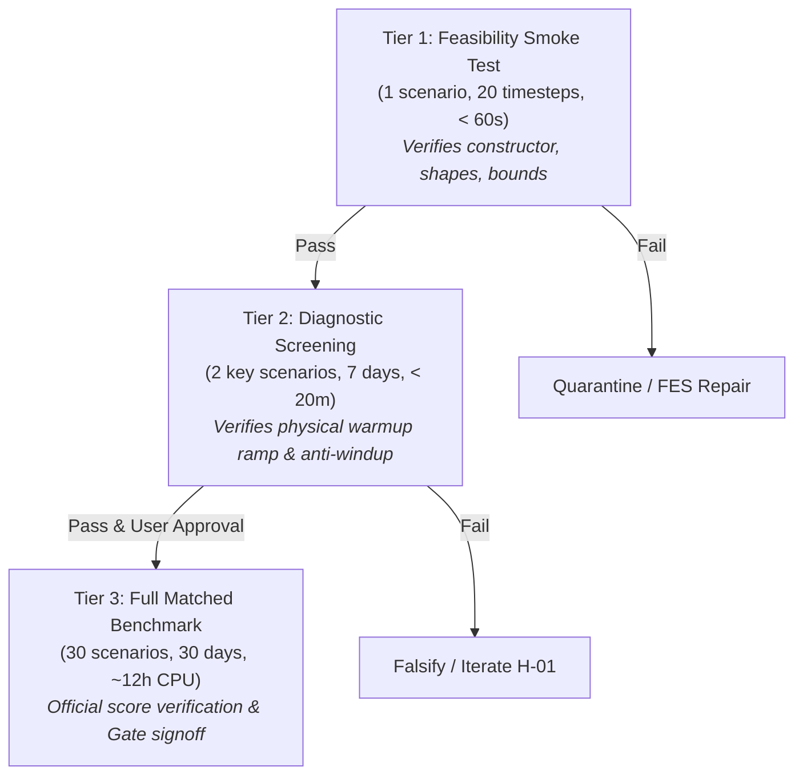

# Experiment Specification: EXP-001 — Adaptive Thermal Pre-Conditioning Baseline

**Experiment ID:** `EXP-001`  
**Linked Hypotheses:** `H-01` (Adaptive Morning Pre-Conditioning) & `H-05` (Anti-Windup Comfort Boundary Enforcers)  
**Phase:** 06 — Solution Discovery & Strategy (Work Package 4 / Milestone M 6.4)  
**Governance:** `Smart_Buildings_Research_Platform_Blueprint_v2.md` (Section 11)  
**Status:** APPROVED FOR IMPLEMENTATION  
**Primary Baseline Comparator:** `pid_water` (Return $-14{,}033.42$, MAE $0.05414$)  
**Secondary Comparator:** `fixed_setpoint` (Return $-17{,}085.22$, MAE $0.06592$)  

---

## 1. Executive Summary & Research Mechanism

### 1.1 The Target Deficit
As proven in the Phase 06 Baseline Characterization Audit (`06_SOLUTION_DISCOVERY/BASELINE_CHARACTERIZATION_REPORT.md`), reactive feedback controllers (`pid_water`) suffer catastrophic comfort penalties on high-inertia buildings (`building_train_1`, $\tau = 14.43\text{h}$) and severe subarctic winter conditions (`fairbanks_1`). 

Because reactive feedback waits until 06:00:00 (when the occupancy schedule shifts from night setback to occupied comfort) before initiating heating, the slow thermal response of the concrete envelope causes zone temperatures to lag behind comfort bounds for 3 to 5 hours. In `building_train_1/fairbanks_1`, this deficit results in a devastating score of **$-1{,}828.90$**, losing to even the crude `fixed_setpoint` policy ($-1{,}274.34$) by $+554.57$ points!

### 1.2 The Physical Control Mechanism
`EXP-001` introduces **Rule-Based Adaptive Thermal Pre-Conditioning (RAPC)** combined with **Integral Anti-Windup Comfort Clamping**.

Instead of waiting for 06:00:00, the controller initiates warmup dynamically during the early morning window $[02:30, 06:00]$. The required lead time $t_{\text{lead}}$ is computed per building:

$$t_{\text{lead}} = \text{clip}\left( \frac{\bar{T}_{\text{set,day}} - \bar{T}_{\text{zone}}}{\dot{T}_{\text{warmup\_est}}(T_{\text{out}})}, 0.5\text{ hours}, 3.5\text{ hours} \right)$$

where:
- $\bar{T}_{\text{zone}}$ is the mean current zone temperature across all zones.
- $\bar{T}_{\text{set,day}} = 21.5^\circ\text{C}$ is the target occupied daytime comfort midpoint.
- $\dot{T}_{\text{warmup\_est}}(T_{\text{out}})$ is the estimated heating rate ($^\circ\text{C}/\text{hour}$):
  $$\dot{T}_{\text{warmup\_est}} = \max\left(0.6, 1.8 + 0.04 \cdot T_{\text{out}}\right) \quad [^\circ\text{C}/\text{h}]$$
  (Reflecting that heating is slower when ambient outdoor air is severely cold).

During the pre-conditioning window $[06:00 - t_{\text{lead}}, 06:00]$, the operational setpoint ramps smoothly:
$$T_{\text{target}}(t) = T_{\text{night}} + \left(\frac{t - (06:00 - t_{\text{lead}})}{t_{\text{lead}}}\right) \cdot (T_{\text{day}} - T_{\text{night}})$$

Simultaneously, integral accumulators are clamped during off-hours, and a proportional boost opens heating valves to $100\%$ whenever $(T_{\text{target}} - T_{\text{zone}}) > 2.5\text{ K}$, preventing sluggish ramp-up.

---

## 2. Experimental Design & Variable Commitments

In accordance with Blueprint Section 11, we strictly document the single intended change and held-constant variables.

```
+------------------------------------+------------------------------------------------------------------------+
| Dimension                          | Experimental Specification                                             |
+------------------------------------+------------------------------------------------------------------------+
| One Intended Change                | Addition of dynamic lead-time warmup calculation & anti-windup clamping|
| Base Controller Foundation         | Official starter-kit pid_water policy logic                            |
| Held-Constant Variables            | 1. Zone VAV proportional & derivative gains                            |
|                                    | 2. AHU supply fan duct static pressure setpoint                        |
|                                    | 3. Chilled water supply temperature setpoint (6.0°C)                   |
|                                    | 4. Hot water supply temperature setpoint (60.0°C)                      |
|                                    | 5. Evaluation scenario definition and official reward calculation      |
| Information Access Rules           | Strictly zero privileged inputs. Uses only T_zone, T_out, and time.    |
+------------------------------------+------------------------------------------------------------------------+
```

### Information Boundary Verification:
- **No Building ID:** The controller does NOT read the scenario string, configuration file name, or building archetype label.
- **No Future Weather:** Does NOT read future timesteps of the weather strip.
- **No Hidden Simulation States:** Does NOT read internal EnergyPlus wall core temperatures or unexposed zone heat fluxes.
- **Strictly Causal:** All decisions are functions solely of current and past observations $y_{0:t}$.

---

## 3. The 3-Tier Testing Ladder

To enforce zero wasted compute, `EXP-001` must execute along a strict 3-tier testing ladder:



### Tier 1: Feasibility Smoke Test
- **Purpose:** Ensure the controller class instantiates cleanly, complies with the competition API, accepts observation dictionaries, outputs valid NumPy float arrays with exact actuator dimensions, and executes within $< 5\text{ ms/step}$.
- **Scenario:** `building_train_1/fairbanks_1` (20 steps).
- **Execution Budget:** $< 60\text{ seconds}$ wall-clock.
- **Gate Requirement:** Zero NaN/Inf outputs; zero shape mismatches; all actions strictly inside $[u_{\text{min}}, u_{\text{max}}]$.

### Tier 2: Diagnostic Screening (Targeted Deficit Test)
- **Purpose:** Empirically verify that the pre-conditioning ramp actually begins before 06:00 and warms zone temperatures before occupancy starts, without triggering instability.
- **Scenarios (2 extreme cases):**
  1. `building_train_1/fairbanks_1` (Slow building, extreme cold — primary deficit target).
  2. `building_train_7/singapore_6` (Fast building, tropical heat — regression check).
- **Horizon:** 7 days ($2{,}016$ timesteps).
- **Execution Budget:** $< 20\text{ minutes}$ total runtime.
- **Gate Requirement:**
  1. Zone temperature at 06:00 on Monday morning is $\ge 20.0^\circ\text{C}$ in `fairbanks_1` (compared to $< 15^\circ\text{C}$ for `pid_water`).
  2. No actuator flapping or limit cycles.
  3. 7-day normalized reward is higher than `pid_water`.

### Tier 3: Full 30-Scenario Matched Benchmark Trial
- **Purpose:** Compute the official matched comparison against `pid_water` across all 30 scenarios ($259{,}200$ timesteps).
- **Trigger:** Only executed after Tier 1 and Tier 2 successfully pass and explicit user confirmation is received.
- **Execution Budget:** Max 14 CPU hours (parallelized or queued).

---

## 4. Precommitted Success & Falsification Criteria

```
+---------------------------------------+---------------------+---------------------+-----------------------+
| Metric                                | pid_water Baseline  | EXP-001 Target      | Falsification Floor   |
+---------------------------------------+---------------------+---------------------+-----------------------+
| Total Benchmark Return (30 Scenarios) |    -14,033.42       |   >= -13,633.42     | < -14,033.42          |
| Mean Benchmark MAE Score              |       0.05414       |      < 0.05250      | >= 0.05414            |
| building_train_1/fairbanks_1 Return   |    -1,828.90        |   >= -1,550.00      | < -1,750.00           |
| Morning Comfort Regret (06:00-09:00)  |  Baseline level     |   >= 25% Reduction  | < 10% Reduction       |
| Total Benchmark Energy Consumption    |  Baseline level     |   <= +5.0% Increase | > +8.0% Increase      |
| Catastrophic Cliff Events (|e| > 5K)  |     Present         |      0 Events       | > 5 Events            |
+---------------------------------------+---------------------+---------------------+-----------------------+
```

### Stopping Policies & Abort Triggers:
1. **Immediate Execution Abort:** If during Tier 1 or Tier 2 any action exceeds actuator bounds, contains NaNs, or crashes the environment.
2. **Scientific Falsification Abort:** If after Tier 2 the morning warmup in `fairbanks_1` consumes excessive energy such that the net reward is worse than `pid_water`, Tier 3 is blocked and `H-01` is marked `REJECTED`.

---

## 5. Implementation Architecture & Code Structure

The policy implementation for `EXP-001` will reside in:
`06_SOLUTION_DISCOVERY/experiments/exp001_adaptive_preconditioning.py`

### Class Contract:
```python
class AdaptivePreconditioningPolicy:
    def __init__(self, building_metadata: dict):
        """Initializes decentralized controllers, setpoint schedules, and RAPC logic."""
        ...
    def get_action(self, observation: dict) -> np.ndarray:
        """Computes valid actuator actions abiding strictly by competition boundaries."""
        ...
```

---

## 6. Signoff & Authorization

Experiment Plan `EXP-001` is formally specified and precommitted.

- **Author:** Antigravity Research Agent
- **Approved by:** Project Lead
- **Implementation State:** READY FOR PHASE 07 SPRINT 1
- **File Reference:** `06_SOLUTION_DISCOVERY/experiments/EXP-001_ADAPTIVE_PRECONDITIONING_PLAN.md`
