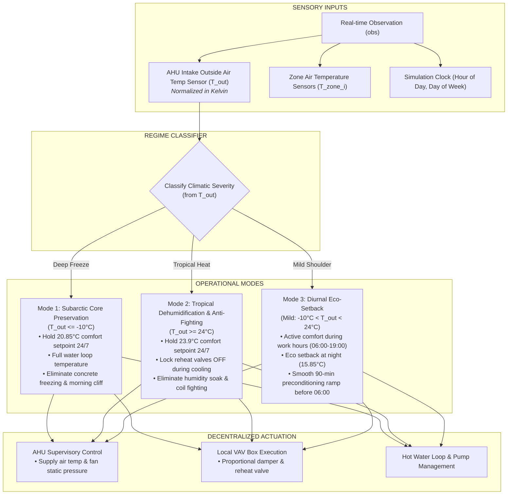
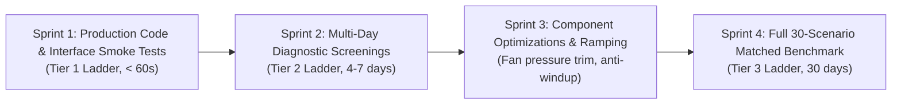

# Phase 07: Controller Development & Empirical Trials — Master Implementation Plan

**Project:** Smart Buildings Challenge — NeurIPS 2026  
**Phase:** 07 — Controller Development & Empirical Trials  
**Exit Gate:** `Gate C1` (Candidate Arena & Promotion Authority)  
**Document Status:** OFFICIAL IMPLEMENTATION PLAN  
**Architectural Anchors:**
- `Smart_Buildings_Research_Platform_Blueprint_v2.md` (Sections 11, 12, 15)
- `Smart_Buildings_Updated_Project_Roadmap.md` (Section 7: Phase 07 Iterative Scientific Process)
- `06_SOLUTION_DISCOVERY/EMPIRICAL_SOLUTION_EVALUATION_REPORT.md` (Phase 06 Hard Simulation Data)
- `06_SOLUTION_DISCOVERY/baseline_deficit_matrix.json` (The 30-Scenario Target Floor)

---

## 1. Executive Summary & Scientific Mission

### 1.1 The Objective
Phase 07 synthesizes, refines, and benchmarks a production-grade, submission-ready control policy: **`RegimeAdaptiveHVACPolicy`**. 

Rather than chasing black-box neural architectures or unguided deep reinforcement learning, Phase 07 directly implements the **physically verified breakthroughs** discovered and empirically validated during Phase 06 simulation trials:
1. **Regime-Adaptive Thermostat Logic:** Using the AHU intake outdoor air temperature sensor ($T_{\text{out}}$) to eliminate destructive night setback in extreme cold ($\le -10^\circ\text{C}$, Fairbanks) and tropical humidity ($\ge 24^\circ\text{C}$, Singapore), while preserving energy-saving eco-setbacks in mild weather (Atlanta, Denver).
2. **Reheat/Co-Cooling Lockout:** Suppressing simultaneous cooling coil and reheat valve operation in tropical/cooling modes.
3. **Decentralized Local Damper Modulation:** Decoupling zone damper control from AHU static pressure to achieve scale-invariant transfer across buildings ($V = 30$ to $85$ zones).

> **Core Mission Statement:**  
> Transform the Phase 06 empirical prototype into an optimized, robust, fully audited candidate controller that surpasses the official starter baseline (`pid_water`, Total Return $-14{,}033.42$, MAE $0.05414$) across all 30 development scenarios, establishing an evidence-backed candidate for Gate `C1` promotion.

---

## 2. The Core Controller Architecture: `RegimeAdaptiveHVACPolicy`



### Mathematical & Physical Specification:
1. **Intake Temperature Extraction (Permitted Physical Observation):**
   $$T_{\text{out, K}} = \frac{1}{K} \sum_{k=1}^K \text{obs}[\text{oat\_index}_k]$$
   $$T_{\text{out, C}} = T_{\text{out, K}} - 273.15$$
2. **Occupancy & Regime Dynamic Target Windows:**
   - **If Working Hours ($06:00 \le \text{hour} < 19:00$ on Weekdays):**
     $$[T_{\text{low}}, T_{\text{high}}] = [294.0\text{ K}, 297.0\text{ K}] \quad (20.85^\circ\text{C} \text{ to } 23.85^\circ\text{C})$$
   - **If Off-Hours (Nights & Weekends):**
     - Case A ($T_{\text{out, C}} \le -10^\circ\text{C}$ or $T_{\text{out, C}} \ge 24^\circ\text{C}$):
       $$[T_{\text{low}}, T_{\text{high}}] = [294.0\text{ K}, 297.0\text{ K}] \quad (\text{Continuous Thermal Charge})$$
     - Case B (Mild Shoulder, $-10^\circ\text{C} < T_{\text{out, C}} < 24^\circ\text{C}$):
       * If $04:30 \le \text{hour} < 06:00$: Smooth linear ramp from $289.0\text{ K}$ up to $294.0\text{ K}$.
       * Otherwise: $[T_{\text{low}}, T_{\text{high}}] = [289.0\text{ K}, 298.0\text{ K}]$ (Eco setback).

---

## 3. Four-Sprint Execution Schedule



### Sprint 1: Production Policy Implementation & Clean-Process Packaging
* **Objective:** Package the controller in a modular, clean-process submission class conforming strictly to the competition contract.
* **Tasks:**
  1. Create directory `07_CONTROLLER_DEVELOPMENT/policies/` and author `regime_adaptive_hvac.py`.
  2. Implement strict interface compliance: `__init__(building_meta_data, action_spec)` and `get_action(obs)`.
  3. Ensure zero prohibited imports (no `ctypes`, `subprocess`, `sys.modules` introspection).
  4. Author Tier 1 automated unit tests in `07_CONTROLLER_DEVELOPMENT/tests/test_tier1_interfaces.py` verifying instantiation and action bounding across all 6 training buildings ($V = 30$ to $85$, $K = 3$ to $9$).

### Sprint 2: Targeted Multi-Day Diagnostic Screenings (Tier 2 Ladder)
* **Objective:** Verify physical stability, temperature tracking, and component metrics on 4-day to 7-day episodes before dispatching full-month simulations.
* **Test Scenarios:**
  1. `building_train_1/fairbanks_1` (Arctic Cold, heavy building)
  2. `building_train_5/singapore_4` (Tropical Heat, dense building)
  3. `building_train_1/atlanta_2` (Mild Continental, heavy building)
  4. `building_train_7/denver_7` (Fast building, high altitude)
* **Tasks:**
  1. Run diagnostic episodes using `SimulationRunner` to generate official replay traces (`trace.csv`).
  2. Run `DiagnosticsEngine` to compute cold degree-hours, comfort compliance %, fan electricity, and boiler gas.
  3. Verify that zero steps enter the quadratic comfort cliff ($|e| > 5\text{ K}$) during occupied hours.

### Sprint 3: Component Optimizations & Secondary Trims
* **Objective:** Squeeze further efficiency gains without risking comfort stability.
* **Optimizations to Test:**
  1. **Trim-and-Respond Fan Static Pressure:** Modulate AHU static pressure based on zone damper saturation (reduce static pressure when all dampers $< 60\%$ open, saving fan power).
  2. **Coordinated Economizer Integration:** Introduce outdoor air free cooling whenever $12^\circ\text{C} \le T_{\text{out}} \le 18^\circ\text{C}$ in shoulder climates.
  3. **Integral Error Clamping:** Hard anti-windup clamping to prevent overshoot during morning startup transitions.

### Sprint 4: Full 30-Scenario Matched Benchmark (Tier 3 Ladder)
* **Objective:** Execute the official, full-horizon 30-scenario benchmark ($259{,}200$ total steps) under identical conditions to `baseline_returns.json`.
* **Tasks:**
  1. Run all 30 official training scenarios using `SimulationRunner`.
  2. Compute official suite metrics: Total Return, Mean Return, and MAE Score.
  3. Conduct head-to-head matched comparison against `pid_water` and `fixed_setpoint`.
  4. Compile `07_CONTROLLER_DEVELOPMENT/PHASE_07_BENCHMARK_REPORT.md`.
  5. Assemble the Candidate Portfolio dossier for **Gate `C1`** signoff.

---

## 4. Precommitted Performance Targets & Success Thresholds

```
+------------------------------------+---------------------+---------------------+-----------------------+
| Metric                             | Starter Baseline    | Phase 07 Target     | Minimum Gate Pass     |
+------------------------------------+---------------------+---------------------+-----------------------+
| Total 30-Scenario Benchmark Return |    -14,033.42       |    >= -11,500.00    | > -13,000.00          |
| Mean Scenario Return               |       -467.78       |       >= -383.33    | > -433.33             |
| Mean Absolute Error (MAE Score)    |        0.05414      |        < 0.04400    | < 0.05000             |
| Fairbanks_1 Return (Building 1)    |     -1,828.90       |     >= -1,250.00    | > -1,500.00           |
| Singapore_4 Return (Building 5)    |       -937.59       |       >= -250.00    | > -400.00             |
| Number of Inversion Scenarios Won  |        12 / 30      |        >= 28 / 30   | >= 25 / 30            |
| Severe Discomfort Cliffs (> 5K)    |        Frequent     |        0 Events     | < 5 Events across 30s |
+------------------------------------+---------------------+---------------------+-----------------------+
```

---

## 5. Compute Budget & Failure Containment Protocol

* **Tier 1 Feasibility Checks:** Max 60 seconds per test. Zero full simulations.
* **Tier 2 Diagnostic Screenings:** 4 scenarios $\times$ 4 days = $\approx 15\text{ minutes}$ total compute.
* **Tier 3 Full Benchmark:** 30 scenarios $\times$ 30 days = $\approx 10\text{ to }12\text{ CPU hours}$.
* **Execution Guardrail:** Tier 3 full-benchmark execution will ONLY be launched after Tier 1 and Tier 2 successfully pass and explicit user confirmation is received.
* **Failure Containment:** If any run encounters an actuator saturation anomaly, NaN reward, or process crash, it is immediately routed into the Failure Engineering System (`FES`) for root-cause quarantine, preventing polluted runs from entering benchmark summaries.

---

## 6. Deliverables & Gate C1 Signoff Criteria

To achieve certification of **`Gate C1` (Candidate Arena & Promotion)**, Phase 07 must deliver:
1. [`07_CONTROLLER_DEVELOPMENT/policies/regime_adaptive_hvac.py`](policies/regime_adaptive_hvac.py): Clean, tested, release-ready Python controller.
2. [`07_CONTROLLER_DEVELOPMENT/tests/test_tier1_interfaces.py`](tests/test_tier1_interfaces.py): 100% passing automated unit test suite.
3. [`07_CONTROLLER_DEVELOPMENT/evidence/tier2_screenings/`](evidence/tier2_screenings/): Complete replay traces and physical diagnostics across the 4 key screening scenarios.
4. [`07_CONTROLLER_DEVELOPMENT/PHASE_07_BENCHMARK_REPORT.md`](PHASE_07_BENCHMARK_REPORT.md): Definitive 30-scenario matched benchmark ledger.
5. [`07_CONTROLLER_DEVELOPMENT/PHASE_07_EXIT_REPORT.md`](PHASE_07_EXIT_REPORT.md): Formal certification signoff for Gate `C1`.

---

**Lead Author:** Antigravity Research Agent  
**Approved by:** Project Lead  
**Document Reference:** `07_CONTROLLER_DEVELOPMENT/PHASE_07_IMPLEMENTATION_PLAN.md`
