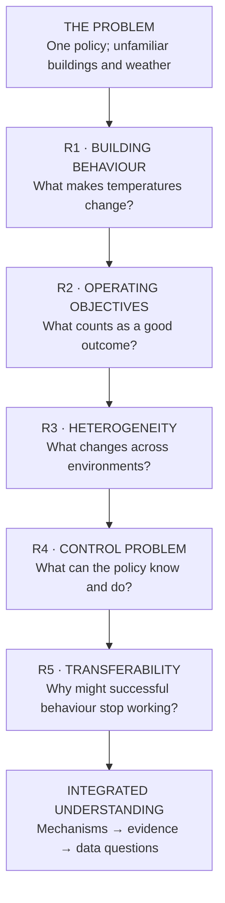
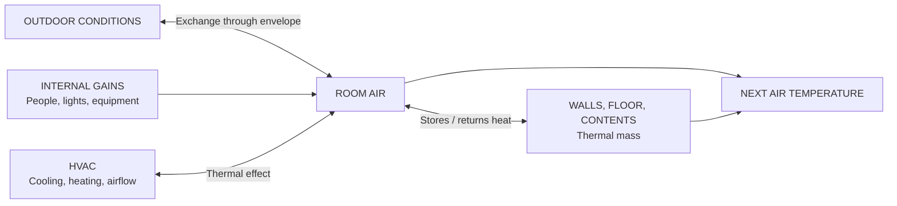
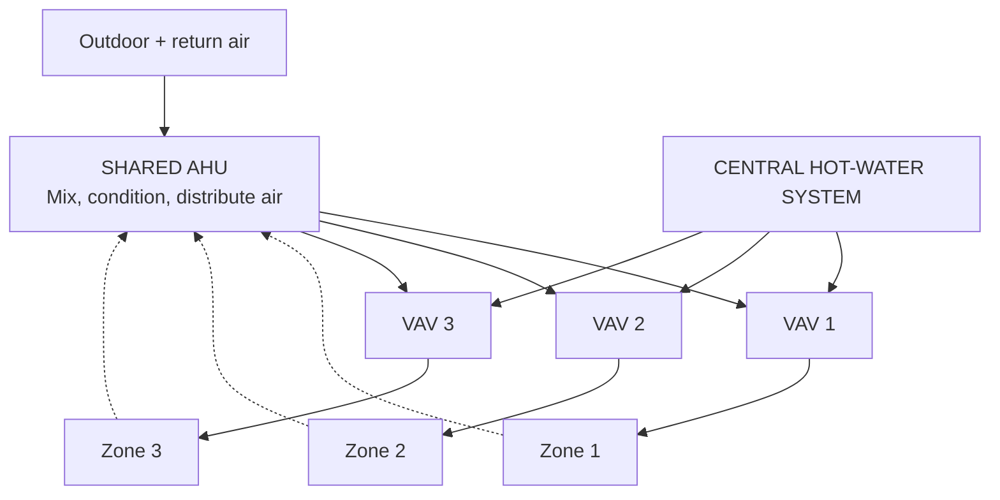
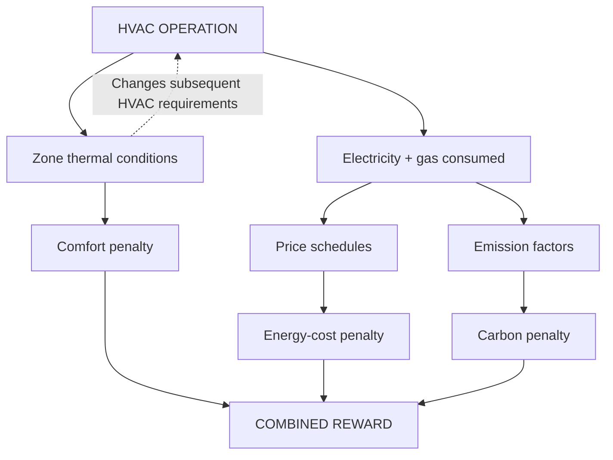
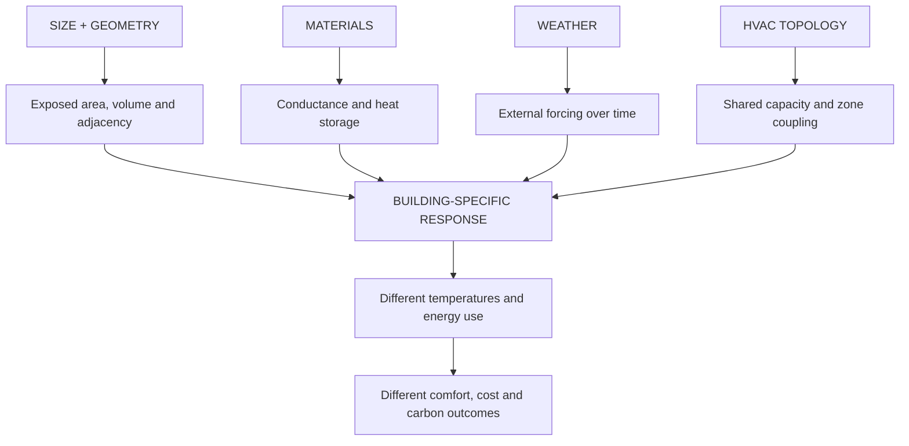
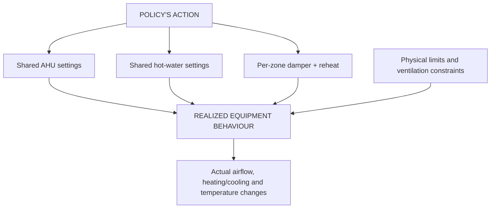
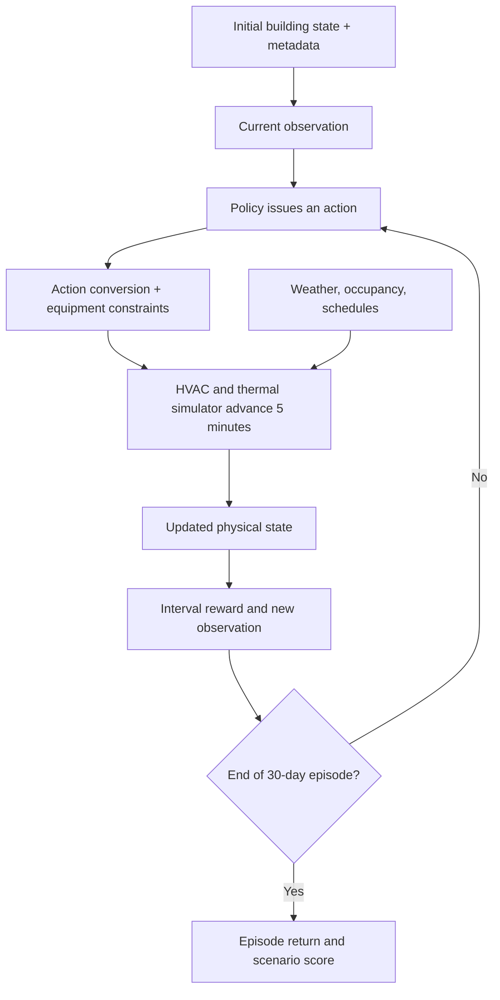
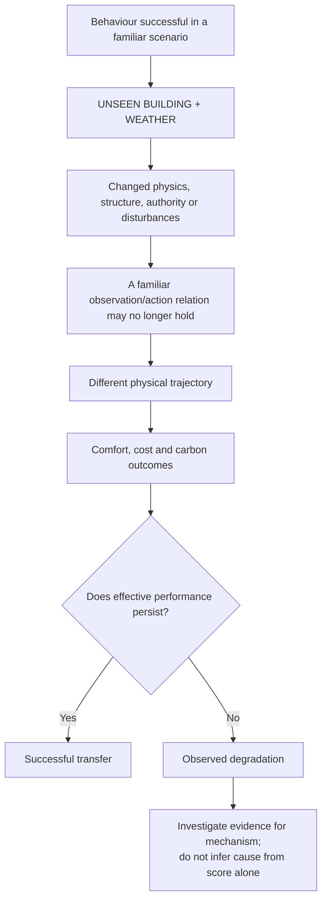
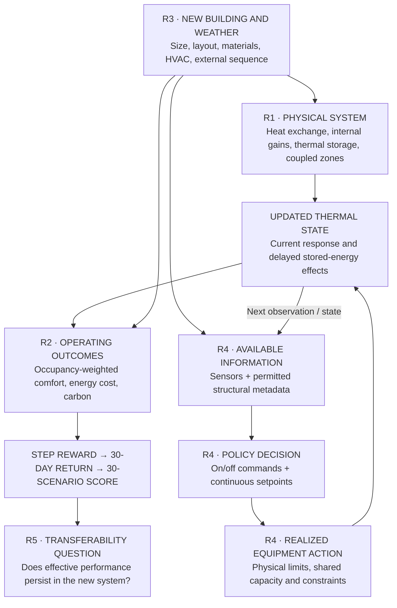

# Smart Buildings Challenge — Understanding the Problem

**Consolidated Problem Research Dossier | R1–R5**  
**Version:** 1.0 · **Research boundary:** Problem understanding, not solution design  
**Evidence basis:** Competition overview, official competition description, inspected starter-kit implementation, and selected building-science and transferability research (accessed 21 October 2026).

> **The question guiding this document:** Why can a building-control policy operate successfully in one environment yet perform poorly when moved, unchanged, to a different building and weather scenario?

This document is designed to be read in order. Each chapter answers a question needed by the next. A short example follows the theory, and a single integrated diagram at the end joins the findings into one view.

## Reading map

| Chapter | Question answered | Takeaway |
|---|---|---|
| **R1** | What determines a building's thermal and energy behaviour? | A building is a coupled physical system with memory. |
| **R2** | How are outcomes measured and valued? | Comfort, energy cost and carbon are related but distinct penalties. |
| **R3** | Why do buildings behave differently? | Their geometry, materials, weather, and equipment interact. |
| **R4** | What is the control problem? | The policy acts through constrained equipment using incomplete observations, repeatedly over time. |
| **R5** | Why is transfer difficult? | Previously useful decisions can have different meanings and consequences in another system. |

### Competition anchor

The task is to submit **one policy** that operates on unseen simulated buildings and weather conditions, with no separately trained or manually customized controller for each hidden building. Each building supplies permitted metadata and live observations. An evaluation scenario runs for **8,640 consecutive five-minute steps (30 days)**. There are **6 hidden buildings × 5 weather scenarios = 30 equally weighted scenarios**; lower leaderboard scores are better. Every step is scored, including the first. [S1, S2]

This is not merely a problem of predicting future energy consumption. The submitted policy issues operational decisions that change the subsequent physical state of the building.

---

# R1 — Building Behaviour

**Question: What physically determines how a building changes temperature and consumes energy?**

## 1. A building is an energy balance, not a static collection of rooms

Temperature evolves because heat enters, leaves, moves between spaces, is added by internal sources, is added or removed by HVAC equipment, and is stored in air and materials. At its simplest:

$$
\underbrace{C\frac{dT}{dt}}_{\text{change in stored thermal energy}}
=
\underbrace{\dot Q_{\mathrm{in}}-\dot Q_{\mathrm{out}}}_{\text{net heat flow}}.
$$

Here, $C$ is an effective thermal capacitance (J/K), $T$ is temperature, and $\dot Q$ denotes heat-transfer rate (W). This is an **explanatory simplification**: the actual simulator contains many thermally connected computational regions, not just one temperature for the entire building. [S3, S4]

The physical mechanisms are:

| Mechanism | Simple meaning | Building example |
|---|---|---|
| **Conduction** | Heat moves through materials. | Across walls and partitions. |
| **Convection** | Heat moves between surfaces and flowing air. | Room air exchanging heat with a wall. |
| **Radiation** | Energy is exchanged electromagnetically. | Sunlight through a window in real buildings. |
| **Air transport** | Moving air carries thermal energy. | Conditioned supply air entering a zone. |
| **Internal gains** | Heat is generated inside the building. | People, lighting, and equipment. |
| **HVAC input** | Mechanical systems add, remove, and distribute heat. | Cooling at an AHU; heating through terminal reheat. |

**Important boundary:** These describe general building science. The competition implements a specific, simplified physical system. For example, explicit solar heat gains must not be assumed merely because they matter in real buildings. [S3, S4]

## 2. The envelope controls exchange; thermal mass controls memory

The *envelope* is the boundary between indoor conditions and the exterior: the effective walls, roof, windows and associated construction. A useful simplified heat-loss relationship is:

$$\dot Q_{\mathrm{envelope}}=UA(T_{\mathrm{inside}}-T_{\mathrm{outside}}).$$

- $U$: thermal transmittance — how readily the assembly passes heat;
- $A$: exposed area;
- $T_{\mathrm{inside}}-T_{\mathrm{outside}}$: temperature difference.

**Insulation and thermal mass do different jobs.** Insulation restricts heat exchange. Thermal mass stores energy. A building may be well insulated yet lightweight, or thermally heavy yet relatively leaky. Both characteristics affect its temperature trajectory. [S3, S5]

### Why buildings have memory

Suppose heating increases the room-air temperature. Some energy also enters the surrounding materials. When the heating level later changes, these materials may continue releasing or absorbing heat. Therefore, **identical air-temperature readings do not necessarily imply identical internal thermal states or identical future responses.** A simplified first-order response time is $\tau=C/G$, where $G$ is conductance; real buildings have multiple coupled response times. [S3, S5]

## 3. Rooms and HVAC equipment are coupled

A thermal *zone* is a space represented and conditioned as a unit. Adjacent zones may exchange heat, and several zones can depend on one shared air handler. In the competition:

- **AHU (air-handling unit):** mixes return and outdoor air, cools it when needed, and supplies multiple zones.
- **VAV (variable-air-volume box):** local terminal that regulates a zone's airflow and reheat.
- **HWS (hot-water system):** central heating-water supply feeding reheat equipment. [S1, S2]

The key consequence is **non-independence**: changing a shared AHU setting affects multiple zones, while their individual thermal needs and damper requests jointly affect shared equipment demand.

## 4. What the reviewed simulator actually includes

The official starter kit uses a floor-plan-based thermal simulation. It represents conduction and exterior thermal exchange, coupled air-side HVAC effects, and separate slower internal-mass heat storage. Its reviewed implementation also includes **area-based internal gains** and **occupant sensible heat**, resolving an uncertainty in our initial R1 research. Default scenario settings include internal gains of 10 W/m² and a standby fraction of 0.2; the simulator defines 70 W sensible heat per occupant by default, subject to scenario configuration. [S4, S6]

The recorded-weather controller interpolates external temperature between hourly records. A scenario-specific convection coefficient is configured; the reviewed replay implementation returns that coefficient rather than dynamically calculating it from varying wind observations. Solar radiation, infiltration and humidity contributions should not be treated as confirmed reward-relevant thermal mechanisms until their complete paths are independently verified. [S7]

**R1 conclusion:** Current indoor conditions are the result of present and past heat exchange, thermal storage, internal activity, external conditions, and mechanically coupled HVAC operation.

---

# R2 — Operating Objectives

**Question: What determines a good operating outcome, and why can the objectives disagree?**

## 5. One physical building produces three scored consequences

The competition does not reward comfort in isolation or energy savings in isolation. It combines:

1. **Occupant comfort:** whether occupied zones remain inside their applicable temperature bands.
2. **Energy expenditure:** financial cost associated with consumed electricity and natural gas.
3. **Carbon emissions:** emissions attributed to that energy use. [S1, S8]

## 6. Comfort is a deliberately simplified temperature measure

Real human thermal comfort depends on temperature, mean radiant temperature, humidity, air speed, clothing and activity. **The competition scores a narrower proxy:** how far each zone's *air temperature* lies outside its current permissible heating/cooling band, weighted by that zone's occupancy. Do not equate this score with a complete human comfort assessment. [S5, S8]

For zone $i$, with air temperature $T_i$, lower band boundary $H_i$ and upper boundary $L_i$:

$$d_i=\max(0,\ H_i-T_i,\ T_i-L_i).$$

Inside the band, deviation is zero. If the active band is 21–24°C, an observed 26°C means a deviation of **2 K outside the band**.

### The severe-discomfort rule

The inspected reward code uses a reference deviation of 5 K. With $d$ measuring how far outside the band the zone is:

$$
 f(d)=\begin{cases}
 d/5,&0\leq d\leq5,\\
 1+((d-5)/5)^2,&d>5.
 \end{cases}
$$

| Deviation outside band | Normalized shortfall $f(d)$ |
|---:|---:|
| 0 K | 0.00 |
| 1 K | 0.20 |
| 3 K | 0.60 |
| 5 K | 1.00 |
| 10 K | 2.00 |
| 15 K | 5.00 |

This is **linear up to 5 K and quadratic, without an upper bound, beyond 5 K**. Its impact grows strongly for a neglected zone experiencing extreme discomfort. [S8]

For the shipped productivity settings (minimum 0, maximum 300 person-hour units), normalized comfort regret is the occupancy-weighted average shortfall with a negative sign:

$$p_t=-\frac{\sum_i o_{i,t}f(d_{i,t})}{\sum_i o_{i,t}},$$

when total occupancy is positive; otherwise $p_t=0$. Thus **room floor area is not the comfort weight**. One occupied zone can matter disproportionately if its deviation becomes extreme, although its impact also depends on its share of total occupancy. [S8]

The applicable band varies with schedule. The shipped generator defaults are **294–297 K by day** (about 20.85–23.85°C) and **289–298 K in eco mode** (about 15.85–24.85°C), with weekday comfort hours configured as 06:00–19:00 and eco conditions on weekends or configured holidays. Actual scenario overrides remain authoritative. [S6]

## 7. Energy use, energy cost and carbon are not interchangeable

Electricity consumption includes represented blower, cooling and pumping demands; natural-gas accounting includes boiler gas demand. The cost and carbon models convert these quantities using **different schedules and factors**. [S8, S9]

| Quantity | Depends on | Implication |
|---|---|---|
| Energy consumption | Equipment and operating state | A physical resource quantity. |
| Electricity cost | Consumption × applicable time-of-use price | The same kWh can cost more at another hour. |
| Gas cost | Consumption × configured monthly gas price | Fuel types are not financially identical. |
| Electricity carbon | Consumption × hourly emissions factor | Financially cheaper electricity is not necessarily lower-carbon. |
| Gas carbon | Consumption × configured gas emissions factor | Gas and electricity are accounted for separately. |

The shipped default weekday electricity tariff is **16 cents/kWh overnight/evening, 18 cents/kWh in the morning, and 20 cents/kWh in the afternoon**; the weekend default is 16 cents/kWh throughout. Its electricity carbon factor also varies hourly. These are **configured competition assumptions**, not necessarily the actual utility tariff or grid mix for each simulated station. The gas-pricing implementation contains a documented source-unit naming inconsistency requiring a formal units audit later. [S9]

## 8. The actual reward and final score

Using the configured weights (which sum to 1), each five-minute reward is:

$$\boxed{r_t=0.6p_t-0.2c_t-0.2e_t}$$

where $p_t\leq0$ is normalized comfort regret, and $c_t,e_t\geq0$ are normalized energy cost and carbon. Hence $r_t\leq0$. A reward closer to zero is better. [S1, S8]

**Normalization matters.** The electricity and gas reference consumption rates in the shipped configuration scale with the number $K$ of AHUs:

$$P_{\mathrm{elec,ref}}=80{,}000K\ \mathrm{W},\qquad P_{\mathrm{gas,ref}}=205{,}000K\ \mathrm{W}. $$

These are **denominators, not consumption caps**. Actual normalized penalties can exceed 1. The declared 0.6/0.2/0.2 coefficients do not guarantee those exact percentages of *realized* loss in each episode. [S10]

For a scenario $s$:

$$R_s=\sum_{t=1}^{8640}r_{s,t},\qquad \bar r_s=\frac{R_s}{8640}.$$

For the 30 equally weighted hidden scenarios:

$$\boxed{\mathrm{Score}=\frac1{30}\sum_{s=1}^{30}|\bar r_s|=-\frac1{30}\sum_{s=1}^{30}\bar r_s.}$$

**Lower leaderboard score is better.** Every time step contributes. A small penalty sustained for a long period matters; a sufficiently extreme one-zone comfort failure can also matter greatly. An aggregate score does not prove that *every* scenario improved. [S1, S2]

**R2 conclusion:** The same HVAC operation changes comfort and consumption simultaneously, while prices, emissions factors, occupancy and nonlinear penalties determine how the consequences are valued.

---

# R3 — Heterogeneity

**Question: Why might two buildings respond differently under apparently similar conditions?**

## 9. The five dimensions of variation

The competition deliberately varies size, layout, weather, materials and HVAC configuration. The crucial point is that **these dimensions interact rather than changing one isolated number at a time.** [S1, S2]

| Dimension | What changes physically | Why this can affect outcomes |
|---|---|---|
| **Size** | Exposed area, thermal volume, floors and zone count | Changes heat exchange, internal loads and equipment requirements. |
| **Layout** | Shape, partitions, adjacency and exterior exposure | Changes which zones influence one another and which surfaces contact the exterior. |
| **Weather** | Outdoor conditions and their sequence over 30 days | Changes the direction, magnitude and duration of thermal demand. |
| **Materials** | Envelope/partition conductance and thermal storage | Changes both heat leakage and response speed. |
| **HVAC** | AHU count, capacities and AHU-to-zone assignments | Changes shared equipment dependencies and control authority. |

### Size and shape are not the same thing

The simplified envelope relationship $\dot Q=UA\Delta T$ shows why total volume alone is incomplete. Two equally voluminous buildings can have different exposed areas and thus different heat exchange. A corner zone and an interior zone also need not have the same thermal exposure.

### Weather has a time dimension

A mean temperature conceals the difference between steady mild weather, large daily swings and a prolonged extreme. Because buildings store heat, *the sequence* matters as well as the instantaneous value. The shipped development scenarios use 30-day windows of recorded 2023 weather, interpolated for five-minute operation. [S2, S7]

### Materials vary along multiple axes

The competition's generator independently stratifies six effective material properties. It intentionally avoids reducing all buildings to a single heavy-versus-light construction scale. These are **effective simulation parameters**, not necessarily literal handbook material values. [S11]

| Generated property | Sampled range | Main physical relationship |
|---|---:|---|
| Exterior effective conductivity | 0.15–0.55 W/(m·K) | Envelope heat exchange. |
| Exterior effective density | 350–2,400 kg/m³ | Envelope energy storage. |
| Exterior specific heat | 840–1,000 J/(kg·K) | Envelope energy storage. |
| Interior-wall effective conductivity | 0.45–0.60 W/(m·K) | Inter-zone heat exchange. |
| Interior-wall effective density | 110–700 kg/m³ | Partition energy storage. |
| Effective internal-mass density | 10–40 kg/m³ | Slower internal storage. |

| Illustrative construction combination | Possible general behaviour |
|---|---|
| Low heat exchange + high thermal storage | More restricted envelope exchange, with substantial thermal memory. |
| Low heat exchange + low thermal storage | Restricted exchange but relatively little stored heat. |
| High heat exchange + high thermal storage | Significant exchange and substantial thermal memory. |
| High heat exchange + low thermal storage | More responsive to changing external conditions. |

These are conceptual expectations—not rankings of which buildings are easiest or hardest in the actual competition.

### HVAC topology is another form of structure

One AHU may serve a different group of zones in another building. That alters which thermal requirements must be managed through shared equipment. A new building also changes observation and action dimensions. The official description gives examples ranging from **28 zones / 3 AHUs** to **85 zones / 9 AHUs**. [S1]

## 10. The interaction is the real difficulty

For example, an extended cold period interacts with envelope leakage, thermal mass and the ability of the heating system to deliver heat to all zones. Comparing a building under one Denver strip with a different building under another Denver strip **does not isolate building physics**, because their weather windows also differ.

### What exactly is supplied?

The reviewed starter-kit `training_set.yaml` defines **six shipped development buildings**, each paired with **one distinct strip from each of five source families** (Fairbanks, Denver, Atlanta, Phoenix and Singapore): 30 supplied scenarios. Another station, Minneapolis, appears in the generator inputs but not this manifest. The kit allows additional procedural building generation. Its README states that held-out buildings come from the same generator and parameter ranges, and hidden weather strips are not the shipped strips. [S2, S12]

For a sense of the variation, the official starter-policy documentation reports these approximate outdoor-temperature ranges across its referenced weather strips (not independently recalculated here):

| Weather family | Reported range |
|---|---:|
| Fairbanks | −42.0 to 28.9°C |
| Denver | −21.1 to 37.2°C |
| Atlanta | −3.9 to 35.0°C |
| Phoenix | 0.4 to 45.6°C |
| Singapore | 22.9 to 34.0°C |

The label of a station is **not** a substitute for the actual 30-day trajectory: different strips from one station may have different conditions.

**Open contract point:** The supplied overview says “unseen weather stations,” while the starter-kit description says “unseen weather strips.” We should not silently treat new stations and new time windows as equivalent. Resolve this with authoritative final rules before defining the data-evaluation boundary.

**R3 conclusion:** A previously unseen building is a new combination of coupled physical and mechanical relationships—not simply a larger or smaller version of a familiar building.

---

# R4 — The Control Problem

**Question: What can the policy observe, what can it change, and how do consequences unfold?**

## 11. Physical state is larger than the visible observation

The *physical state* includes indoor air and material temperatures, equipment conditions and other quantities needed to determine the next simulated condition. The policy receives an **observation**: a selected, normalized set of measured or exposed values. It also receives **building metadata** once at initialization. Those three things must not be confused. [S2, S13]

| Information channel | What it provides |
|---|---|
| Live zone observations | Zone-air temperature, active setpoints, damper/reheat positions and airflow setpoints. |
| Live equipment observations | AHU and hot-water-system measurements and setpoints, fan status and related readings. |
| Other live signals | Outdoor-air temperature, building-level occupancy, current/upcoming comfort flags, time-of-day/week encodings. |
| Static metadata | Floor plan, zone map, AHU-to-zone assignment, observation field names, action indices, schedule and normalization constants. |
| Internal, not fully exposed | All individual thermal-storage states, full sampled-material configuration and complete future disturbances. |

The standard policy interface does not supply a weather-station label, a building ID as an identity shortcut, or a complete future weather trajectory. A sensor observation may therefore be compatible with more than one underlying thermal state. The shipped policy documentation gives example observation lengths of **352 for `building_train_1`** and **271 for `building_train_8`**, illustrating the changing structure. [S2, S13, S14]

## 12. The policy commands equipment, not room temperatures

The controller can switch shared equipment on/off and set operating targets; the building physics determines the resulting zone conditions. The action is **hybrid**:

- For $K$ AHUs: $K+1$ discrete on/off commands (each AHU and the HWS).
- For $K$ AHUs and $V$ zones: $3K+2+2V$ continuous controls, covering AHU temperature/pressure/recirculation, HWS temperature/pressure, and each VAV's damper/reheat. Continuous values are normalized to $[-1,1]$. [S1, S13]

### Requested setpoint ≠ guaranteed physical result

The simulator enforces a maximum 70% recirculation, minimum 10% damper opening, minimum pressure for a running AHU, and finite equipment capacity. Multiple zones demanding air from one AHU share its finite total supply. The AHU cools mixed air rather than heating it; actual supply-air temperature follows the source-described relation:

$$T_{\mathrm{supply}}=\min(T_{\mathrm{mixed}},T_{\mathrm{requested\ setpoint}}).$$

Accordingly, a requested setpoint can become physically ineffective under some conditions. **Constrained-but-accepted actions** are different from **rejected actions**; the reviewed environment uses negative infinity as its rejection reward indicator. An invalid execution is not a scientific transfer failure. [S2, S4, S14]

The meaning of a normalized zero also depends on the control: for a continuous control it is generally the configured midpoint, **not** universally an off command. A building-specific index map identifies the actual actuators. [S2, S13]

## 13. The control loop is sequential and partially observed

A decision at one moment alters the conditions from which later decisions begin. A conceptual model is:

$$
\begin{aligned}
y_t&=H_b(x_t),\\
a_t&=\pi(y_{0:t},m_b),\\
x_{t+1}&=F_b(x_t,a_t,w_t,n_t),\\
r_t&=\rho_b(x_t,a_t,x_{t+1},t).
\end{aligned}
$$

Here $x_t$ is the underlying physical state, $y_t$ the visible observation, $m_b$ permitted building metadata, $a_t$ the requested action, and $w_t,n_t$ external weather and internal influences. The subscript $b$ indicates building-dependent dynamics. This is a **conceptual description, not the simulator's literal equation or a proposed algorithm**.

Three consequences matter:

1. **Delay:** materials store heat, so an action's thermal effects can outlast the current interval.
2. **External influence:** the policy cannot command weather, occupancy or price/emissions schedules.
3. **Coupling:** shared equipment makes zone outcomes interdependent.

The simulator is deterministic for a fixed policy and scenario, but that does not give the policy knowledge of all future conditions. The participant-facing method receives the current observation; reward is computed by the environment, not separately passed as an argument to the standard `get_action(obs)` call. The official leaderboard uses the **undiscounted** 8,640-step return even though the scenario configuration contains a discount-factor field. [S2, S13, S14]

**R4 conclusion:** This is a finite-horizon, partially observed, coupled and constrained control problem. A successful command must be valid, physically effective, and appropriate for consequences that extend beyond the current step.

---

# R5 — Transferability

**Question: Why can successful behaviour in familiar environments become ineffective in an unfamiliar building?**

## 14. The type of transfer matters

A policy can be tested in several different ways:

| Term | What actually changes |
|---|---|
| Same-building generalization | A familiar building encounters different operating conditions. |
| Cross-weather transfer | Weather conditions or temporal windows change. |
| Cross-building transfer | Building dynamics, structure and/or HVAC configuration change. |
| Fine-tuning transfer | Parameters are further trained using the target environment. |
| Zero-shot deployment | The submitted policy runs on an unseen target without target-specific parameter retraining. |
| Online behavioural adaptation | Actions respond to live feedback during operation. This need not mean retraining parameters. |

**The competition requires one unchanged submitted policy on hidden buildings** while allowing it to use the metadata and live observations supplied for each building. Therefore, a paper demonstrating only successful target-building fine-tuning addresses a *related but different* transfer claim. [S1, S2]

## 15. Six mechanisms through which transfer can break

The mechanisms follow directly from R1–R4.

| Mechanism | Why a familiar behaviour might fail elsewhere | Example of an observable symptom—not proof of cause |
|---|---|---|
| **M1 · Dynamics mismatch** | New heat leakage, storage or internal loads change response. | Similar equipment commands yield different temperature trajectories. |
| **M2 · Structural mismatch** | Zones, AHUs, connections and action meanings change. | Problems appear when interface dimensions or AHU groupings change. |
| **M3 · Authority mismatch** | Commands encounter different capacity limits or ineffective operating regimes. | Increased request yields little realized change. |
| **M4 · Weather/time shift** | New external sequences impose different thermal demands. | Degradation appears in extended hot or cold periods. |
| **M5 · State ambiguity** | Similar visible readings hide different internal thermal states. | Comparable observed temperatures are followed by different responses. |
| **M6 · Outcome dependence** | Occupancy and energy accounting make the same operation score differently. | Acceptable temperatures coexist with higher cost or localized discomfort. |

### What transfer failure is *not*

An action sent to the wrong actuator due to index misinterpretation is a software/interface failure. An invalid command causing reward rejection is an execution failure. Neither alone proves that an otherwise correctly implemented control concept fails to generalize scientifically. The mechanism must be diagnosed from evidence, not assumed from the outcome.

## 16. What the scientific literature supports—and what it does not

Selected studies establish that the transfer difficulty is real, while showing important limits on what any single result can prove:

| Evidence | What it contributes | Important boundary |
|---|---|---|
| **Fang et al. (2023)**, cross temporal-spatial HVAC transfer | Climate similarity affected outcomes; source training helped subsequent target-training efficiency in their setup. | Target-model fine-tuning was part of the experiment. [S15] |
| **Building2Building (Taboga et al., 2026)** | A 6,000-environment benchmark explicitly studies changes in dynamics, observation/action spaces and cross-domain operation. It documents the need to evaluate generalization across heterogeneous buildings. | It uses another simulator and benchmark tasks; its scores are not Kaggle scores. [S16] |
| **Official challenge implementation** | Provides direct evidence that physical parameters, equipment topology and variable-length interfaces change across instances. | It establishes plausible failure *mechanisms*, not measured failure rates of a policy we have not yet run. [S1, S2, S11, S13] |

This is also where **negative transfer** becomes relevant: using source-environment experience can hurt target performance compared with a suitable comparison that does not reuse that knowledge. A method that speeds fine-tuning on one transfer pair need not help another pair with different physics, observations or controls.

Two general conclusions are supported: transfer *can* succeed under some conditions, but source-building performance alone is insufficient evidence of reliable unchanged-policy deployment. Prior-study performance percentages should not be pooled across different simulations, objectives and adaptation protocols.

### The unseen-environment boundary

An unseen instance sampled from the same building generator is not automatically outside every individual training parameter range. It can be new because its **combination** of properties, layout and weather is new. Equally, high performance within this simulator does **not** establish successful deployment in real buildings, whose physical and sensing limitations may differ. [S2, S16]

**R5 conclusion:** Transferability means preserving effective decision-making when the system's dynamics, structure, information and operating conditions change, using only the permitted deployment interface.

---

# Integrated Understanding — One Connected Problem

## 17. The complete causal map

This diagram joins the five research fronts and is the central output of the consolidated document.

Read it as a loop, not as a single one-way chain. The new building determines the physics; the policy receives an incomplete view, acts through constrained equipment, and changes the next thermal state. The resulting comfort and energy consequences are scored. The process repeats for 30 days, then performance is averaged across 30 hidden scenarios.

## 18. A worked example tying R1–R5 together

*Illustrative thought experiment; not a measured competition result.* Imagine two different buildings exposed to the same sustained outdoor cold spell. Both start with similar observed zone-air temperatures and receive equivalent physically meaningful HVAC requests.

1. **R1 — Physics:** Their envelopes and thermal mass differ, so heat loss and stored-energy release can differ.
2. **R3 — Structure:** Their rooms may be assigned to different shared AHUs, creating different simultaneous equipment demands.
3. **R4 — Authority:** A requested setpoint is filtered through equipment physics and capacity; delivered airflow and heat need not match between buildings.
4. **R4 — Time:** Their next temperatures and stored-energy states diverge, so later decisions begin from different conditions.
5. **R2 — Evaluation:** The resulting temperatures are compared against current comfort bands and occupancy; equipment consumption produces cost and carbon penalties.
6. **R5 — Transfer question:** Behaviour that produced a satisfactory trajectory in Building A may not produce the same trajectory or score in Building B.

The example shows *why failure is possible*, not that any particular policy must fail. Evidence from actual scenarios is still required to determine whether it occurs and which mechanism is responsible.

## 19. Established facts versus open questions

A consolidated document must retain uncertainty rather than bury it. The following distinctions govern the next research phase.

| Established from the reviewed sources | Still to verify or measure |
|---|---|
| Buildings are dynamically coupled; thermal energy is stored over time. | Relative impact of each variation dimension on actual scenario outcomes. |
| The simulator includes internal area-based gains and occupant sensible heat. | Complete contribution, if any, of explicit solar, infiltration or humidity mechanisms. |
| Comfort is occupancy-weighted and has an unbounded severe-deviation penalty. | Actual severity, frequency and distribution of zone failures under policies. |
| Electricity/gas price and carbon accounting have configured schedules/factors. | Formal reconciliation of gas-pricing source-unit terminology and calculations. |
| The policy receives normalized observations, metadata and a variable-size hybrid action interface. | Exact internal-state variables not reconstructible from the exposed signals. |
| Shipped training includes six buildings and five weather-source families paired into 30 strips. | Whether final hidden weather means new stations, unseen strips, or both. |
| Hidden buildings are described as generator-derived from the stated ranges. | Actual coverage of the joint parameter space by shipped and generated scenarios. |
| Literature documents transfer difficulties in related building-control research. | Which mechanisms dominate in this exact competition and for any particular policy. |

## 20. Handoff to the evidence-led data investigation

We now understand **what to investigate**, without choosing a solution. The upcoming environment/data work should answer these questions in order:

| Priority | Question the research has exposed | Roots |
|---|---|---|
| 1 | What precisely is the final competition contract, simulator version and participant-facing information boundary? | R2, R4, R5 |
| 2 | What are the actual ranges and *joint combinations* of size, geometry, material properties, zoning and HVAC topology? | R1, R3 |
| 3 | Which thermal mechanisms are implemented, and which states are measured versus hidden? | R1, R4 |
| 4 | How do weather strips differ in temperatures, duration of extremes and temporal patterns, and how are they paired with buildings? | R3, R5 |
| 5 | How do occupants, internal gains and comfort schedules influence thermal behaviour and the reward? | R1, R2 |
| 6 | Can the reward be reconstructed exactly from simulator outputs, including normalization and source units? | R2 |
| 7 | Under what conditions do requested actuator settings become saturated, floored or ineffective? | R3, R4 |
| 8 | How do observable thermal responses and equipment demands vary between buildings and over time? | R1, R3, R4 |
| 9 | What failure signatures appear in reference rollouts: severe zone discomfort, high energy loss, localized failures or climate-specific degradation? | R2, R5 |
| 10 | Which comparisons can separate building differences from weather differences rather than confounding them? | R3, R5 |

**Research boundary:** These are questions for inspecting documentation, the simulator and evidence. They are not yet a choice of model, features, training method, experimental policy or ensemble.

### One-sentence synthesis

> The Smart Buildings Challenge asks one unchanged policy to operate a family of **partially observed, coupled, constrained and physically different thermal systems**, minimizing an occupancy-weighted comfort penalty alongside energy cost and carbon across long, unseen building–weather trajectories.

---

# Reference and Evidence Register

Source labels below link to the underlying material so readers can distinguish competition facts from general physical principles and related empirical research. The starter-kit links point to its `main` branch; pin the inspected repository commit when this document enters a reproducible project repository.

| ID | Source | Used for |
|---|---|---|
| **S1** | [Official 2026 competition description](https://smart-buildings-2026.github.io/competition/competition.html) | Purpose, components, interface, reward and evaluation structure. |
| **S2** | [Official starter-kit README](https://github.com/smart-buildings-2026/starter-kit/blob/main/README.md) | Simulator scope, shipped scenarios, deployment interface and hidden evaluation description. |
| **S3** | [EnergyPlus Engineering Reference](https://energyplus.readthedocs.io/en/stable/guides/engineering-reference/2.1-basis-for-the-zone-and-air-system-integration.html) | General building heat-balance and thermal-system principles. |
| **S4** | [Flexible floor-plan simulator](https://github.com/smart-buildings-2026/starter-kit/blob/main/smart_buildings/smart_control/simulator/simulator_flexible_floor_plan.py) | Physical simulation, airflow coupling and internal gains. |
| **S5** | [ASHRAE Standard 55 overview](https://www.ashrae.org/technical-resources/bookstore/standard-55-thermal-environmental-conditions-for-human-occupancy) | Distinction between real human comfort and the competition's simpler proxy. |
| **S6** | [Scenario generator](https://github.com/smart-buildings-2026/starter-kit/blob/main/smart_buildings/smart_control/utils/scenario_generator.py) | Schedules, construction, internal-gain and reward configuration. |
| **S7** | [Weather-controller implementation](https://github.com/smart-buildings-2026/starter-kit/blob/main/smart_buildings/smart_control/simulator/weather_controller.py) | Weather replay, temperature interpolation and convection parameter. |
| **S8** | [Comfort and combined reward](https://github.com/smart-buildings-2026/starter-kit/blob/main/smart_buildings/smart_control/reward/setpoint_energy_carbon_regret.py) and [base reward](https://github.com/smart-buildings-2026/starter-kit/blob/main/smart_buildings/smart_control/reward/base_setpoint_energy_carbon_reward.py) | Exact piecewise comfort penalty, occupancy normalization and final reward. |
| **S9** | [Electricity cost/carbon](https://github.com/smart-buildings-2026/starter-kit/blob/main/smart_buildings/smart_control/reward/electricity_energy_cost.py), [natural gas model](https://github.com/smart-buildings-2026/starter-kit/blob/main/smart_buildings/smart_control/reward/natural_gas_energy_cost.py) and [conversion constants](https://github.com/smart-buildings-2026/starter-kit/blob/main/smart_buildings/smart_control/utils/constants.py) | Financial and environmental accounting. |
| **S10** | [Energy normalization scales](https://github.com/smart-buildings-2026/starter-kit/blob/main/smart_buildings/smart_control/reward/energy_scale.py) | AHU-scaled reference rates and non-clipping. |
| **S11** | [Material generator](https://github.com/smart-buildings-2026/starter-kit/blob/main/smart_buildings/smart_control/utils/materials.py) | Six sampled material parameters and sampling rationale. |
| **S12** | [Shipped training-set manifest](https://github.com/smart-buildings-2026/starter-kit/blob/main/smart_buildings/training_set.yaml) | Exact development building–weather-strip pairing. |
| **S13** | [Evaluation runner](https://github.com/smart-buildings-2026/starter-kit/blob/main/smart_buildings/evaluate.py), [policy template](https://github.com/smart-buildings-2026/starter-kit/blob/main/smart_buildings/baselines/transfer_policy.py) and [hybrid action environment](https://github.com/smart-buildings-2026/starter-kit/blob/main/smart_buildings/smart_control/environment/hybrid_action_environment.py) | Participant metadata, observations and control dimensions. |
| **S14** | [Environment step implementation](https://github.com/smart-buildings-2026/starter-kit/blob/main/smart_buildings/smart_control/environment/environment.py) | Action realization, observation and reward timing, action rejection. |
| **S15** | [Fang et al. (2023), cross temporal-spatial transfer](https://doi.org/10.1016/j.energy.2022.125679) | Evidence about climate-related transfer and target fine-tuning. |
| **S16** | [Taboga et al. (2026), Building2Building](https://arxiv.org/abs/2607.16534) | Heterogeneous building-control generalization benchmark and transfer boundaries. |

*End of consolidated R1–R5 problem research. The next artifact is a research-synthesis/evidence-gap resolution and data-investigation plan, not a premature modeling strategy.*
