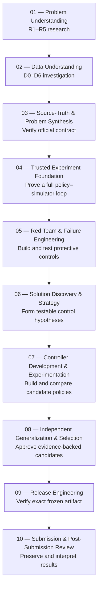
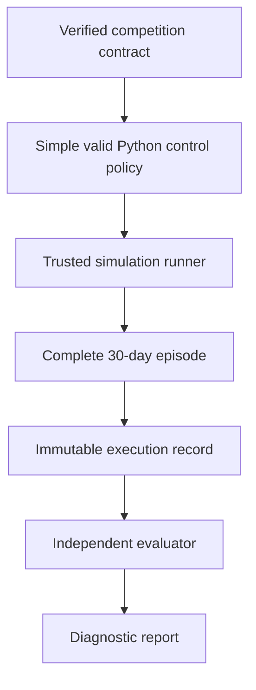
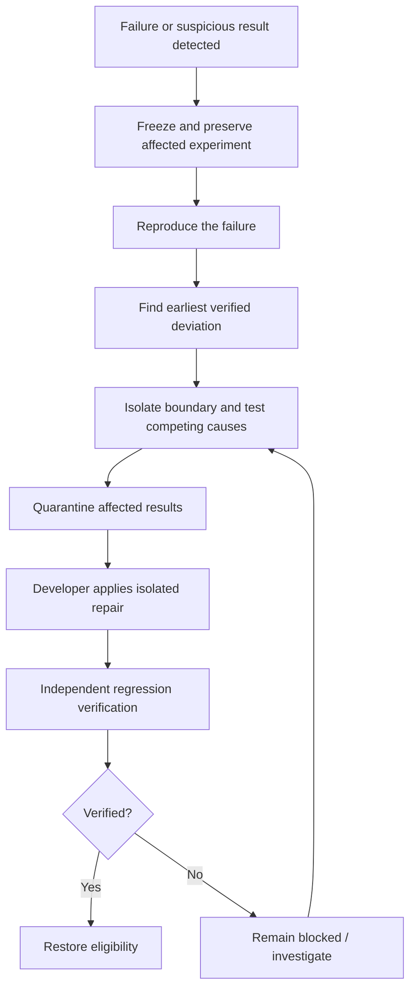
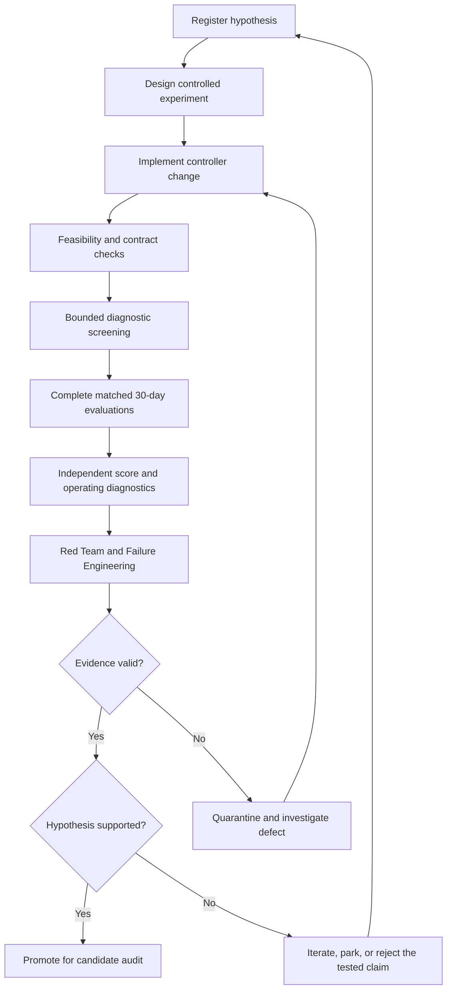
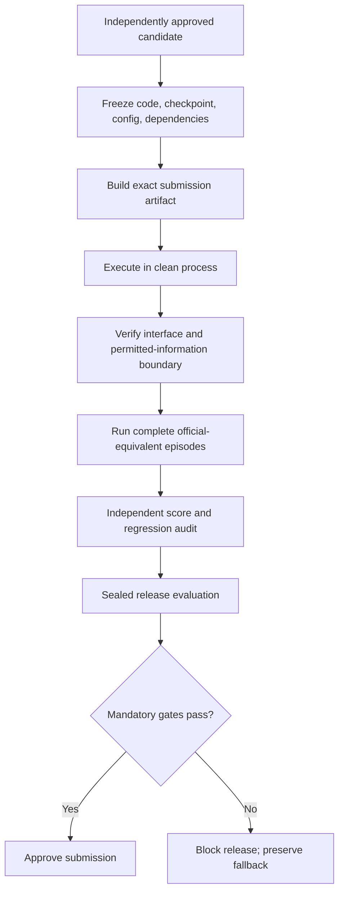
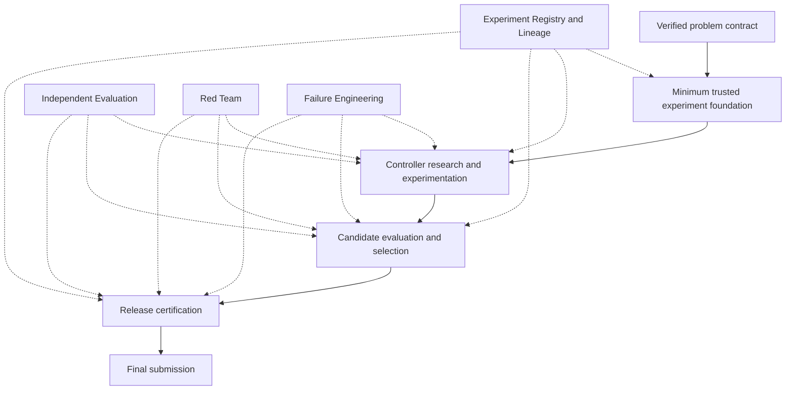

# Smart Buildings Challenge — Updated Project Roadmap

**From Data Understanding to the Final Submission**  
**Working implementation sequence | Aligned with the Smart Buildings Research Platform Blueprint V2**

> **Core decision:** This is a sequential HVAC control-policy project, not a conventional static-CSV prediction competition. We must develop one Python policy that operates inside a physical simulator and generalizes to unseen buildings and weather. The roadmap therefore establishes a trustworthy experimental and evaluation system *before serious controller optimization*.
>
> The phases below represent the order in which major work is authorized. Independent Evaluation, Red Team, Failure Engineering, and Experiment Lineage become ongoing operating capabilities once established; they are **not** one-time final-stage checklists.

---

## 1. The complete journey

The original workflow—investigate data, engineer features, train a model, validate predictions, submit—does not adequately cover this competition. Our new workflow is:



| Phase | Purpose | Current position |
|---|---|---|
| **01 — Problem Understanding** | Establish what makes the competition scientifically difficult. | Research deliverable completed: R1–R5. |
| **02 — Data Understanding** | Understand supplied environments, simulator, interfaces, and limitations. | Investigation deliverable completed: D0–D6; consequential claims still require source-truth reconciliation. |
| **03 — Source-Truth & Problem Synthesis** | Reconcile findings with the official implementation and freeze the actual problem contract. | **Immediate next phase.** |
| **04 — Trusted Experiment Foundation** | Establish reproducible full-episode execution and independent measurement. | Pending. |
| **05 — Red Team & Failure Engineering** | Establish detection, protection, fault isolation, and experiment-integrity gates. | Pending. |
| **06 — Solution Discovery & Strategy** | Evaluate plausible control approaches and define controlled hypotheses. | Pending. |
| **07 — Controller Development & Experimentation** | Develop, train where applicable, test, and progressively improve policies. | Pending. |
| **08 — Independent Generalization & Selection** | Determine which candidates genuinely transfer and qualify for promotion. | Pending. |
| **09 — Release Engineering** | Freeze, package, and independently verify the exact submission. | Pending. |
| **10 — Submission & Post-Submission Review** | Submit the certified artifact and interpret results without leaderboard chasing. | Pending. |

**Implementation philosophy:** Build the research platform incrementally alongside actual controller development. Do not build a huge infrastructure without testing a controller; equally, do not optimize controllers without trustworthy measurement.

---

## 2. Phase 03 — Source-Truth & Problem Synthesis

### Why this comes immediately after Data Understanding

The Data Understanding Guide contains valuable work, but some of its consequential implementation claims conflict with the official starter-kit source inspected subsequently. For example:

- The guide classifies floor-plan arrays as hidden, whereas the official evaluator's participant-facing metadata includes `floor_plan` and `zone_map`.
- The guide describes a fixed occupancy divisor in comfort normalization, whereas the inspected reward implementation uses actual total occupancy when occupancy is positive.
- Additional generator ranges and interface details must be verified against the pinned release rather than assumed from prose.

These discrepancies could invalidate architecture choices, score reconstruction, and assessments of what information the policy may legally use. We must therefore reconcile the documentation with the *exact inspected competition revision* before selecting solution approaches.

### Three workstreams

1. **Verify the specification.** Inspect the official release, policy interface, runtime metadata, action meanings, constraints, reward implementation, scenario manifest, episode execution, and scoring procedure. Use executable checks wherever feasible.
2. **Consolidate the problem.** Bring R1–R5 and verified Data Understanding together into one engineering definition: what the policy receives, what it controls, how the building responds, what changes across environments, how success is evaluated, and what remains unknown.
3. **Define valid success.** Establish scoring, auxiliary diagnostics, access rules, evaluation principles, and critical failures that prohibit candidate promotion.

### Required outputs

```text
competition-spec.yaml
SOURCE_TRUTH_AUDIT.md
VERIFIED_PROBLEM_AND_SYSTEM_CONTRACT.md
SOURCE_TRUTH_TESTS/
```

The audit must record discrepancies, the original assertion, source evidence, resolution, and affected downstream conclusions. An unresolved material claim is a blocker, not an invitation to guess.

**Exit gate — S0: Source Truth.** We can explain exactly what the Python policy must do; demonstrate the participant interface with valid execution; independently verify the rules determining its performance; and show that no unresolved material specification conflict affects planned implementation.

---

## 3. Phase 04 — Minimum Trusted Experiment Foundation

**Goal:** Prove that a simple policy can operate one complete simulated building, produce an immutable and reconstructable experiment, and be scored independently.

This is the **Minimum Trusted Vertical Slice**. It is deliberately not a sophisticated ML model. An existing simple reference policy is sufficient for testing the system.



| Component | Minimum responsibility |
|---|---|
| Policy interface | Initialize with permitted metadata and action specification; return valid hybrid actions. |
| Trusted runner | Execute the exact selected scenario under recorded configuration. |
| Run registry | Give runs permanent IDs and preserve artifacts without overwriting. |
| Trace recorder | Capture observations, requested actions, validated/translated commands, available realized responses, and reward components. |
| Independent evaluator | Reproduce the official score without relying solely on a headline from the training code. |
| Reference policies | Provide valid matched-comparison points. |
| Certified fallback | Preserve a known-working controller and its packaging evidence. |

### What proves this works?

- Execute a complete **8,640-step** scenario and save its provenance.
- Reconstruct the official score independently and reconcile it with the evaluator.
- Reload the policy in a fresh process and reproduce or tolerance-validate its behavior.
- Introduce isolated known defects (for example, invalid action shape or wrong score arithmetic) and show that they are detected rather than accepted as normal results.

**Exit gate — T1: Trusted Core.** One complete, traceable, reproducible policy experiment exists, including a valid artifact, run manifest, independent score, and diagnostic evidence.

---

## 4. Establish independent evaluation before serious model development

Evaluation design must be fixed early because it determines which scientific conclusions we are allowed to draw. Unlike normal row-level cross-validation, the protected unit is a **building–weather environment and its complete sequential episode**, with care to separate underlying building and weather provenance.

### Environment governance

| Suite | Purpose | Access discipline |
|---|---|---|
| **DEV** | Training, experimentation, and debugging. | Visible to developers. |
| **SELECT** | Reusable candidate comparisons. | May influence selection; is not the final audit. |
| **GENERALIZATION** | Protected evaluation on unfamiliar building–weather configurations. | Independently governed. |
| **STRESS** | Difficult, rare, or deliberately unusual diagnostic conditions. | Label separately from the official-distribution estimate. |
| **SEALED RELEASE** | Final evaluation of a frozen candidate. | No iterative tuning against this suite. |

Membership must be assigned and versioned before optimization. Retain building configuration hashes, generator batch/seed provenance, weather-strip provenance, scenario hashes, and overlap checks. Avoid random train/validation splitting of individual five-minute observations. **Joint transfer—unseen building plus unseen weather strip—is the primary internal generalization test.**

The original 30 shipped scenarios remain a defined reference suite. Additional officially permitted generated buildings and scenarios can extend development and internal evaluation. The suite sizes should be established using compute constraints and available independent environment variation rather than an arbitrary percentage split.

### Two kinds of success measurement

| Official-equivalent metric | Independent diagnostics |
|---|---|
| Measures the competition objective exactly. | Explains what happened physically and operationally. |
| Gives equal weight to per-scenario values. | Examines individual buildings, weather conditions, AHU groups, and zones. |
| Enables fair candidate comparison. | Exposes severe comfort events, action failures, saturation, and fragile transfer. |
| Uses full official-length episodes for scoreable comparisons. | Retains uncertainty and limitations of the sample of environments. |

An improved mean score is evidence of competitiveness, not sufficient evidence of reliable generalization.

**Exit gates — E1/E2:** Environment partitions are protected; official score calculation is independently reproduced; matched comparisons work; known incorrect scoring and information-contamination cases are detected.

---

## 5. Phase 05 — Red Team and Failure Engineering

These are **separate, permanent authorities**, not one final test pass.

- **Independent Red Team:** Tries to falsify claims of reliability, generalization, validity, and release readiness. Attacks leakage, environment memorization, observation-index shortcuts, invalid evaluation, closed-loop fragility, and artifact defects.
- **Failure Engineering System:** Detects and reproduces specific failures, locates the earliest verified deviation, isolates the responsible boundary, traces affected results, confirms the root cause, and independently verifies repair and regression coverage.



### Prove that the safeguards work

Inject known defects **only in isolated diagnostic copies**. Examples:

- Swap observation indices or misassign zones to actuators.
- Apply incorrect reward normalization.
- Attempt to use forbidden future or internal scenario information.
- Calculate a score from an incomplete rollout as though it were full-length.
- Remove a required deployment artifact.

The safeguards must demonstrate detection, evidence preservation, fault isolation, affected-lineage quarantine, repair verification, and a permanent regression test. They must also distinguish genuine physical limits from software bugs. An upstream error requires re-evaluation of all materially affected conclusions, not merely a patch to the latest run.

**Exit gates — F1/R1:** The minimum Red Team and Failure Engineering controls detect planted faults and block invalid claims. They then stay active throughout every controller change, experiment, candidate promotion, and release. Full adversarial coverage is progressively expanded; it need not all exist before the first basic controller test.

---

## 6. Phase 06 — Solution Discovery & Strategy

Once the environment and experimentation process are trustworthy, investigate **what approaches can solve the actual control difficulties**. Do not select reinforcement learning, Transformers, GNNs, or a different architecture because the name sounds suitable.

Start from the problem decomposition established in R1–R5:

| Actual control difficulty | Investigation question |
|---|---|
| Different building dynamics | How can decisions remain effective when thermal responses vary? |
| Variable zone and AHU counts | How can a policy interpret and act on changing structures? |
| Partial observations | How can it respond when internal thermal conditions are incompletely visible? |
| Shared equipment | How do zone-level decisions interact through common AHUs and heating supply? |
| Delayed consequences | How should present actions account for later building response? |
| Competing objectives | What operating behavior navigates comfort, expenditure, and carbon tradeoffs? |
| Unseen weather and buildings | What evidence supports transfer beyond supplied development scenarios? |

For each possible solution family, investigate its mechanism, prerequisites, source of evidence, implementation cost, failure modes, and testable prediction. Convert promising possibilities into controlled hypotheses. One example is testing whether a permitted observation-derived estimate of recent thermal response improves unfamiliar-building performance compared with an otherwise matched controller without that estimate.

### Deliverables

1. **Solution Investigation Agenda:** Problem-to-approach mapping and required evidence.
2. **Hypothesis Register:** Distinct, falsifiable research propositions with comparators.
3. **First Experiment Plan:** Controlled changes, prespecified success criteria, evaluation suites, cost limits, and red-team checks.

**Exit gate:** Defensible candidate directions exist with experiments that can distinguish whether their proposed mechanisms actually help. This phase does not have to establish which solution is best in advance.

---

## 7. Phase 07 — Controller Development & Experimentation

This phase is an iterative scientific process—not an untracked loop of training, checking a score, and tuning again.



### Every meaningful experiment must establish

1. What changed, and what remained fixed?
2. Why was the change expected to help?
3. Did the implementation behave as intended?
4. Did the behavior improve the official-equivalent metric under fair, matched conditions?
5. Did it survive unfamiliar environments without creating consequential failures?

Cheap screening can establish feasibility and detect obvious defects, but **short rollouts are not substitutes for complete 8,640-step competitive comparisons**. Compare serious candidates on matched scenarios under the same versioned evaluation protocol. Record all attempted variants, rather than selectively preserving winners.

A scientifically valid negative result is retained as knowledge. A defective run is classified as a **system failure**, not evidence that the hypothesis itself was wrong.

---

## 8. Phase 08 — Independent Generalization & Candidate Selection

A controller must progress through evidence levels, not receive approval because of one attractive aggregate result.

| Level | Required evidence |
|---|---|
| **1. Executable** | Valid interface, actions, and end-to-end execution. |
| **2. Operationally competent** | Meaningful control behavior across complete episodes. |
| **3. Competitive** | Verified matched improvements against appropriate reference policies. |
| **4. Generalizable** | Maintained performance on independently generated unfamiliar building–weather environments. |
| **5. Release-verified** | Exact frozen implementation passes the separate release audit. |

### Candidate evaluation includes

- Official-equivalent loss and decomposition into comfort, cost, and carbon.
- Per-scenario distribution and worst-scenario results.
- Severe comfort violations and their duration and magnitude.
- Development-to-unseen performance gaps.
- Paired comparisons against baselines or the current champion.
- Variation across independently sampled environments and, if relevant, stochastic training seeds.
- Red Team, Failure Engineering, interface, and artifact-integrity results.

A mean score alone can conceal an individual building's severe failure. Repeating one deterministic scenario many times establishes repeatability, **not** independent generalization evidence.

### Preserve a candidate portfolio

- **Champion:** Best independently approved policy under the current protocol.
- **Challengers:** Valid policies seeking improvement.
- **Alternatives:** Policies with useful, complementary strengths.
- **Archive:** Prior candidates and experiments, including valid failures.
- **Fallback:** An independently verified submission-ready policy.

Combining multiple policies is optional, not a mandatory ensembling stage. An added component or more complicated controller must justify its cost, complexity, and new failure modes.

**Exit gate — C1:** A candidate demonstrates an evidence-backed improvement and generalization, survives required audits, and receives independent promotion approval.

---

## 9. Phase 09 — Release Engineering

The release question is different from the research question: **Will the exact software submitted behave like the policy we tested?**



A submission must not depend on notebook state, development-only files, undocumented packages, privileged simulator access, or scenario identifiers unavailable in hidden evaluation. Verify different observation/action dimensions and all required policy entry points. If a release fails, isolate and repair the failure, then repeat affected gates rather than submitting it for its previous development score.

**Exit gate — REL:** Exact artifact independently certified and a working fallback retained.

---

## 10. Phase 10 — Submission & Post-Submission Review

Submit only the certified artifact. Preserve its manifest, revision, hash, dependencies, evaluation protocol, audit evidence, and observed submission outcome.

If public-leaderboard performance differs from internal evaluation:

1. Preserve the observation and the exact submitted release.
2. Verify artifact execution and scoring first.
3. Check evaluation representativeness, possible shift, and selection history.
4. Do not blindly retune against public feedback.
5. Keep conclusions limited to what the evidence proves.

Internal testing should be the strongest defensible estimate of generalization available, **not a promise of hidden-test success**. An invalid experiment cannot be rescued by a good public score, and a valid local evaluation cannot guarantee an unknown hidden population.

---

## 11. Permanent operating authorities: what continues in parallel?

The numbered phases authorize major capabilities, but the protective subsystems must remain active during experiments, model revisions, candidate selection, and release.



| Authority | What it owns |
|---|---|
| **Controller Development** | Ideas, implementation, training when applicable, and repair proposals. |
| **Independent Evaluation** | Protocols, protected environment suites, independent score, fair comparison, and diagnostic reporting. |
| **Red Team** | Challenges to leakage, memorization, shortcut behavior, invalid conclusions, and release reliability. |
| **Failure Engineering** | Detection, reproduction, first-deviation analysis, fault isolation, containment, affected-lineage tracking, repair and regression verification. |
| **Registry & Lineage** | Immutable run identity, provenance, dependencies, audit states, and impact analysis. |
| **Release Authority** | Exact-artifact verification, approval gates, fallback, and archived submission identity. |

Development agents must not independently approve their own consequential repairs or change protected evaluation definitions to improve apparent results. Material protocol changes, candidate promotion, and final submission require reviewed decisions.

---

## 12. Formal implementation gates

Use the gates in the revised V2 blueprint as operational acceptance criteria:

| Gate | What must be demonstrated |
|---|---|
| **S0 — Source Truth** | Correct competition contract and executable verification. |
| **T1 — Trusted Core** | Reproducible, immutable, full-episode experiment. |
| **E1 — Suite Governance** | Protected, provenance-checked environment partitions. |
| **E2 — Independent Measurement** | Correct official scoring and trustworthy diagnostics. |
| **F1 — Failure Engineering** | Known faults are detected, reproduced, isolated, and repaired with regression evidence. |
| **R1 — Red Team** | Leakage, shortcuts, and false performance claims are meaningfully challenged. |
| **X1 — Experiment Engine** | One hypothesis can undergo a fair, complete, traceable experiment. |
| **C1 — Candidate Arena** | Valid candidates can be compared and independently promoted. |
| **L1 — Lineage & Operations** | An upstream defect can be traced to all affected runs, candidates, and releases. |
| **REL — Release** | Exact submission artifact independently certified. |

Implement through vertical slices, not an enormous directory-first build. The minimum useful loop is **SPECIFY → EXPERIMENT → VERIFY → COMPARE → DECIDE → PRESERVE → REPEAT**.

---

## 13. Current project position and next work package

**Completed as research deliverables**

- Problem Research — R1–R5.
- Data Understanding — D0–D6.

**Current caveat:** Completion of these documents does not certify every implementation-specific assertion. The differences already identified between the Data Understanding Guide and official source are an input to the Source-Truth Audit.

**Immediate next phase: Phase 03 — Source-Truth & Problem Synthesis.** It must produce:

```text
competition-spec.yaml
SOURCE_TRUTH_AUDIT.md
VERIFIED_PROBLEM_AND_SYSTEM_CONTRACT.md
SOURCE_TRUTH_TESTS/
```

Only after this source-truth gate passes do we proceed to the minimum trusted policy–simulator–evaluation loop.

> **Project operating rule:** Do not start by choosing an ML architecture. First make it possible to tell the difference between a successful control idea and a broken experiment. Then develop sophisticated policies without losing confidence in what the results actually mean.

---

## Reference documents

- *Smart Buildings Research Platform Blueprint V2* — implementation architecture, authorities, and acceptance gates.
- *Smart Buildings Problem Research R1–R5* — scientific understanding of physical behavior, objectives, heterogeneity, control, and transferability.
- *Data Understanding Guide D0–D6* — investigated environment, data, simulator, and evidence, subject to Source-Truth reconciliation.
- Official starter kit: <https://github.com/smart-buildings-2026/starter-kit>
- Official competition page: <https://www.kaggle.com/competitions/neurips-2026-smart-buildings/>
